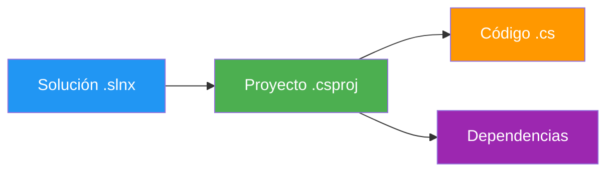

::top::

<div class="flex items-center gap-4 w-full">
  
  <span class="ud-pill">Entornos de Desarrollo · 1DAW · Curso 2026-2027</span>
</div>

::default::

# Entornos de desarrollo

### Instalación y configuración de tu entorno de desarrollo a medida

::bottom::

<div class="ud-author">
  
  <div>
    <b class="ud-author-name">José Luis González Sánchez</b>
    <span class="ud-author-meta">IES Luis Vives · Leganés · <a href="https://joseluisgs.dev">joseluisgs.dev</a></span>
  </div>
</div>

<PacMan :size="54" label="Cargando ideas..." />

---

## 📦 Materiales de la unidad

Todo el material de la UD02 está publicado en el repositorio de GitHub, organizado por carpetas:

<div class="grid grid-cols-2 gap-6 items-start">
<div>

- 📚 **7 puntos** — teoría, ejemplos reales y resúmenes
- 📝 **Prácticas** — 5 prácticas en `practicas/`
- 📎 **Chuletas de atajos** — keymaps en `keymaps/`
- 🖼️ **Imágenes y recursos** — capturas de los IDEs en `images/`
- 🎬 **Vídeos** — lista de reproducción en YouTube

</div>
<div class="flex flex-col items-center justify-center gap-4 pt-4">

<RepoBadge repo="EntornosDesarrollo-02-2026-2027" caption="Repositorio con materiales de la unidad" />

<div class="text-sm opacity-75 text-center max-w-55">

Clónalo, forquéalo o descárgalo en zip: el material siempre está a un clic.

</div>

</div>
</div>

---

## 🎯 Resultados de aprendizaje: RA2

<RaaCcee
  code="RA2"
  title="Evalúa entornos integrados de desarrollo analizando sus características para editar código fuente y generar ejecutables."
  :letters="['a','b','c','d','e','f','g']"
  :ccee="[
  'Se han instalado entornos de desarrollo, propietarios y libres.',
  'Se han añadido y eliminado módulos en el entorno de desarrollo.',
  'Se ha personalizado y automatizado el entorno de desarrollo.',
  'Se ha configurado el sistema de actualización del entorno de desarrollo.',
  'Se han generado ejecutables a partir de código fuente de diferentes lenguajes en un mismo entorno de desarrollo.',
  'Se han generado ejecutables a partir de un mismo código fuente con varios entornos de desarrollo.',
  'Se han identificado las características comunes y específicas de diversos entornos de desarrollo.'
]" />

---

## 📚 Índice: los 7 puntos del tema

<div class="grid grid-cols-3 gap-3 text-sm">

<TopicCard :num="1" title="Introducción a los IDE" desc="Qué es, qué hace y qué lleva dentro" />
<TopicCard :num="2" title="Instalación de herramientas" desc="Kits, IDEs, Git y terminal" />
<TopicCard :num="3" title="Anatomía de los IDEs" desc="Rider, IntelliJ y VS Code por dentro" />
<TopicCard :num="4" title="Configuración y personalización" desc="Plugins, ajustes y sync" />
<TopicCard :num="5" title="Operativa básica del IDE" desc="Editar, compilar, depurar y versionar" />
<TopicCard :num="6" title="Atajos de teclado" desc="Menos ratón, más ritmo" />
<TopicCard :num="7" title="Resumen y conclusiones" desc="Cierre del tema" />

</div>

<div class="ud-card mt-4 flex items-center justify-between gap-4 px-4 py-2">

<span class="text-sm">📦 <b>Materiales:</b> los 7 puntos, prácticas, chuletas y vídeos de la unidad</span>

<RepoBadge repo="EntornosDesarrollo-02-2026-2027" />

</div>

---
layout: section
---

<div class="ud-section-number">01</div>

# Introducción a los IDE

<div class="opacity-70">Qué es, qué hace y qué lleva dentro</div>

---

## 1 · Punto de partida

<div class="grid grid-cols-2 gap-5 items-start">
<div>

<TipBox type="consejo" title="Punto de partida">

¿Puedes programar con un editor de texto? Sí. ¿Y si además tienes compilación, depuración y Git en la misma ventana?

</TipBox>

<TipBox type="analogia">

Un IDE es como un **taller mecánico especializado**: en lugar de herramientas sueltas dispersas por el garaje, tienes todo organizado e integrado para trabajar más rápido y con menos errores.

</TipBox>

</div>
<div>

<Objetivos :items="[
  'Definir qué es un entorno de desarrollo integrado',
  'Distinguir IDE, editor y herramientas externas',
  'Identificar editor, compilación y depuración',
  'Relacionar proyectos, Git, terminal y plugins',
]" />

</div>
</div>

---

## 🧰 ¿Qué es un IDE?

Un **IDE** integra herramientas para desarrollar; un editor extensible incorpora funciones mediante extensiones.

<div class="grid grid-cols-2 gap-5 items-start">
<div>

<ConceptCard icon="🖥️" title="IDE" accent="blue">

Integra editor, construcción, depuración y gestión del proyecto. **Rider**, por ejemplo, está orientado al desarrollo con .NET.

</ConceptCard>

En Rider compilas la solución sin salir del entorno.

</div>
<div>

<ConceptCard icon="🧩" title="Editor extensible" accent="green">

VS Code añade soporte de lenguajes y depuración mediante extensiones. Necesita el **SDK** correspondiente para construir un proyecto.

</ConceptCard>

En VS Code eliges las extensiones del proyecto.

</div>
</div>

<TipBox type="nota">

El IDE **no sustituye al SDK**: configura y utiliza las herramientas necesarias para el lenguaje.

</TipBox>

---

## 🔗 Herramientas integradas frente a herramientas sueltas

<div class="grid grid-cols-2 gap-5 items-start">
<div>

**Sin integrar las herramientas:**

1. Editas el archivo en un editor.
2. Abres una terminal y compilas.
3. Buscas el error y vuelves al editor.

</div>
<div>

**Con un IDE:**

1. Editas y ves los avisos en el código.
2. Compilas desde el propio proyecto.
3. Saltas del error a la línea afectada.

</div>
</div>

<TipBox type="nota">

El IDE organiza el flujo de trabajo, pero los mismos compiladores y SDK pueden utilizarse también desde una terminal.

</TipBox>

---

## 🧭 Un entorno para cada necesidad

| Tipo | Características | Ejemplos |
|---|---|---|
| **IDE monolenguaje** | Optimizado para un solo lenguaje | PyCharm (Python), PhpStorm (PHP) |
| **IDE políglota** | Soporta múltiples lenguajes | IntelliJ IDEA (Java, Kotlin, SQL), VS Code |
| **IDE especializado** | Para plataformas específicas | Android Studio, Xcode |
| **Centrado en una tecnología** | Herramientas adaptadas a su ecosistema | Rider para .NET |

<TipBox type="consejo">

La frontera no es rígida: un IDE puede especializarse en una tecnología y admitir otros lenguajes mediante plugins.

</TipBox>

---

## 🧭 ¿Dónde interviene el IDE?

El IDE está contigo en todas las fases del proyecto, pero se usa **fundamentalmente en la fase de codificación**.


<div class="grid grid-cols-2 gap-5 items-start">
<div>

<TipBox type="nota">

El IDE destaca en **codificación**, pero también ayuda con pruebas, control de versiones y mantenimiento.

</TipBox>

</div>
<div>

<ConceptCard icon="⚡" title="Fase estrella: codificación" accent="green">

Usar un IDE permite desarrollar el proyecto de forma **mucho más ágil**, independientemente del modelo de desarrollo que se utilice.

</ConceptCard>

</div>
</div>

---

## 🧩 Los componentes del IDE

<div class="grid grid-cols-2 gap-5 items-start">
<div>

| Herramienta | Para qué sirve |
|---|---|
| **Editor** | Escribir y comprender código |
| **Build** | Construir el proyecto |
| **Depurador** | Detener e inspeccionar |
| **Proyecto** | Organizar archivos y dependencias |

</div>
<div>

| Herramienta | Para qué sirve |
|---|---|
| **Terminal** | Ejecutar comandos |
| **Git** | Registrar cambios y colaborar |
| **Refactorización** | Mejorar la estructura |
| **Plugins** | Ampliar funciones |

</div>
</div>

---

## ✍️ El editor te acompaña

<div class="grid grid-cols-2 gap-5 items-start">
<div>

```csharp
int cantidad = 3;
decimal precio = 4.50m;
Console.WriteLine(cantidad * precio);
```

El editor distingue los tipos y los valores mediante colores. Al escribir `Console.`, puede sugerir `WriteLine` y mostrar información sobre sus parámetros.

</div>
<div>

<ConceptCard icon="💡" title="Ayuda mientras escribes" accent="green">

- **Resaltado** de sintaxis
- **Autocompletado** y documentación
- **Análisis** y avisos
- Correcciones y navegación

</ConceptCard>

</div>
</div>

---

## 🏗️ Construir y ejecutar no es lo mismo

Primero preparamos los archivos de salida; al ejecutarlo, vemos qué hace con los datos.

<div class="grid grid-cols-2 gap-5 items-start">
<div>

<ConceptCard icon="🔨" title="Build" accent="blue">

El SDK compila el código y prepara los archivos de salida del proyecto. Si encuentra errores de compilación, los muestra para que puedas corregirlos.

</ConceptCard>

`dotnet build` detecta si falta una variable.

</div>
<div>

<ConceptCard icon="▶️" title="Run" accent="green">

Ejecuta la aplicación con la configuración seleccionada; puede compilar antes. Así puedes observar su comportamiento y comprobar el resultado.

</ConceptCard>

Con `dotnet run` vemos la salida y el resultado.

</div>
</div>

<TipBox type="advertencia">

Un proyecto puede **compilar** y aun así tener errores de lógica al ejecutarse.

</TipBox>

---

## ⚙️ Compilador frente a intérprete

Los IDEs integran las herramientas que traducen tu código fuente a código máquina.

<div class="grid grid-cols-2 gap-5 items-start">
<div>

<ConceptCard icon="🧱" title="Compilador" accent="blue">

Traduce **todo el código fuente** a código máquina (binario) antes de ejecutarlo.

**Analogía:** un traductor profesional que traduce un libro completo de inglés a español antes de publicarlo: la traducción lleva tiempo, pero una vez publicada, la lectura es rápida.

</ConceptCard>

</div>
<div>

<ConceptCard icon="⚡" title="Intérprete" accent="green">

Traduce el código fuente **línea a línea** a medida que se va ejecutando, siendo generalmente más lento.

**Analogía:** un traductor simultáneo que traduce mientras hablas: más lento pero inmediato, sin esperar a terminar todo el discurso.

</ConceptCard>

</div>
</div>

<TipBox type="nota">

Los IDEs permiten **compilar o interpretar** el código en un formato ejecutable o en *bytecode*.

</TipBox>

---

## 🔍 ¿Qué ve el editor mientras escribes?

<div class="grid grid-cols-2 gap-5 items-start">
<div>

```csharp
string nombre = "Ana";
Console.WriteLine(nombre);
```

El resaltado ayuda a distinguir tipos, cadenas y llamadas. El autocompletado sugiere miembros disponibles al escribir.

El **analizador léxico** revisa palabras mal escritas y el **analizador sintáctico** informa si la estructura está bien realizada.

</div>
<div>

Si escribes mal un nombre, el IDE puede marcarlo antes de compilar. Al situar el cursor sobre un aviso, muestra información y, a veces, una **corrección rápida**.

<TipBox type="advertencia">

Un aviso no siempre es un error de compilación. Lee el mensaje antes de aplicar una sugerencia.

</TipBox>

</div>
</div>

<TipBox type="truco">

**«El IDE me marca error pero el código está bien»:** a veces el IDE no ha actualizado su índice o hay problemas de caché. **Reiniciar el IDE** suele solucionar estos falsos positivos.

</TipBox>

---

## 🐞 El depurador: para y observa

1. Coloca un **breakpoint** en el margen del editor.
2. Inicia la aplicación en modo **Debug**.
3. Inspecciona las variables al detenerse.
4. Avanza paso a paso o continúa la ejecución.

<TipBox type="truco">

El depurador te ayuda a comprobar **qué ocurre de verdad**, no solo lo que esperabas que ocurriera.

</TipBox>

---

## 🔀 Proyecto, terminal y Git

<div class="grid grid-cols-2 gap-5 items-start">
<div>

- El **explorador** organiza solución, proyectos y archivos.
- La **terminal integrada** comparte el contexto del proyecto: si estás en `/projects/miapp`, **ya abre ahí**, sin necesidad de navegar con `cd`.
- El SDK y Git deben estar instalados y disponibles.

```bash
git add .     # Preparar cambios
git commit    # Confirmar cambios
git push      # Subir a remoto
git pull      # Descargar cambios
git branch    # Trabajar con ramas
git merge     # Fusionar ramas
```

</div>
<div>

<ConceptCard icon="📚" title="Historial del proyecto" accent="purple">

Git registra cambios mediante **commits**. La interfaz del IDE facilita las operaciones, pero no reemplaza los conceptos de Git.

</ConceptCard>

<TipBox type="nota">

**VS Code incluye soporte nativo para Git** de fábrica; en Rider e IntelliJ, Git aparece integrado en la barra de herramientas.

</TipBox>

</div>
</div>

---

## 🧹 Refactorizar el código

Mejorar la estructura del código **sin alterar su funcionalidad externa** es la refactorización: no cambia lo que hace el programa, solo cómo se lee.

```csharp
// Antes: código duplicado
double precio1 = cantidad1 * precioUnitario1;
double precio2 = cantidad2 * precioUnitario2;
double precio3 = cantidad3 * precioUnitario3;

// Después: extraer método
double precio1 = CalcularPrecio(cantidad1, precioUnitario1);
double precio2 = CalcularPrecio(cantidad2, precioUnitario2);
double precio3 = CalcularPrecio(cantidad3, precioUnitario3);
```

<TipBox type="nota">

Extraer `CalcularPrecio` elimina la duplicación y mejora la comprensión. El IDE localiza los usos afectados: revísalos y ejecuta el programa o las pruebas para comprobar que mantiene el mismo comportamiento.

</TipBox>

---

## 🧩 Añadir capacidades al IDE

Los **plugins** o complementos agregan una función nueva y específica a la aplicación principal: soporte de lenguajes, análisis de código, integración con servicios o temas visuales.

| IDE | Marketplace | Plugins instalados |
|---|---|---|
| **IntelliJ IDEA** | JetBrains Marketplace | Lombok, Key Promoter X |
| **VS Code** | VS Code Marketplace | Python, Prettier, GitLens |
| **Rider** | JetBrains Marketplace | Unity, Unreal support |

<TipBox type="consejo">

Una extensión de C# en VS Code aporta análisis y navegación del lenguaje: instálala desde el Marketplace, revisa quién la publica y comprueba que es compatible con tu versión. **No instales demasiados plugins**: cada uno consume recursos y puede ralentizar el IDE.

</TipBox>

---

## 🏅 Herramientas del curso

| Herramienta | En qué destaca | Papel en el curso |
|---|---|---|
| **JetBrains Rider** | C# y .NET | IDE principal |
| **IntelliJ IDEA** | Java y Kotlin | IDE para proyectos Java |
| **VS Code** | Editor extensible y multiplataforma | Alternativa ligera |

<RealExample app="Microsoft, Stack Overflow y GitHub">

Microsoft utiliza **Rider** como IDE principal para el desarrollo de herramientas internas de Azure y .NET, y **Stack Overflow** también usa tecnologías .NET con Rider para su backend. **GitHub** desarrolló Codespaces sobre VS Code: entornos de desarrollo en la nube.

</RealExample>

<TipBox type="nota">

Según la encuesta de **Stack Overflow 2025**, VS Code es el editor más usado (**73 %**), seguido de IntelliJ IDEA (**26 %**). Conocer varios IDEs te hace más polivalente en el mercado laboral.

</TipBox>

---

## Resumen del punto 1

<div class="grid grid-cols-2 gap-5 items-start">
<div>

<ConceptCard icon="✅" title="Buenas prácticas">

- Aprende los **atajos esenciales** desde el principio: te ahorran minutos cada hora de código
- Usa **control de versiones desde el primer día**, aunque sea un proyecto pequeño
- **No instales todos los plugins** que veas: elige los esenciales y comprueba que no ralentizan
- Aprovecha el **depurador** en vez de llenar el código de `Console.WriteLine`

</ConceptCard>

</div>
<div>

<ConceptCard icon="⏭️" title="¿Qué viene después?">

En el **Punto 02: Instalación de herramientas** instalarás todo lo que aquí solo describiste: kits de desarrollo (.NET SDK y JDK), los tres IDEs del curso, Git y utilidades como Oh My Posh.

</ConceptCard>

</div>
</div>

---
layout: section
---

<div class="ud-section-number">02</div>

# Instalación de herramientas

<div class="opacity-70">Kits, IDEs, Git y terminal, paso a paso</div>

---

## 2 · Punto de partida

<div class="grid grid-cols-2 gap-5 items-start">
<div>

<TipBox type="consejo" title="Punto de partida">

Tienes instalado Rider, pero no puedes compilar C#. ¿Has instalado y seleccionado el **.NET SDK**?

</TipBox>

<TipBox type="analogia">

El **JDK o .NET SDK es el motor del coche**: el IDE es el tablero de control y el volante. **Sin motor, el tablero no sirve de nada.**

</TipBox>

</div>
<div>

<Objetivos :items="[
  'Instalar y verificar los SDK de .NET y Java',
  'Preparar Rider, IntelliJ IDEA y VS Code',
  'Instalar Git y conocer herramientas opcionales',
  'Crear una solución y gestionar paquetes .NET',
]" />

</div>
</div>

---

## 📦 SDK y runtime: cada uno tiene su papel

Para crear un programa necesitas herramientas de desarrollo; para ponerlo en marcha necesitas un entorno de ejecución compatible.

<div class="grid grid-cols-2 gap-5 items-start">
<div>

<ConceptCard icon="🛠️" title="SDK" accent="blue">

Kit para **desarrollar**: herramientas de compilación, bibliotecas y entorno de ejecución. El .NET SDK, por ejemplo, incluye la CLI `dotnet`.

</ConceptCard>

En clase instalaremos el **SDK de .NET** para crear, compilar y ejecutar nuestros proyectos.

</div>
<div>

<ConceptCard icon="▶️" title="Runtime" accent="green">

Entorno necesario para **ejecutar** aplicaciones compatibles. Por sí solo no incluye todas las herramientas para crear y compilar proyectos.

</ConceptCard>

Quien solo vaya a ejecutar una aplicación puede necesitar el runtime, según cómo se haya publicado.

</div>
</div>

---

## 🗺️ Orden recomendado de instalación

1. **SDK:** instala .NET y, cuando trabajes con Java, el JDK.
2. **IDE:** instala Rider y las alternativas que vayas a utilizar.
3. **Git:** prepara el control de versiones para tus proyectos.
4. **Verificación:** comprueba versiones y crea un proyecto de prueba.

<TipBox type="nota">

El IDE puede instalarse antes que un SDK, pero debe **localizarlo y seleccionarlo** para construir los proyectos que lo necesitan.

</TipBox>

---

## 🔷 Instalar y comprobar .NET

1. Descarga el **SDK de .NET 10** desde la web oficial de .NET.
2. Ejecuta el instalador para tu sistema operativo.
3. Abre una terminal nueva y verifica la instalación.
4. Selecciona el SDK en Rider si el IDE no lo detecta.

```bash
dotnet --version
dotnet --list-sdks
```

- **.NET 10:** LTS, soportado **hasta noviembre de 2028** — es el del curso.
- **.NET 11:** Preview (2026): para probar novedades, no para producción.

<TipBox type="nota">

El SDK incluye el runtime; comprueba la versión requerida por el proyecto. Usa siempre versiones LTS y evita las Preview en producción.

</TipBox>

---

## ☕ Instalar y comprobar el JDK

1. Instala el **JDK 25** desde un distribuidor de confianza.
2. Configura el JDK en IntelliJ o en la herramienta que uses.
3. Comprueba tanto el compilador como la ejecución.

```bash
javac --version
java --version
```

<TipBox type="advertencia">

Si un comando no se encuentra, revisa `PATH`, abre una terminal nueva y comprueba la configuración del proyecto.

</TipBox>

---

## 🧩 Qué incluye el JDK

El **JDK** (Java Development Kit) es el kit necesario para **desarrollar** programas: incluye la **Máquina Virtual de Java (JVM)** y la biblioteca estándar necesaria para la ejecución, además de herramientas clave como `javac`, `jar` y `javadoc`.

```bash
javac HolaMundo.java        # Compilar
java HolaMundo              # Ejecutar
jar cf miapp.jar *.class    # Empaquetar
javadoc *.java              # Generar documentación
```

<TipBox type="advertencia">

**JDK ≠ JRE:** el JRE solo permite ejecutar Java, mientras que el JDK permite compilar. En el curso usamos **JDK 25** (la LTS más reciente) y necesitas `JAVA_HOME` y `PATH` configurados.

</TipBox>

---

## ⬇️ Cuatro formas de instalar el JDK

| Método | Ventajas | Desventajas |
|---|---|---|
| **Instalador oficial de Oracle** | Oficial, garantizado | Requiere cuenta Oracle |
| **OpenJDK (Adoptium)** | Libre y *open source* | Actualizaciones manuales |
| **SDKMAN!** (Linux/Mac) | Gestiona versiones múltiples | Solo terminal |
| **Chocolatey / winget** (Windows) | Fácil actualización | Gestor adicional |

<TipBox type="consejo">

Para ejecutar IntelliJ IDEA no hace falta instalar Java por separado: **JetBrains Runtime va incluido** con el IDE. Pero para **desarrollar** en Java necesitas un JDK *standalone*.

</TipBox>

---

## 🧪 ¿Qué comprobaremos en cada instalación?

<div class="grid grid-cols-2 gap-5 items-start">
<div>

**.NET**

```bash
dotnet --list-sdks
dotnet --version
```

La lista muestra los SDK disponibles; la versión activa puede depender del proyecto y de `global.json`.

</div>
<div>

**Java**

```bash
javac --version
java --version
```

`javac` compila y `java` ejecuta. Comprueba además el JDK seleccionado en el proyecto del IDE.

</div>
</div>

---

## 🛠️ Instalar los IDE del curso

| Herramienta | Instalación | Primera comprobación |
|---|---|---|
| **Rider** | JetBrains Toolbox o instalador | Detectar .NET SDK |
| **IntelliJ IDEA** | Toolbox o instalador | Seleccionar JDK |
| **VS Code** | Instalador oficial | Añadir extensiones necesarias |

<TipBox type="consejo">

Toolbox permite gestionar productos y versiones de JetBrains. Consulta las condiciones de licencia aplicables.

</TipBox>

<TipBox type="nota">

**IntelliJ IDEA** viene en dos ediciones: **Community** (libre y gratuita) y **Ultimate** (comercial, con *trial* de 30 días). Para el curso basta con **Community**; para probar Ultimate hay licencia gratuita para estudiantes con el *GitHub Student Pack*.

</TipBox>

---

## 🛠️ Rider: preparar el primer proyecto

1. Instala **Rider** desde JetBrains Toolbox o su instalador.
2. Abre el IDE e identifica la opción de crear o abrir una solución.
3. Comprueba que Rider encuentra el **.NET SDK**.
4. Crea una aplicación de consola y ejecuta la configuración del proyecto.

<TipBox type="consejo">

Si el SDK no aparece, revisa los ajustes de herramientas de .NET y vuelve a comprobar la instalación.

</TipBox>

---

## 🧾 Rider: licencia y métodos de instalación

Rider es *cross-platform* (Windows, macOS y Linux) y está disponible en una única edición **comercial**, con *trial* de 30 días para probarlo; los estudiantes disponen de licencia gratuita con el *GitHub Student Pack*.

| Método | Detalle |
|---|---|
| **Toolbox App** (recomendado) | Gestiona productos, versiones y actualizaciones |
| **Standalone** (manual) | Accesos directos, *launchers* en el `PATH`, asociaciones de ficheros |
| **Silenciosa** (Windows) | Sin interfaz, con *switches* como `/S` |
| **Snap** (Linux) | `sudo snap install rider --classic` |

<TipBox type="nota">

Tras instalar con Toolbox, un diálogo permite instalar el **JetBrains ETW Service** (profiling) y añadir Rider a las exclusiones de Windows Defender para mejorar el arranque.

</TipBox>

---

## 🧩 VS Code: preparar el soporte de lenguajes

VS Code es un editor extensible: las capacidades para un lenguaje dependen de las extensiones instaladas.

| Necesidad | Extensión esencial |
|---|---|
| **Java** | Extension Pack for Java (depuración, Maven/Gradle) |
| **C# y .NET** | **C#** (Microsoft): soporte C#, .NET y depuración |
| **Análisis C#** | **ReSharper** (JetBrains): análisis y refactorizaciones |
| **Control de versiones** | Git accesible desde el sistema |

<TipBox type="nota">

Lee la descripción del Marketplace y comprueba el editor, la extensión y el SDK antes de crear el proyecto.

</TipBox>

---

## 🧩 ReSharper en VS Code

**JetBrains ReSharper** es la versión ligera para VS Code: aporta al editor de Microsoft el análisis de código de los IDEs JetBrains.

- **Análisis en tiempo real:** detecta errores y *code smells* mientras escribes.
- **Refactorizaciones:** renombrar, extraer métodos, cambiar firmas y decenas más.
- **Quick Fixes:** correcciones automáticas con un clic (el icono del bombillo).
- **Navigation:** ir a declaraciones, implementaciones y usos de un símbolo.
- **Code cleanup:** formateo y limpieza según las reglas de estilo.

**Instalación:** `Ctrl+Shift+X` → busca «ReSharper» → **JetBrains ReSharper** → **Install**.

<TipBox type="nota">

**ReSharper vs C# Dev Kit:** Dev Kit da la estructura de proyecto; ReSharper, el análisis — van juntas.

</TipBox>

---

## ⌨️ Comandos habituales de ReSharper

| Comando | Atajo | Descripción |
|---|---|---|
| **Quick Fix** | `Alt+Enter` | Correcciones y sugerencias |
| **Refactor** | `Ctrl+Shift+R` | Menú de refactorizaciones |
| **Go to Implementation** | `Ctrl+F12` | Ir a la implementación de una interfaz |
| **Find Usages** | `Shift+F12` | Buscar todos los usos de un símbolo |
| **Code Cleanup** | `Ctrl+Shift+F9` | Limpiar y formatear código |

<TipBox type="consejo">

Si usas **Rider** para C#, no necesitas ReSharper en VS Code: Rider ya lo incluye todo. ReSharper es ideal cuando prefieres VS Code como editor principal pero quieres el análisis de código de JetBrains.

</TipBox>

---

## 🔀 Instalar Git

Instala Git desde su distribución oficial o el gestor de paquetes de tu sistema y verifica que el IDE lo detecta:

```bash
git --version
git status
```

<div class="grid grid-cols-2 gap-5 items-start">
<div>

**Git** conserva el historial y permite colaborar. **VS Code incluye soporte Git de fábrica**: su vista de Control de Código Fuente avisa si Git no está detectado y ofrece instalarlo.

</div>
<div>

**GitKraken** es un cliente visual opcional para trabajar con repositorios Git. Versión **gratuita** para repositorios públicos y privados limitados; **Pro** para privados ilimitados (gratuito para estudiantes con GitHub Student Pack).

</div>
</div>

---

## 🎨 Fuentes y terminal

Estas opciones mejoran la comodidad al trabajar, pero no son necesarias para compilar ni ejecutar un proyecto.

<div class="grid grid-cols-2 gap-5 items-start">
<div>

<ConceptCard icon="🔤" title="Fuentes de código" accent="blue">

**JetBrains Mono**, **Fira Code** y **Source Code Pro** (Adobe, libre) son fuentes monoespaciadas que facilitan alinear el código. Las **ligaduras** combinan caracteres: `!=` aparece como `≠` y `=>` como `⇒`.

</ConceptCard>

Configura la fuente en `Settings → Font` y un tamaño de 14-16 con interlínea 1.2 para distinguir bien caracteres como `0` y `O`.

</div>
<div>

<ConceptCard icon="✨" title="Oh My Posh" accent="purple">

Personaliza el prompt de la terminal y puede mostrar información como la rama de Git. Es opcional; usa una Nerd Font si el tema necesita iconos.

</ConceptCard>

Un prompt con la rama activa ayuda a comprobar dónde trabajas antes de hacer un commit.

</div>
</div>

---

## ⬇️ Instalar Oh My Posh

**Oh My Posh** personaliza la terminal de comandos con un entorno visual y funcional. Se instala desde un gestor de paquetes o con el instalador oficial:

```bash
winget install JanDeDobbeleer.OhMyPosh   # Windows
brew install oh-my-posh                   # macOS
curl -s https://ohmyposh.dev/install.sh | bash -s   # Linux
```

<TipBox type="truco">

Un prompt de Oh My Posh puede verse así: `✦ ~/projects/miApp main →`. Es **opcional pero muy recomendable**: muestra la rama de Git y el tiempo de ejecución de cada comando.

</TipBox>

---

## 🔤 Oh My Posh necesita una Nerd Font

Las **Nerd Fonts** son fuentes con miles de iconos extra (Git, Docker, flechas, carpetas…) que Oh My Posh usa para decorar la terminal. Descárgalas en **nerdfonts.com**.

- **FiraCode Nerd Font** — con ligaduras de código
- **JetBrainsMono Nerd Font** — la que usamos en el IDE
- **Cascadia Code Nerd Font** — la terminal de Windows
- **Hack Nerd Font** — ligera y legible

En **Windows Terminal**: `Configuración → Perfil → Apariencia → Fuente`. En **VS Code**, añade a `settings.json` la línea `"terminal.integrated.fontFamily": "FiraCode Nerd Font"`.

<TipBox type="advertencia">

**Sin la Nerd Font**, Oh My Posh mostrará caracteres raros o cuadros en lugar de iconos. Instala primero la fuente y luego configúrala en la terminal.

</TipBox>

---

## 📁 Solución, proyecto y código



<TipBox type="nota">

Una **solución** agrupa proyectos; cada `.csproj` define cómo se construye un proyecto.

</TipBox>

---

## 📄 ¿Qué guarda el archivo de proyecto?

Un `.csproj` describe la configuración necesaria para compilar. Por ejemplo:

```xml
<Project Sdk="Microsoft.NET.Sdk">
  <PropertyGroup>
    <OutputType>Exe</OutputType>
    <TargetFramework>net10.0</TargetFramework>
    <ImplicitUsings>enable</ImplicitUsings>
    <Nullable>enable</Nullable>
    <TreatWarningsAsErrors>true</TreatWarningsAsErrors>
    <LangVersion>14</LangVersion>
  </PropertyGroup>
</Project>
```

`OutputType` indica el tipo de salida y `TargetFramework` el framework de destino. Las dependencias también se declaran en el proyecto.

---

## 🧾 Las propiedades del `.csproj`

| Propiedad | Descripción | Valor |
|-----------|-------------|-------|
| `OutputType` | Tipo de salida | `Exe` (ejecutable) o `Library` (biblioteca) |
| `TargetFramework` | Framework objetivo | `net10.0` |
| `ImplicitUsings` | Usings implícitos | `enable` |
| `Nullable` | Gestión estricta de nulos | `enable` |
| `LangVersion` | Versión de C# | `14` para .NET 10 |

<TipBox type="nota">

`TreatWarningsAsErrors` hace que los avisos se traten como errores, igual que en los proyectos del curso. Si en un futuro aparece **C# 15** (.NET 11), lo veremos próximamente: aquí seguimos con `LangVersion` 14.

</TipBox>

---

## 🏗️ Crear una solución con la CLI

Desde una carpeta de trabajo, crea la solución y el proyecto; después añádelo:

```bash
mkdir MiSolucion
cd MiSolucion
dotnet new sln
dotnet new console -n MiProyecto
dotnet sln add MiProyecto/MiProyecto.csproj
```

<TipBox type="truco">

Puedes abrir la solución resultante en Rider o trabajar con la terminal integrada de VS Code.

</TipBox>

<TipBox type="nota">

En .NET 10, `dotnet new console` genera código con **Top Level Statements**: no necesitas `class Program` ni `static void Main()`.

</TipBox>

---

## ▶️ Compilar y ejecutar

Desde la carpeta de la solución, compila y ejecuta el proyecto:

```bash
dotnet build
dotnet run --project MiProyecto
```

<div class="grid grid-cols-2 gap-5 items-start">
<div>

**Build** genera los artefactos de compilación.

</div>
<div>

**Run** ejecuta el proyecto indicado; puede compilarlo primero.

</div>
</div>

<TipBox type="truco">

**Chuleta del día a día:** `dotnet build`, `dotnet run`, `dotnet clean`, `dotnet restore` y `dotnet publish -c Release -o ./publish`. Las salidas quedan en `bin/Debug/net10.0/`: la `.dll` es el ensamblado y el `.exe` es el ejecutable en Windows.

</TipBox>

---

## 📚 NuGet: dependencias para .NET

NuGet permite agregar bibliotecas al proyecto y restaurarlas cuando se necesitan: es el gestor de paquetes de .NET, con más de 350.000 bibliotecas.

```bash
dotnet add package Newtonsoft.Json
dotnet add package Newtonsoft.Json --version 13.0.3
dotnet list package
dotnet remove package Newtonsoft.Json
```

<TipBox type="nota">

Ejecuta los comandos de paquetes en la carpeta del proyecto o indica el proyecto explícitamente. Usa `--version` para fijar la versión exacta que necesitas.

</TipBox>

---

## 📦 Paquetes habituales y fuentes

| Paquete | Uso |
|---------|-----|
| **Newtonsoft.Json** | Serialización JSON |
| **Microsoft.EntityFrameworkCore** | ORM para bases de datos |
| **Serilog** | Logging estructurado |
| **NUnit** | Framework de tests |

```xml
<configuration>
  <packageSources>
    <add key="nuget.org" value="https://api.nuget.org/v3/index.json" protocolVersion="3" />
  </packageSources>
</configuration>
```

<TipBox type="advertencia">

Ese bloque es el contenido de `~/.nuget/NuGet/NuGet.Config`. **Comprueba la fuente y la versión** de un paquete antes de incorporarlo al proyecto.

</TipBox>

---

## 📦 ¿Por qué restaurar paquetes?

<div class="grid grid-cols-2 gap-5 items-start">
<div>

El proyecto guarda **qué paquetes necesita**, no una copia de todas las bibliotecas dentro del código fuente.

```bash
dotnet restore
dotnet build
```

</div>
<div>

Al clonar un proyecto, la restauración obtiene las dependencias configuradas. `dotnet build` suele restaurarlas automáticamente si hace falta.

<TipBox type="advertencia">

Comprueba la fuente y la versión de un paquete antes de incorporarlo.

</TipBox>

</div>
</div>

---

## Resumen del punto 2

<div class="grid grid-cols-2 gap-5 items-start">
<div>

<ConceptCard icon="✅" title="Buenas prácticas">

- Instala **primero los SDK** (JDK, .NET) y después los IDE: al revés, el IDE no los detecta
- **Verifica cada instalación** con `java --version` y `dotnet --version`
- Usa la **Toolbox App** de JetBrains para centralizar Rider e IntelliJ
- En producción, **nada de versiones Preview**: usa las LTS

</ConceptCard>

</div>
<div>

<ConceptCard icon="⏭️" title="¿Qué viene después?">

En el **Punto 03: Anatomía de los IDEs** abrirás el capó de lo que acabas de instalar: qué hay dentro de Rider, IntelliJ y VS Code, y para qué sirve cada zona.

</ConceptCard>

</div>
</div>

---
layout: section
---

<div class="ud-section-number">03</div>

# Anatomía de los IDEs

<div class="opacity-70">Rider, IntelliJ y VS Code por dentro</div>

---

## 3 · Punto de partida

<div class="grid grid-cols-2 gap-5 items-start">
<div>

<TipBox type="consejo" title="Punto de partida">

Tienes un proyecto abierto. ¿Dónde están el código, la terminal y los errores de compilación?

</TipBox>

<TipBox type="analogia">

Como en la cabina de un coche, conocer cada control evita perder tiempo buscándolo.

</TipBox>

</div>
<div>

<Objetivos :items="[
  'Localizar las zonas principales de Rider e IntelliJ',
  'Reconocer gutter, barra de estado y terminal',
  'Identificar las vistas y paneles de VS Code',
  'Navegar por archivos, acciones y proyecto',
]" />

</div>
</div>

---

## 🖥️ Rider: una vista general

<div class="grid grid-cols-2 gap-5 items-start">
<div>

- **Explorador de solución:** proyectos y archivos.
- **Editor:** código y pestañas.
- **Gutter:** margen con acciones y breakpoints.
- **Tool Windows:** terminal, Git y resultados.
- **Barra de estado:** información del archivo y entorno.

</div>
<div>


</div>
</div>

---

## 🧭 IntelliJ IDEA: una familia conocida

<div class="grid grid-cols-2 gap-5 items-start">
<div>

Rider e IntelliJ comparten conceptos de la interfaz de **JetBrains**:

- Área central de edición
- Ventanas de herramientas
- Navegación y búsqueda de acciones
- Margen de ejecución y depuración

</div>
<div>


</div>
</div>

---

## 🪟 Tool Windows, gutter y barra de estado

| Zona | Qué encontrarás |
|---|---|
| **Tool Windows** | Proyecto, Git, terminal y resultados |
| **Gutter** | Números de línea, breakpoints y acciones |
| **Barra de estado** | Línea y columna (`52:11`), fin de línea (LF/CRLF), codificación (UTF-8), sangría y rama |
| **Toolbar** | Proyecto, versión, ejecución y construcción |

<TipBox type="truco">

Los **widgets de la barra de estado son interactivos**: cambia la codificación, el salto de línea o la rama de Git directamente desde ahí.

</TipBox>

<RealExample app="Toyota">

Toyota estandariza sus entornos IDE con una configuración común y los documenta en guías internas: cualquier desarrollador encuentra las herramientas en el mismo sitio y su adaptación baja de semanas a horas.

</RealExample>

---

## 📍 El gutter: el margen también trabaja

En el borde izquierdo del editor encontrarás información asociada a cada línea:

- **Números de línea** para orientarte.
- **Breakpoints** para detener la depuración.
- Iconos para ejecutar una prueba o acceder a una acción.
- Indicadores de cambios y plegado de bloques.

<TipBox type="truco">

Haz clic en el margen junto a una línea ejecutable para añadir o quitar un breakpoint.

</TipBox>

---

## 🧭 Navegar por una solución en Rider

1. Abre la ventana **Solution** y despliega un proyecto.
2. Localiza `Program.cs` y ábrelo en el editor.
3. Usa el buscador de acciones si no recuerdas un comando.
4. Abre la terminal integrada para ejecutar `dotnet` o `git`.

<TipBox type="nota">

El explorador muestra la estructura del proyecto. La **terminal integrada** hereda el `PATH` del sistema y puedes configurarla para usar distintos *shells*: PowerShell, CMD, WSL o bash. Comprueba dónde estás antes de lanzar un comando.

</TipBox>

<TipBox type="truco">

La **barra de navegación** (`Alt+Home`) muestra la ruta del elemento (`com.ejemplo.Main → main()`) y permite saltar a cualquier clase, método o variable.

</TipBox>

---

## 🪟 Atajos de las Tool Windows

| Atajo | Ventana | Función |
|---|---|---|
| `Alt+1` | Proyecto | Ver la estructura del proyecto |
| `Alt+2` | Bookmarks | Marcadores y breakpoints |
| `Alt+9` | Git | Control de versiones |
| `Alt+0` | Commit | Preparar commits |
| `Alt+F12` | Terminal | Línea de comandos |
| `F12` | Última *tool window* | Saltar desde el editor a la ventana activa |

<TipBox type="nota">

Los atajos numéricos de las *Tool Windows* llegan hasta `Alt+9` (y `Alt+0` para Commit): **no existe ningún `Alt+12`**. La ventana *Database* no tiene atajo numérico por defecto y se le puede asignar uno en `Settings | Keymap`.

</TipBox>

---

## 🧩 VS Code: editor y vistas

<div class="grid grid-cols-2 gap-5 items-start">
<div>

- **Barra de actividad:** cambia entre vistas.
- **Explorer:** archivos del workspace.
- **Editor:** pestañas y código.
- **Panel:** terminal, salida y problemas.
- **Barra de estado:** información del contexto.

</div>
<div>


</div>
</div>

---

## 🧭 La Activity Bar y sus atajos

La **Activity Bar** es la barra vertical del extremo izquierdo: sirve para cambiar entre las vistas principales. Al pasar el ratón por encima se ve el nombre de cada vista y su atajo:

| Vista | Atajo | Función |
|---|---|---|
| Explorer | `Ctrl+Shift+E` | Explorador de archivos |
| Search | `Ctrl+Shift+F` | Búsqueda global |
| Source Control | `Ctrl+Shift+G` | Git integrado |
| Run and Debug | `Ctrl+Shift+D` | Depuración |
| Extensions | `Ctrl+Shift+X` | Marketplace |

<TipBox type="truco">

Tres atajos más del editor: `Ctrl+B` oculta o muestra la barra lateral, `` Ctrl+` `` la terminal y `Ctrl+Shift+M` el panel de **Problems**.

</TipBox>

---

## 🔎 La paleta de comandos en VS Code

La **Command Palette** permite buscar acciones por nombre, aunque no recuerdes dónde están en los menús.

1. Pulsa `Ctrl+Shift+P` en Windows/Linux.
2. Escribe parte de la acción, por ejemplo `format document`.
3. Selecciona la opción y comprueba el resultado.

La paleta usa **coincidencia difusa** (*fuzzy matching*): no hace falta escribir el texto completo.

<TipBox type="truco">

Si **quitas el `>`** inicial, la paleta pasa a **buscar archivos** del workspace, igual que `Ctrl+P`. Ejemplo difuso: si buscas `jre`, encuentra `JavaRuntimeEnvironment`, porque las letras coinciden en orden.

</TipBox>

---

## 🔎 Buscar acciones y archivos

| Acción | Rider / IntelliJ | VS Code |
|---|---|---|
| Buscar una acción | `Ctrl+Shift+A` | `Ctrl+Shift+P` |
| Abrir un archivo | `Ctrl+Shift+N` | `Ctrl+P` |
| Buscar en el archivo | `Ctrl+F` | `Ctrl+F` |
| Terminal | `Alt+F12` | `` Ctrl+` `` |

<TipBox type="nota">

Atajos habituales en **Windows/Linux**: pueden variar con el sistema operativo y el keymap.

</TipBox>

---

## Resumen del punto 3

<div class="grid grid-cols-2 gap-5 items-start">
<div>

<ConceptCard icon="✅" title="Buenas prácticas">

- Memoriza los **atajos de las Tool Windows**: `Alt+1` (Proyecto), `Alt+F12` (Terminal), `Alt+9` (Git)
- La **Command Palette** (`Ctrl+Shift+P`) encuentra cualquier comando sin buscar en menús
- **Aprovecha el gutter**: los iconos del margen son accesos directos a ejecutar, depurar y refactorizar
- La **barra de estado** es interactiva: codificación, saltos de línea y rama de Git, desde ahí

</ConceptCard>

</div>
<div>

<ConceptCard icon="⏭️" title="¿Qué viene después?">

En el **Punto 04: Configuración y personalización** convertirás ese entorno en tuyo: plugins, apariencia, atajos y sincronización entre equipos.

</ConceptCard>

</div>
</div>

---
layout: section
---

<div class="ud-section-number">04</div>

# Configuración y personalización

<div class="opacity-70">Plugins, ajustes y sincronización</div>

---

## 4 · Punto de partida

<div class="grid grid-cols-2 gap-5 items-start">
<div>

<TipBox type="consejo" title="Punto de partida">

Dos personas usan el mismo IDE. Una trabaja con pocos plugins y atajos conocidos; la otra aún no encuentra sus herramientas.

</TipBox>

<TipBox type="analogia">

Configurar el IDE es **ordenar tu mesa**: deja cerca lo que utilizas y retira lo que sobra.

</TipBox>

</div>
<div>

<Objetivos :items="[
  'Instalar, desactivar y eliminar plugins',
  'Configurar apariencia, editor y atajos',
  'Compartir ajustes de proyecto de forma reproducible',
  'Gestionar actualizaciones de forma responsable',
]" />

</div>
</div>

---

## 🧩 Añadir y quitar plugins

<div class="grid grid-cols-2 gap-5 items-start">
<div>

**JetBrains**

1. Abre `Settings` → `Plugins`.
2. Busca en Marketplace e instala.
3. Reinicia si se solicita.
4. Desactiva o desinstala desde la lista.

</div>
<div>

**VS Code**

1. Abre Extensiones: `Ctrl+Shift+X`.
2. Busca e instala la extensión.
3. Desactiva o desinstala cuando no la necesites.
4. Revisa sus permisos y configuración.

</div>
</div>

---

## 🧩 Plugins esenciales de JetBrains

| Plugin | Utilidad |
|---|---|
| **Key Promoter X** | Aprende atajos mientras trabajas |
| **Lombok** | Anotaciones para reducir *boilerplate* |
| **Rainbow Brackets** | Colorea los paréntesis anidados |
| **String Manipulation** | Manipulación de texto avanzada |

<TipBox type="consejo">

**Empieza con lo mínimo:** instala solo los plugins que realmente necesitas. Demasiados plugins ralentizan el IDE; desactivar es más seguro que desinstalar, porque puedes volver a activarlo si causa problemas.

</TipBox>

---

## 🧩 Desactivar no es desinstalar

<div class="grid grid-cols-2 gap-5 items-start">
<div>

**Desactivar** conserva la extensión instalada, pero impide que se cargue. Es útil para comprobar si causa un problema.

</div>
<div>

**Desinstalar** elimina la extensión del entorno. Puedes volver a instalarla si la necesitas más adelante.

</div>
</div>

<TipBox type="consejo">

Después de cambiar plugins, sigue las indicaciones del IDE: algunas acciones requieren reiniciar o recargar la ventana.

</TipBox>

---

## 🧩 Extensiones por tecnología

| Categoría | Extensión | Valoración |
|-----------|-----------|------------|
| **Java** | Extension Pack for Java | ⭐⭐⭐⭐⭐ |
| **Python** | Python (Microsoft) | ⭐⭐⭐⭐⭐ |
| **C#** | C# (Microsoft) | ⭐⭐⭐⭐⭐ |
| **C#** | ReSharper (JetBrains) | ⭐⭐⭐⭐⭐ |
| **HTML/CSS** | Live Server | ⭐⭐⭐⭐⭐ |
| **Git** | GitLens | ⭐⭐⭐⭐⭐ |
| **Formato** | Prettier | ⭐⭐⭐⭐⭐ |

<TipBox type="truco">

También se instalan desde la terminal: `code --install-extension ms-python.python`, `code --install-extension esbenp.prettier-vscode` o `code --install-extension eamodio.gitlens`.

</TipBox>

---

## 🎛️ Ajustes personales y de proyecto

Antes de cambiar una opción, decide si afecta solo a tu forma de trabajar o a quienes abren el proyecto.

<div class="grid grid-cols-2 gap-5 items-start">
<div>

<ConceptCard icon="👤" title="Usuario" accent="blue">

Preferencias generales: tema, fuente y atajos que se aplican a tus proyectos. Si el IDE lo permite, puedes sincronizarlas entre tus equipos.

</ConceptCard>

Por ejemplo: un tema oscuro solo para ti.

</div>
<div>

<ConceptCard icon="📁" title="Workspace" accent="green">

Ajustes específicos del proyecto. En VS Code pueden sobrescribir los de usuario; algunos se pueden compartir con el equipo mediante el repositorio.

</ConceptCard>

El equipo comparte su formato de proyecto.

</div>
</div>

<RealExample app="Netflix">

Netflix da a sus desarrolladores una configuración estándar de IntelliJ IDEA con plugins de seguridad y análisis de código: **mismo tema, mismas reglas de formato y mismos plugins**, y cualquiera puede trabajar en cualquier proyecto.

</RealExample>

---

## ⚙️ ¿Dónde se guardan los ajustes?

<div class="grid grid-cols-2 gap-5 items-start">
<div>

**Rider / IntelliJ**

Abre `Settings` con `Ctrl+Alt+S` en el keymap habitual de Windows/Linux. Busca por nombre: tema, plugins, editor o keymap.

</div>
<div>

**VS Code**

Abre Settings con `Ctrl+,`. Puedes usar la interfaz o editar `settings.json`; selecciona el ámbito de usuario o workspace.

</div>
</div>

<TipBox type="nota">

**Jerarquía de ajustes:** `Default` (valores del IDE) → `User` (tu configuración personal) → `Workspace` (del proyecto) → `Folder` (carpeta concreta). **Cada nivel anula el anterior.**

</TipBox>

---

## ⌨️ Trae tus atajos de otro editor

Si vienes de otro editor, VS Code permite instalar **extensiones Keymap** para conservar tus atajos:

- **JetBrains Keybindings** — los atajos de JetBrains en VS Code
- **Vim** — modo Vim emulado
- **Sublime Text Keybindings** — los atajos de Sublime Text

<TipBox type="nota">

En Rider e IntelliJ los atajos se cambian desde `Settings → Keymap`. Personaliza los que uses a menudo y revisa los posibles conflictos antes de cambiarlos: en el **punto 6** veremos cómo usarlos con fluidez.

</TipBox>

---

## 🖋️ Apariencia y guardado

- Elige un **tema** con contraste suficiente.
- Usa una fuente monoespaciada legible.
- Ajusta tamaño, sangría y formato.
- Decide si quieres **Auto Save** y formato al guardar.

| Tema | Fondo | Uso recomendado |
|------|-------|-----------------|
| **Light** | Blanco | Presentaciones, impresión |
| **Dark** | Negro | Programación prolongada |
| **Darcula** | Gris oscuro | Predeterminado, popular |

<TipBox type="advertencia">

La apariencia es personal; las reglas de formato compartidas deben acordarse con el equipo. Prueba un tema oscuro si programas muchas horas: reduce la fatiga visual.

</TipBox>

---

## 💾 Auto Save y Hot Exit

Por defecto, VS Code guarda con una acción explícita (`Ctrl+S`), pero puedes activar el **Auto Save** y el IDE también recuerda los cambios no guardados al salir (**Hot Exit**):

| Configuración | Valor | Descripción |
|---------------|-------|-------------|
| `files.autoSave` | `off` | Manual (por defecto) |
| `files.autoSave` | `afterDelay` | Auto después de X ms (1000 por defecto) |
| `files.autoSave` | `onFocusChange` | Al cambiar de pestaña |
| `files.autoSave` | `onWindowChange` | Al cambiar de ventana |

<TipBox type="consejo">

Para principiantes, mantener `off` ayuda a entender el flujo de trabajo; para productividad, `afterDelay` con 1000 ms es ideal. También se activa desde `File > Auto Save`.

</TipBox>

---

## ✨ Tu `settings.json` de oro

La configuración de VS Code se guarda en JSON; puedes editarla directamente para ajustes avanzados:

```json
{
    "editor.fontFamily": "JetBrains Mono",
    "editor.fontSize": 14,
    "editor.lineHeight": 1.6,
    "editor.fontLigatures": true,
    "editor.multiCursorModifier": "ctrlCmd",
    "editor.formatOnSave": true,
    "editor.wordWrap": "on"
}
```

<TipBox type="truco">

`editor.multiCursorModifier` cambia la tecla de selección múltiple a `Ctrl+Click`; `formatOnSave` formatea al guardar y `wordWrap` activa el ajuste de línea.

</TipBox>

---

## 📁 Dotfiles: tu configuración como código

<div class="grid grid-cols-2 gap-5 items-start">
<div>

Los **dotfiles** son archivos de configuración que empiezan por punto (`.settings.json`, `.editorconfig`). Guardarlos en un repositorio **Git** permite sincronizar tu configuración entre dispositivos.

<TipBox type="nota">

Guarda el `.editorconfig` en la raíz del proyecto para que todo el equipo use las mismas reglas de edición, independientemente del IDE que use cada persona.

</TipBox>

</div>
<div>

```ini
root = true

[*]
indent_style = space
indent_size = 4
end_of_line = lf
charset = utf-8
trim_trailing_whitespace = true
insert_final_newline = true

[*.{csproj,slnx,xml}]
indent_size = 2

[*.md]
trim_trailing_whitespace = false
```

</div>
</div>

---

## 🔁 Sincronización y automatización

<div class="grid grid-cols-2 gap-5 items-start">
<div>

**Configuración personal**

- Sincroniza ajustes, atajos y extensiones con las opciones del IDE.
- Guarda copias de seguridad de tu configuración.

</div>
<div>

**Configuración del equipo**

- Comparte `.editorconfig` y ajustes de proyecto adecuados.
- Documenta los SDK y plugins necesarios.
- Automatiza instalaciones solo con fuentes de confianza.

</div>
</div>

<RealExample app="Spotify">

Spotify usa `.editorconfig` en todos sus repositorios para que el código de más de 200 desarrolladores tenga el mismo estilo, independientemente del IDE que use cada uno. Esto evita *diffs* innecesarios en las revisiones de código.

</RealExample>

---

## ⚡ Instala tu entorno de una vez

Crea un script `setup.ps1` (PowerShell) que instale todas las herramientas de golpe:

```powershell
# Script de configuración del entorno
winget install JetBrains.Rider
winget install Microsoft.VisualStudioCode
winget install Git.Git
code --install-extension ms-dotnettools.csharp
code --install-extension JetBrains.ReSharper
code --install-extension ms-python.python
```

<RealExample app="AWS, Spotify y Glovo">

AWS recomienda configurar un entorno estandarizado con los SDK específicos **antes** de instalar cualquier IDE, para que todo el equipo trabaje con las mismas versiones. En empresas como **Spotify** o **Glovo**, los *scripts* de configuración automatizan la instalación de JDK, .NET y Git en las nuevas máquinas.

</RealExample>

---

## 🧰 Tu configuración, de un vistazo

| Herramienta | Uso |
|-------------|-----|
| **Dotfiles** | Configuración persistente en Git |
| **Snippets** | Ahorro de tiempo en código repetitivo |
| **Settings Sync** | Sincronización entre dispositivos |
| **Scripts setup** | Instalación automatizada |
| **`.editorconfig`** | Formato consistente en equipo |

<TipBox type="nota">

La sincronización incluye configuración del editor, atajos de teclado, extensiones o plugins, snippets y apariencia. **No incluye** archivos de proyecto ni código: eso lo lleva Git.

</TipBox>

---

## 🔁 Settings Sync: tu entorno en otro equipo

<div class="grid grid-cols-2 gap-5 items-start">
<div>

**VS Code — Settings Sync**

1. `Ctrl+Shift+P` → «Settings Sync: Turn On».
2. Elige qué sincronizar: ajustes, atajos, extensiones, snippets.
3. Inicia sesión con GitHub o Microsoft.
4. En el otro equipo, actívalo y pulsa «Download».

</div>
<div>

**JetBrains — Settings Repository**

1. Instala el plugin **Settings Repository** (`Settings → Plugins`).
2. `File → Settings Repository` → configura un repositorio Git.
3. Se sincroniza al abrir o cerrar el IDE.
4. Alternativa: **JetBrains Account**.

</div>
</div>

<TipBox type="advertencia">

Sincronizar configuración no sustituye a Git ni copia el código de tus proyectos.

</TipBox>

---

## 🧱 Snippets: plantillas reutilizables

Un **snippet** expande una abreviatura en una plantilla de código. Por ejemplo, puedes crear uno para una salida de consola:

```csharp
Console.WriteLine("Mensaje");
```

<TipBox type="truco">

Usa snippets para patrones frecuentes; comprueba siempre el código generado antes de ejecutarlo.

</TipBox>

---

## ✂️ Crear un snippet de C# en VS Code

Abre la paleta, busca **Configure Snippets** y elige C#. En el archivo de snippets, define una abreviatura:

```json
{
  "Salida": {
    "prefix": "salida",
    "body": "Console.WriteLine($1);"
  }
}
```

Al escribir `salida` y aceptar la sugerencia, aparece la llamada; `$1` indica la primera posición del cursor.

---

## 🔄 Actualizaciones y mantenimiento

Los IDEs de JetBrains ofrecen varios **canales de actualización**:

| Canal | Descripción | Cuándo usarlo |
|-------|-------------|---------------|
| **Stable** | Versión probada y estable | Producción y proyectos importantes |
| **EAP** (*Early Access Program*) | Versiones preliminares con nuevas funciones | Probar novedades, reportar bugs |
| **Nightly** | Compilaciones diarias, inestables | Desarrolladores de plugins |

<TipBox type="nota">

**VS Code** solo tiene un canal (estable), pero permite el control manual con `"update.mode": "manual"` en `settings.json`. En JetBrains, `Help → Change Settings → Updates` elige el canal.

</TipBox>

<TipBox type="advertencia">

Antes de una actualización importante, haz commit de tu trabajo y revisa los requisitos del proyecto.

</TipBox>

---

## 🔄 Actualizar sin perder el control

1. Comprueba el **canal estable** y las actualizaciones disponibles.
2. Guarda el trabajo y revisa si los plugins son compatibles.
3. Actualiza el IDE y reinicia cuando se solicite.
4. **Actualiza los plugins aparte:** en JetBrains, `Settings → Plugins → Updates`; en VS Code, `Ctrl+Shift+X` → pestaña **Updates**.
5. Abre un proyecto y verifica SDK, extensiones y construcción.

<TipBox type="nota">

Las actualizaciones de plugins son **independientes del IDE**: un plugin puede actualizarse sin actualizar el IDE y viceversa. Toolbox facilita gestionar las versiones de productos JetBrains.

</TipBox>

---

## 🔄 ¿Y si la actualización rompe algo?

Si una actualización causa problemas, puedes **volver a una versión anterior** (*rollback*):

- **JetBrains:** desinstala la versión actual y descarga la anterior desde `jetbrains.com/idea/other-releases/`.
- **VS Code:** descarga la versión anterior desde `code.visualstudio.com/updates/v1XX` e instálala por encima de la actual.

<TipBox type="truco">

JetBrains guarda la configuración en `~/.IdeaICXXXX.X/` (IntelliJ) o `~/.riderXXXX.X/` (Rider): si necesitas migrarla entre versiones, **copia esa carpeta** antes de desinstalar.

</TipBox>

---

## Resumen del punto 4

<div class="grid grid-cols-2 gap-5 items-start">
<div>

<ConceptCard icon="✅" title="Buenas prácticas">

- Empieza con **lo mínimo**: los plugins que de verdad necesitas, ni uno más
- Lleva `.editorconfig` a todos tus proyectos para un formato común
- **Sincroniza tu configuración** (Settings Sync / Settings Repository): no la pierdas si cambias de equipo
- **No desactives las actualizaciones**: traen parches de seguridad

</ConceptCard>

</div>
<div>

<ConceptCard icon="⏭️" title="¿Qué viene después?">

En el **Punto 05: Operativa básica del IDE** dejarás de configurar para usarlo de verdad: edición asistida, refactorización, builds, depuración y Git desde el propio entorno.

</ConceptCard>

</div>
</div>

---
layout: section
---

<div class="ud-section-number">05</div>

# Operativa básica del IDE

<div class="opacity-70">Editar, compilar, depurar y versionar</div>

---

## 5 · Punto de partida

<div class="grid grid-cols-2 gap-5 items-start">
<div>

<TipBox type="consejo" title="Punto de partida">

Ya tienes el entorno preparado. ¿Cómo pasas de un archivo de código a un programa funcionando?

</TipBox>

<TipBox type="nota">

El desarrollo en el IDE sigue un **flujo de trabajo**: editar el código, construir el proyecto, ejecutarlo y comprobar su comportamiento.

</TipBox>

</div>
<div>

<Objetivos :items="[
  'Usar edición asistida y refactorización',
  'Diferenciar build, clean y rebuild',
  'Generar y ejecutar programas desde distintos entornos',
  'Depurar y gestionar cambios con Git',
]" />

</div>
</div>

---

## ✍️ Edición asistida

<div class="grid grid-cols-2 gap-5 items-start">
<div>

- **Autocompletado:** propone símbolos y métodos. En VS Code se llama **IntelliSense** (`Ctrl+Space`).
- **Documentación:** explica parámetros y tipos.
- **Acciones rápidas:** sugieren correcciones.
- **Búsqueda:** encuentra texto y símbolos.

</div>
<div>

<ConceptCard icon="💡" title="No aceptes a ciegas" accent="yellow">

Lee la sugerencia y comprueba que hace lo que necesitas. La herramienta ayuda, pero **la decisión es tuya**.

</ConceptCard>

</div>
</div>

<TipBox type="truco">

**Filtrado CamelCase:** escribe solo las letras en mayúscula de un nombre y el autocompletado acota las sugerencias: al teclear `cra` propone `CreateApplication()` o `CreateArray()`.

</TipBox>

---

## 💡 Completar código y aplicar una corrección

<div class="grid grid-cols-2 gap-5 items-start">
<div>

Escribe `Console.` en un archivo C#: el editor puede mostrar los miembros disponibles, como `WriteLine`. En VS Code ese asistente se llama **IntelliSense** y se activa también con `Ctrl+Space`.

Usa las flechas para seleccionar una sugerencia y acepta solo cuando sea la que necesitas.

</div>
<div>

Si aparece un aviso, sitúa el cursor en la línea y abre sus **acciones rápidas**. En VS Code, `Ctrl+.` muestra las correcciones disponibles.

<TipBox type="nota">

Las sugerencias dependen del contexto, el SDK y el soporte instalado para el lenguaje.

</TipBox>

</div>
</div>

---

## 🔎 Buscar, reemplazar y formatear

| Acción | Rider / IntelliJ | VS Code |
|---|---|---|
| Buscar en archivo | `Ctrl+F` | `Ctrl+F` |
| Buscar en proyecto | `Ctrl+Shift+F` | `Ctrl+Shift+F` |
| Reemplazar | `Ctrl+R` / `Ctrl+Shift+R` | `Ctrl+H` / `Ctrl+Shift+H` |
| Formatear | `Ctrl+Alt+L` | `Shift+Alt+F` (documento) · `Ctrl+K Ctrl+F` (selección) |

<TipBox type="advertencia">

Antes de reemplazar en todo el proyecto, revisa las coincidencias y el alcance.

</TipBox>

<TipBox type="truco">

En `settings.json` puedes automatizar el formato con `editor.formatOnType`, `editor.formatOnSave`, `editor.formatOnPaste` y `editor.defaultFormatter`.

</TipBox>

---

## ✂️ Selección por columnas

**Box Selection:** coloca el cursor en una esquina y arrastra manteniendo pulsado **Shift+Alt**. Sirve, por ejemplo, para comentar varias líneas de golpe:

```text
línea 1
línea 2
línea 3
    ↓ Con box selection
// línea 1
// línea 2
// línea 3
```

<TipBox type="truco">

También puedes añadir cursores con **Alt+Click** o `Ctrl+Alt+Down`. En `editor.multiCursorModifier` cambias la tecla modificadora a **Ctrl+Click**.

</TipBox>

---

## 📂 Plegar el código

El *folding* colapsa regiones de código desde los iconos del **gutter**; el cursor decide qué región se pliega:

| Atajo | Función |
|---|---|
| `Ctrl+Shift+[` | Plegar la región más interna del cursor |
| `Ctrl+Shift+]` | Desplegar la región |
| `Ctrl+K Ctrl+0` | Plegar todo |
| `Ctrl+K Ctrl+J` | Desplegar todo |

<TipBox type="nota">

Plegar los bloques que no estás usando deja a la vista el código que te interesa y facilita moverse por un archivo largo.

</TipBox>

---

## 🧹 Refactorizar sin cambiar el resultado

<div class="grid grid-cols-2 gap-5 items-start">
<div>

```csharp
decimal total = cantidad * precio;
Console.WriteLine(total);
```

</div>
<div>

Renombrar un símbolo con **Rename** ayuda a expresar su significado sin cambiar el comportamiento.

- Usa **Rename** sobre el símbolo.
- Revisa los cambios propuestos.
- Ejecuta las pruebas después.

</div>
</div>

---

## ⌨️ Refactorizar con atajos

| Atajo | Refactorización | Descripción |
|---|---|---|
| `Shift+F6` | **Rename** | Renombrar variable, método o clase |
| `Alt+Delete` | **Safe Delete** | Eliminar sin romper referencias |
| `Ctrl+Alt+M` | **Extract Method** | Crear método desde código |
| `Ctrl+Alt+V` | **Extract Variable** | Crear variable desde una expresión |
| `Ctrl+Alt+C` | **Extract Constant** | Crear constante |
| `Ctrl+Alt+P` | **Extract Parameter** | Crear parámetro |
| `Ctrl+F6` | **Change Signature** | Modificar los parámetros del método |

<TipBox type="truco">

`Ctrl+Alt+Shift+T` abre **Refactor This**. Revisa siempre los cambios en el diálogo *Refactoring Preview* y deshaz con `Ctrl+Z` si algo no te convence.

</TipBox>

---

## 🧹 Extraer un método: antes y después

<div class="grid grid-cols-2 gap-5 items-start">
<div>

**Antes:** el mismo cálculo se repite en cada línea.

```csharp
// Antes
double area1 = Math.PI * radius1 * radius1;
double area2 = Math.PI * radius2 * radius2;
```

</div>
<div>

**Después:** una función expresa el cálculo.

```csharp
// Después de Extract Method
double area1 = CalculateArea(radius1);
double area2 = CalculateArea(radius2);

private static double CalculateArea(double radius) {
    return Math.PI * radius * radius;
}
```

</div>
</div>

El IDE puede extraer el método y sustituir la expresión. Revisa las llamadas y comprueba que el resultado no cambia.

---

## 🔨 Build, clean y rebuild

| Operación | Qué hace | Cuándo usarlo |
|---|---|---|
| **Build** | Compila solo archivos modificados y sus dependencias | Uso diario (rápido) |
| **Clean** | Elimina las salidas de compilación (`bin/obj`) | Antes de un build completo |
| **Rebuild** | Limpia todo y compila desde cero | Tras cambiar dependencias o SDK |

```bash
dotnet build
dotnet clean
dotnet build
```

<TipBox type="truco">

**Incremental = segundos; clean = minutos.** En JetBrains, `Build | Build Project` (`Ctrl+F9`) es incremental, `Rebuild Project` limpia y compila todo y `Recompile` (`Ctrl+Shift+F9`) recompila un archivo. En `Settings | Compiler` puedes activar **Build project automatically**.

</TipBox>

---

## 📋 Cómo leer el resultado de un build

1. Lanza la construcción desde el IDE o con `dotnet build`.
2. Revisa la ventana **Build**, **Problems** o la salida de terminal.
3. Abre el error para ir al archivo y la línea indicados.
4. Corrige el código y vuelve a construir.

<TipBox type="advertencia">

Un **warning** es un aviso y un **error** impide completar la compilación. Según la configuración, un proyecto puede tratar avisos como errores.

</TipBox>

---

## 🔷 Un mismo proyecto, distintos entornos

| IDE | Herramienta de build | Comando | Resultado |
|-----|---------------------|---------|-----------|
| **JetBrains Rider** | Botón Build / `Ctrl+F9` | `dotnet build` | `MiApp.dll` |
| **VS Code** | Terminal integrada | `dotnet build` | `MiApp.dll` |
| **Visual Studio** | Menú Build / `Ctrl+Shift+B` | `msbuild` | `MiApp.exe` |
| **Línea de comandos** | Terminal del sistema | `dotnet publish -c Release -o ./publish` | `MiApp.exe` (autocontenido) |

<TipBox type="nota">

Un mismo código fuente compilado con distintos entornos genera ejecutables equivalentes: la diferencia está en el depurador, el autocompletado y la refactorización. En Java, **IntelliJ IDEA**, **VS Code** o **Eclipse** generan el mismo `MiApp.jar` con `javac` + `jar`.

</TipBox>

---

## 🧪 Compara Rider y VS Code con el mismo código

1. Crea una aplicación de consola .NET en una carpeta compartida.
2. En **Rider**, abre la solución, compila y ejecuta.
3. En **VS Code**, abre la misma carpeta y ejecuta:

```bash
dotnet build
dotnet run --project MiProyecto
```

4. Compara los mensajes y resultados, no solo el aspecto del IDE.

<TipBox type="nota">

Ejecuta estos comandos desde la carpeta de la solución creada en el punto 2; comprueba que ambos entornos usan el SDK adecuado.

</TipBox>

---

## ☕ Otro lenguaje: Java

Para desarrollar Java, instala y selecciona un JDK. En la terminal puedes compilar y ejecutar una clase:

```bash
javac Hola.java
java Hola
```

<TipBox type="nota">

IntelliJ IDEA y VS Code pueden trabajar con Java; VS Code necesita el soporte adecuado. Un IDE políglota requiere configurar las herramientas de cada lenguaje.

</TipBox>

---

## ☕ Preparar el ejemplo de Java

Crea un archivo `Hola.java` con una clase del mismo nombre:

```java
public class Hola {
    public static void main(String[] args) {
        System.out.println("Hola");
    }
}
```

Desde su carpeta, `javac Hola.java` genera `Hola.class`; `java Hola` ejecuta la clase con la máquina virtual de Java.

---

## 🧪 Dos lenguajes en un mismo entorno

En **VS Code** puedes trabajar con C# y Java si instalas sus SDK y el soporte correspondiente:

| Lenguaje | Compilar | Ejecutar |
|---|---|---|
| **C#** | `dotnet build` | `dotnet run` |
| **Java** | `javac Hola.java` | `java Hola` |

Abre cada proyecto o carpeta y ejecuta sus comandos desde la terminal integrada. El IDE es el mismo; **las herramientas de construcción son distintas**.

---

## 📦 Un JAR para Java

Un archivo **JAR** (*Java Archive*) agrupa clases y recursos. En IntelliJ se crea como **artefacto**:

1. `File | Project Structure` (`Ctrl+Alt+Shift+S`) → **Artifacts**.
2. Clic en `+` → **JAR** → **From modules with dependencies**.
3. Selecciona la clase principal (*Main Class*).
4. `Build | Build Artifacts` → **Build**: el `.jar` queda en `out/artifacts`.

```bash
java -jar miaplicacion.jar
```

<TipBox type="advertencia">

Para ejecutarlo así, el JAR debe tener configurada una clase principal en su manifiesto y disponer de las dependencias necesarias. En la sección **Output Layout** puedes añadir archivos extra (imágenes, configuración, otros JAR).

</TipBox>

---

## 📦 Build no es publicar

<div class="grid grid-cols-2 gap-5 items-start">
<div>

**Construir**

`dotnet build` compila y prepara las salidas para desarrollo y pruebas.

</div>
<div>

**Publicar**

`dotnet publish` prepara los archivos para despliegue. El resultado depende del sistema y de las opciones.

</div>
</div>

<TipBox type="advertencia">

Una DLL .NET, un ejecutable nativo y un JAR no son el mismo formato. Comprueba qué necesita el entorno de destino.

</TipBox>

---

## 🐞 Un breakpoint en acción

```csharp
int cantidad = 3;
decimal precio = 4.50m;
decimal total = cantidad * precio;
Console.WriteLine(total);
```

1. Sitúa un **breakpoint** en el cálculo de `total`.
2. Inicia Debug e inspecciona `cantidad` y `precio`.
3. Avanza una línea y comprueba `total`.

<TipBox type="truco">

**Truco profesional:** durante la depuración puedes cambiar el valor de una variable sobre la marcha y continuar la ejecución (por ejemplo, `contador = 100` o `nombre = "TEST"`) para probar casos límite **sin modificar el código fuente**.

</TipBox>

---

## 🐞 Cuatro tipos de breakpoint

| Tipo de breakpoint | Uso |
|-------------------|-----|
| **Line** | Detener en una línea específica |
| **Conditional** | Detener solo si se cumple una condición |
| **Exception** | Detener cuando se lanza una excepción |
| **Logpoint** | Escribir en el log sin detener la ejecución |

<TipBox type="consejo">

**Usa breakpoints condicionales** en lugar de poner 20 *breakpoints* a lo loco: así detienes la ejecución solo cuando importa.

</TipBox>

<RealExample app="Spotify">

Cuando un servicio de Spotify falla en producción, sus desarrolladores usan *breakpoints* y depuración remota para inspeccionar el estado de la aplicación en tiempo real, encontrando el error sin añadir logs por todo el código.

</RealExample>

---

## 🐞 Encontrar un error de lógica

```csharp
decimal precio = 10m;
int unidades = 3;
decimal total = precio + unidades;
Console.WriteLine(total);
```

El programa compila, pero el total esperado es **30**, no 13. Detén la ejecución en el cálculo, inspecciona las variables y sustituye `+` por `*`.

<TipBox type="nota">

La depuración ayuda a encontrar el error; después ejecuta de nuevo y comprueba el resultado.

</TipBox>

<TipBox type="nota">

Frase célebre de **Edsger Dijkstra**: «Si depurar es el proceso de eliminar *bugs*, entonces programar es el proceso de ponerlos».

</TipBox>

---

## 👣 Moverse por el programa

| Acción | IntelliJ | VS Code | Qué hace |
|---|---|---|---|
| **Step Over** | `F8` | `F10` | Ejecuta la línea sin entrar en el método |
| **Step Into** | `F7` | `F11` | Entra dentro del método llamado |
| **Step Out** | `Shift+F8` | `Shift+F11` | Sale del método actual y vuelve al llamante |
| **Continue** | `F9` | `F5` | Prosigue hasta otro breakpoint o el final |
| **Evaluate** | `Alt+F8` | — | Evalúa una expresión al vuelo |
| **Stop** | `Ctrl+F2` | `Shift+F5` | Termina la depuración |

<TipBox type="truco">

Además de variables, observa la **pila de llamadas** para saber cómo has llegado al punto actual.

</TipBox>

---

## 🔀 Git desde el IDE


<TipBox type="advertencia">

Un **commit es local**; `push` envía los commits al repositorio remoto. Revisa lo que preparas antes de confirmar.

</TipBox>

---

## ⌨️ Atajos de Git en cada IDE

<div class="grid grid-cols-2 gap-5 items-start">
<div>

**VS Code**

| Atajo | Función |
|---|---|
| `Ctrl+Shift+G` | Panel de control de versiones |
| `Ctrl+G` | Vista *Source Control* |
| `Ctrl+Enter` | Commit |
| Paleta → `git push` / `git pull` | Empujar / descargar |

</div>
<div>

**Rider / IntelliJ** — con el **VCS Widget** de la barra de herramientas:

| Atajo | Función |
|---|---|
| `Ctrl+K` | Commit |
| `Ctrl+T` | Update (descargar cambios) |
| `Ctrl+Shift+K` | Push |
| `Alt+BackQuote` | VCS Quick Popup |

</div>
</div>

<RealExample app="Netflix">

Netflix exige a sus desarrolladores hacer **commits frecuentes con mensajes descriptivos**. Así se puede hacer *rollback* rápido si una *feature* causa problemas en producción y se facilita la revisión de código entre equipos.

</RealExample>

---

## 📚 Git y Local History no son lo mismo

<div class="grid grid-cols-2 gap-5 items-start">
<div>

**Git**

- Guarda commits que decides crear.
- Permite ramas y repositorios remotos.
- Facilita compartir y revisar cambios.

</div>
<div>

**Local History**

- Guardado **automático y frecuente**.
- Registra cambios locales del IDE.
- Recupera ediciones **no commiteadas**.
- Muestra en **verde** los cambios de cada versión.

</div>
</div>

<TipBox type="nota">

**Local History vs Git:** Local History es **automático, frecuente y solo local**; Git es **manual, permanente y compartible**. Usa el primero para recuperar cambios sin commitear y Git para el control de versiones real.

</TipBox>

---

## Resumen del punto 5

<div class="grid grid-cols-2 gap-5 items-start">
<div>

<ConceptCard icon="✅" title="Buenas prácticas">

- **Compila a menudo** (`Ctrl+F9`): no esperes a 500 líneas sin compilar
- Usa **breakpoints condicionales** en vez de veinte puntos a lo loco
- **Depura antes de imprimir**: el depurador te da mucha más información
- **Commits frecuentes y descriptivos**: un commit, un cambio lógico

</ConceptCard>

</div>
<div>

<ConceptCard icon="⏭️" title="¿Qué viene después?">

En el **Punto 06: Atajos de teclado** acelerarás todo lo aprendido aquí: editar, buscar, compilar y depurar sin soltar el ratón.

</ConceptCard>

</div>
</div>

---
layout: section
---

<div class="ud-section-number">06</div>

# Atajos de teclado

<div class="opacity-70">Menos ratón, más ritmo de teclado</div>

---

## 6 · Punto de partida

<div class="grid grid-cols-2 gap-5 items-start">
<div>

<TipBox type="consejo" title="Punto de partida">

¿Cuántas veces al día buscas un archivo, abres la terminal o ejecutas el programa?

</TipBox>

<TipBox type="analogia">

Los atajos son como las teclas de un instrumento: empiezas despacio y mejoras practicando.

</TipBox>

</div>
<div>

<Objetivos :items="[
  'Aprender atajos de navegación y edición',
  'Comparar Rider, IntelliJ y VS Code',
  'Usar atajos de ejecución y depuración',
  'Consultar y personalizar el keymap',
]" />

</div>
</div>

---

## ⌨️ Empieza por lo esencial

| Acción | Rider / IntelliJ | VS Code |
|---|---|---|
| Buscar acción | `Ctrl+Shift+A` | `Ctrl+Shift+P` |
| Buscar archivo | `Ctrl+Shift+N` | `Ctrl+P` |
| Buscar texto | `Ctrl+F` | `Ctrl+F` |
| Reemplazar | `Ctrl+R` | `Ctrl+H` |
| Guardar | `Ctrl+S` | `Ctrl+S` |
| Deshacer | `Ctrl+Z` | `Ctrl+Z` |
| Terminal | `Alt+F12` | `` Ctrl+` `` |

<TipBox type="truco">

**Windows/Linux con el keymap predeterminado:** practica estos atajos durante una semana; no busques más hasta que sean automáticos.

</TipBox>

---

## 📌 Los cuatro atajos por IDE

| IDE | Búsqueda | Guardar | Terminal | Paleta de comandos |
|-----|----------|---------|----------|--------------------|
| **Rider** | `Double Shift` | `Ctrl+S` | `Alt+F12` | `Ctrl+Shift+A` |
| **IntelliJ** | `Double Shift` | `Ctrl+S` | `Alt+F12` | `Ctrl+Shift+A` |
| **VS Code** | `Ctrl+P` | `Ctrl+S` | `` Ctrl+` `` | `Ctrl+Shift+P` |

<RealExample app="Microsoft">

Microsoft incorpora atajos personalizables en VS Code porque sabe que los desarrolladores profesionales gastan más del **60 %** de su tiempo en el IDE: cada segundo ahorrado se traduce en miles de horas de productividad al año.

</RealExample>

---

## 🧭 Navegar y editar

| Acción | Rider / IntelliJ | VS Code |
|---|---|---|
| Ir a definición | `Ctrl+B` | `F12` |
| Ir a implementación | `Ctrl+Alt+B` | `Ctrl+F12` |
| Usos de un símbolo | `Alt+F7` | `Shift+F12` |
| Historial (volver atrás) | `Ctrl+Alt+←` | `Alt+←` |
| Archivos recientes | `Ctrl+E` | `Ctrl+Tab` |
| Renombrar símbolo | `Shift+F6` | `F2` |
| Buscar en proyecto | `Ctrl+Shift+F` | `Ctrl+Shift+F` |

<TipBox type="nota">

Comprueba siempre el keymap: el sistema, la distribución del teclado o las personalizaciones pueden cambiar los atajos.

</TipBox>

---

## ✍️ Editar sin ratón

| Acción | Rider / IntelliJ | VS Code |
|---|---|---|
| Duplicar línea | `Ctrl+D` | `Shift+Alt+↓/↑` |
| Eliminar línea | `Ctrl+Y` | `Ctrl+Shift+K` |
| Mover línea | `Alt+Shift+↑/↓` | `Alt+↑/↓` |
| Comentar / descomentar | `Ctrl+/` | `Ctrl+/` |
| Selección múltiple | `Alt+J` | `Ctrl+D` |

<TipBox type="nota">

Estudios demuestran que usar atajos puede aumentar la productividad hasta un **50 %**: empieza por comentar y mover líneas, que son las acciones que más repites al probar código.

</TipBox>

---

## 🔎 Tres búsquedas diferentes

| Quiero encontrar… | Recurso |
|---|---|
| Un **archivo** por su nombre | Búsqueda rápida de archivos |
| Un **texto** dentro del proyecto | Buscar en archivos |
| La **declaración** de un símbolo | Ir a definición |
| Todas las **referencias** a un método | Buscar usos |

<TipBox type="consejo">

Busca **usos del símbolo**, no solo texto, antes de renombrarlo o cambiar su firma.

</TipBox>

---

## ▶️ Ejecutar y depurar

| Acción | Rider / IntelliJ | VS Code |
|---|---|---|
| Ejecutar / depurar | `Shift+F10` / `Shift+F9` | `F5` inicia depuración |
| Breakpoint | `Ctrl+F8` | `F9` |
| Step Over | `F8` | `F10` |
| Step Into | `F7` | `F11` |
| Step Out | `Shift+F8` | `Shift+F11` |
| Evaluar expresión | `Alt+F8` | — |
| Detener | `Ctrl+F2` | `Shift+F5` |
| Continuar | `F9` | `F5` |

<TipBox type="advertencia">

En VS Code, **F9 marca un breakpoint**: no inicia la depuración.

</TipBox>

---

## 🧭 Atajos avanzados (y sus límites)

| Atajo | Rider / IntelliJ | VS Code | Para qué sirve |
|---|---|---|---|
| **Find in Files** | `Ctrl+Shift+F` | `Ctrl+Shift+F` | Buscar en todo el proyecto |
| **Replace in Files** | `Ctrl+Shift+R` | `Ctrl+Shift+H` | Reemplazar en todo el proyecto |
| **Bookmarks** | `F11` | Requiere extensión | Marcar una línea importante |
| **Column Selection** | `Alt+Shift+Insert` | `Ctrl+Shift+Alt+↑/↓` | Seleccionar en columna |
| **Macro** | `Edit → Macros` | Requiere extensión | Grabar y repetir una secuencia |
| **Local History** | `Local History → Show` | — | Ver el historial local |

<TipBox type="nota">

VS Code **no trae *bookmarks* ni grabación de macros de serie**: las dos necesitan una extensión. Ojo: `Ctrl+K Ctrl+K` es el atajo de **Visual Studio** (otro IDE de Microsoft), no el de VS Code; en Rider e IntelliJ, los macros sí existen de serie en `Edit → Macros`.

</TipBox>

---

## ⌨️ Practica una secuencia completa

1. Abre la paleta de comandos de tu IDE.
2. Busca y abre `Program.cs` sin utilizar el ratón.
3. Añade un breakpoint y comienza la depuración.
4. Avanza una línea y observa una variable.
5. Detén la ejecución y abre la terminal integrada.

<TipBox type="truco">

No intentes memorizar toda una tabla: repite esta secuencia con el **keymap que realmente usas**.

</TipBox>

---

## 🗂️ Categorías de referencia

Una fila por categoría con su atajo estrella (tarjetas completas en `keymaps/`):

| Categoría | Rider / IntelliJ | VS Code |
|---|---|---|
| Búsqueda en todas partes | `Doble Shift` | `Ctrl+Shift+P` |
| Multicursor | `F3` · `Ctrl+Alt+Shift+J` | `Ctrl+Shift+L` |
| Acciones de intención | `Alt+Enter` | `Ctrl+.` |
| Generar código | `Alt+Insert` | — |
| Expandir selección | `Ctrl+W` | `Shift+Alt+→` |
| Compilar proyecto | `Ctrl+F9` | `Ctrl+Shift+B` |
| Commit / Update | `Ctrl+K` / `Ctrl+T` | `Ctrl+Enter` |
| Interfaz | `Alt+1` proyecto · `Alt+F12` terminal | `Ctrl+K Z` Zen · `Ctrl+\` Split |

---

## 💻 macOS y personalización

En **macOS** la tecla modificador es `Cmd` y algunos atajos cambian del todo:

| Acción | Windows / Linux | macOS |
|---|---|---|
| Guardar todo | `Ctrl+S` | `Cmd+S` |
| Abrir solución | `Ctrl+Shift+O` | `Cmd+Shift+O` |
| Navegar a clase | `Ctrl+N` | `Cmd+O` |
| Ir a línea | `Ctrl+G` | `Cmd+L` |
| Ejecutar | `Shift+F10` | `Ctrl+R` |
| Commit | `Ctrl+K` | `Cmd+K` |

<TipBox type="consejo">

Personaliza en `Settings → Keymap` los atajos que no te convenzan: no sufras con la configuración por defecto si no se adapta a ti.

</TipBox>

---

## 🧠 Cómo aprenderlos sin agobiarse

1. Elige cinco acciones que repites cada día.
2. Practica sus atajos durante una semana.
3. Si no recuerdas uno, busca la acción en la paleta.
4. Consulta las tarjetas oficiales en `keymaps/`.

<TipBox type="truco">

Instala **Key Promoter X**: te avisa del atajo que podrías haber usado **cada vez que usas el ratón**. Y personaliza el keymap si lo necesitas, revisando posibles conflictos antes de cambiarlo.

</TipBox>

---

## Resumen del punto 6

<div class="grid grid-cols-2 gap-5 items-start">
<div>

<ConceptCard icon="✅" title="Buenas prácticas">

- Domina **los 10 esenciales** antes de mirar ningún otro atajo
- ¿No recuerdas uno? **Paleta de comandos**: busca la acción por nombre
- **Personaliza** los atajos que no te gusten: no sufras con los por defecto
- **Key Promoter X** te recuerda cada atajo que pudiste usar

</ConceptCard>

</div>
<div>

<ConceptCard icon="⏭️" title="¿Qué viene después?">

En el **Punto 07: Resumen y conclusiones** cierras la unidad con el mapa conceptual, los errores comunes y el checklist de supervivencia.

</ConceptCard>

</div>
</div>

---
layout: section
---

<div class="ud-section-number">07</div>

# Resumen y conclusiones

<div class="opacity-70">Cierre del tema</div>

---

## Mapa conceptual del tema


<TipBox type="nota">

**Patrón universal:** tu entorno se **configura una vez** y después trabaja para ti.

</TipBox>

---

## 🏭 El IDE en producción

<RealExample app="Netflix">

Netflix usa IDEs con extensiones específicas por microservicio y atajos estandarizados: sus desarrolladores cambian de proyecto sin fricción. IntelliJ y VS Code son la base de su productividad.

</RealExample>

<TipBox type="nota">

Microsoft incorpora atajos personalizables en VS Code porque sabe que los desarrolladores pasan **más del 60 % de su tiempo** dentro del IDE.

</TipBox>

---

## Errores comunes a evitar

<div class="grid grid-cols-2 gap-4 items-start">
<div>

| Error | Cómo evitarlo |
|---|---|
| No instalar el SDK | Instálalo **antes** que el IDE y verifica `dotnet --version` |
| Instalar muchos plugins | Añade solo los que uses a diario |
| No sincronizar configuración | Settings Sync (VS Code) o Settings Repository (JetBrains) |
| Ignorar las actualizaciones | Actívalas en el **canal estable** |
| Confundir Build y Rebuild | Build es incremental; Rebuild limpia todo |

</div>
<div>

| Error | Cómo evitarlo |
|---|---|
| Depurar sin inspeccionar | Usa breakpoints y la ventana de variables |
| Confundir commit y push | Recuerda: commit local, push remoto |
| No compartir el formato | Crea `.editorconfig` en la raíz del proyecto |
| Confundir Rider con IntelliJ | Rider es para .NET; IntelliJ, para Java |

<TipBox type="advertencia">

Si una actualización rompe algo, **haz rollback** a la versión anterior y espera al siguiente parche.

</TipBox>

</div>
</div>

---

## Checklist de supervivencia

Repasa primero los conceptos y después comprueba que puedes aplicarlos en un proyecto real.

<div class="grid grid-cols-2 gap-5 items-start">
<div>

<ConceptCard icon="🧠" title="¿Lo tienes claro?" accent="accent">

- [ ] ¿Distingo IDE, SDK y runtime?
- [ ] ¿Entiendo la diferencia entre Build y Rebuild?
- [ ] ¿He memorizado 10 atajos de teclado esenciales?
- [ ] ¿Sé qué hacen commit y push?

</ConceptCard>

</div>
<div>

<ConceptCard icon="🧰" title="¿Lo sabes hacer?" accent="blue">

- [ ] ¿Instalo el JDK y configuro el PATH?
- [ ] ¿Compilo desde la CLI y desde el IDE?
- [ ] ¿Creo un proyecto y genero su ejecutable?
- [ ] ¿Depuro con un breakpoint?

</ConceptCard>

</div>
</div>

<TipBox type="truco">

Practica el mismo flujo en **Rider** y en **VS Code** para distinguir el entorno de las herramientas que utiliza.

</TipBox>

---

## ¿Qué viene después?

<div class="grid grid-cols-2 gap-5 items-start">
<div>


</div>
<div>

<ConceptCard icon="🚀" title="UD03: Sistema de control de versiones" accent="green">

Profundizaremos en **Git**: historial, ramas, repositorios remotos y colaboración. El Git que ya usas desde el IDE será tu punto de partida.

</ConceptCard>

<TipBox type="nota">

**El Git del IDE es el punto de partida:** ahora vemos qué hay por debajo.

</TipBox>

</div>
</div>

---
layout: center
---

<div class="flex flex-col items-center gap-3 w-full text-center">

<PacMan :size="64" />

# ¡Hasta el próximo deploy! <span class="ud-emoji">👋</span>

<b class="text-lg">UD02 · Entornos de desarrollo</b>

<span class="ud-pill">Entornos de Desarrollo · 1DAW · Curso 2026-2027</span>

<RepoBadge repo="EntornosDesarrollo-02-2026-2027" caption="📦 Materiales, prácticas y chuletas" size="lg" />

<div class="ud-social">

<a class="ud-social-pill" href="https://joseluisgs.dev" target="_blank">🌐 joseluisgs.dev</a>
<a class="ud-social-pill" href="https://github.com/joseluisgs" target="_blank">🐙 GitHub</a>
<a class="ud-social-pill" href="https://www.linkedin.com/in/JoseLuisGSDev" target="_blank">💼 LinkedIn</a>
<a class="ud-social-pill" href="https://www.youtube.com/@joseluisgs" target="_blank">🎬 YouTube</a>
<a class="ud-social-pill" href="https://x.com/JoseLuisGSDev" target="_blank">🐦 X</a>
<a class="ud-social-pill" href="https://www.instagram.com/joseluisgs.dev/" target="_blank">📸 Instagram</a>

</div>

</div>
