::top::

<div class="flex items-center gap-4 w-full">
  
  <span class="ud-pill">Entornos de Desarrollo · 1DAW · Curso 2026-2027</span>
</div>

::default::

# Sistema de Control de Versiones

### Del primer commit al trabajo en equipo compartiendo código

::bottom::

<div class="ud-author">
  
  <div>
    <b class="ud-author-name">José Luis González Sánchez</b>
    <span class="ud-author-meta">IES Luis Vives · Leganés · <a href="https://joseluisgs.dev">joseluisgs.dev</a></span>
  </div>
</div>

<PacMan :size="54" label="Cargando ideas..." />

---

## 📦 Materiales de la unidad

Todo el material de la UD03 está publicado en el repositorio de GitHub, organizado por carpetas:

<div class="grid grid-cols-2 gap-6 items-start">
<div>

- 📚 **7 puntos** — teoría, ejemplos reales y resúmenes
- 📝 **Prácticas** — 6 prácticas graduadas en `practicas/`
- 📎 **Chuletas** — cheat sheets de Git y GitHub en `chuletas/`
- 🖼️ **Imágenes y recursos** — capturas y esquemas en `images/`
- 🎬 **Vídeos** — lista de reproducción en YouTube

</div>
<div class="flex flex-col items-center justify-center gap-4 pt-4">

<RepoBadge repo="EntornosDesarrollo-03-2026-2027" caption="Repositorio con materiales de la unidad" />

<div class="text-sm opacity-75 text-center max-w-55">

Clónalo, forquéalo o descárgalo en zip: el material siempre está a un clic.

</div>

</div>
</div>

---

## 🎯 Resultados de aprendizaje y criterios

<RaaCcee
  code="RA4"
  title="Optimiza código empleando las herramientas disponibles en el entorno de desarrollo."
  :letters="['f', 'h', 'i']"
  :ccee="[
    'Se ha realizado el control de versiones integrado en el entorno de desarrollo.',
    'Se han utilizado repositorios remotos para el desarrollo de código colaborativo.',
    'Se han utilizado herramientas para la integración continua del código.',
  ]"
/>

---

## 📚 Índice: los 7 puntos del tema

<div class="grid grid-cols-3 gap-3 text-sm">

<TopicCard :num="1" title="Git inicial" desc="Repositorio, zonas de trabajo y commits" />
<TopicCard :num="2" title="Git avanzado" desc="Ramas, merges, rebase y flujos" />
<TopicCard :num="3" title="Git remoto" desc="GitHub, SSH, versiones y Actions" />
<TopicCard :num="4" title="Colaboración" desc="Pull requests, revisión e integración" />
<TopicCard :num="5" title="Herramientas y recursos" desc="IDEs, GUIs, CLI y complementos" />
<TopicCard :num="6" title="Guía de emergencia Git" desc="Diagnosticar y recuperarse de errores" />
<TopicCard :num="7" title="Resumen y conclusiones" desc="Cierre de la unidad" />

</div>

<div class="ud-card mt-4 flex items-center justify-between gap-4 px-4 py-2">

<span class="text-sm">📦 <b>Materiales:</b> los 7 puntos, prácticas, chuletas y vídeos de la unidad</span>

<RepoBadge repo="EntornosDesarrollo-03-2026-2027" />

</div>

---
layout: section
---

<div class="ud-section-number">01</div>

# Git inicial

<div class="opacity-70">Repositorio, zonas de trabajo y commits</div>

---

## 1 · Punto de partida

<div class="grid grid-cols-2 gap-6 items-start">
<div>

<TipBox type="consejo" title="Punto de partida">

¿Alguna vez has borrado un archivo por accidente y has deseado poder volver atrás en el tiempo? **Git es exactamente eso: una máquina del tiempo para tu código.**

</TipBox>

<TipBox type="analogia">

**Guardar partida en un videojuego:** si cometes un error, vuelves a una partida anterior. Con Git haces lo mismo con tu código —pero en lugar de una partida, tienes miles.

</TipBox>

</div>
<div>

<Objetivos
  :items="[
    'Entender qué es el control de versiones y por qué Git es el estándar',
    'Conocer los conceptos clave: repositorio, commit, staging area y HEAD',
    'Dominar los comandos esenciales: init, add, commit, status, log y diff',
    'Aprender a deshacer cambios de forma segura',
    'Configurar .gitignore y usar etiquetas (tags)',
  ]"
/>

</div>
</div>

---

## 🧭 ¿Qué es el control de versiones?

El **control de versiones** es un sistema que registra los cambios realizados en un archivo o conjunto de archivos a lo largo del tiempo. Permite recuperar versiones específicas, rastrear la evolución del software y coordinar el trabajo en equipo.

<TipBox type="consejo" title="¿Por qué te importa?">

Es la habilidad más importante que dominarás como desarrollador. **Sin él:** pierdes código, no puedes colaborar y cada error es un desastre. **Con él:** cada cambio es una oportunidad de mejora sin miedo.

</TipBox>

<TipBox type="nota">

En el Punto 02 verás ramas y fusiones, en el 03 GitHub y los remotos, en el 04 las pull requests y en el 05 las herramientas gráficas. Este punto es la base de todos.

</TipBox>

---

## 🕰️ Git: distribuido y hecho para Linux

**Git** es un sistema de control de versiones **distribuido**, diseñado por Linus Torvalds en 2005 para gestionar el desarrollo del núcleo Linux.

<TipBox type="nota" title="Dato histórico">

Torvalds creó Git porque el sistema anterior (BitKeeper) dejó de ser gratuito para el proyecto Linux: necesitaba algo rápido, eficiente y distribuido.

</TipBox>

<TipBox type="analogia">

**Git (distribuido) es una máquina del tiempo:** cada desarrollador tiene una copia completa del historial; si una máquina se destruye, las demás siguen con todo. **SVN (centralizado) es una fotocopiadora central:** si se rompe, nadie llega al historial y solo tienes la última copia en tu escritorio.

</TipBox>

<TipBox type="advertencia">

«Distribuido» **no** significa versiones distintas: **todos tienen la misma información completa**.

</TipBox>

---

## ⚖️ Git frente a SVN

| Criterio | **Git** (distribuido) | SVN (centralizado) |
|---|---|---|
| **Riesgo de pérdida** | Mínimo — cada copia es un backup completo | Alto — si el servidor cae sin backup, pierdes todo |
| **Complejidad inicial** | Más conceptos que aprender (HEAD, staging, ramas) | Más sencillo de entender al principio |
| **Recta de aprendizaje** | Pronunciada al principio, plana después | Suave al principio, problemática después |

<TipBox type="nota">

Git es más complejo al principio, pero una vez que lo dominas te da libertad total; SVN es fácil de empezar y te limita a largo plazo. **Por eso la industria entera usa Git.**

</TipBox>

---

## 🔑 ¿Qué es un hash?

Un **hash** es una contraseña única que Git genera automáticamente para cada commit. Si cambias **una sola letra** del código, el hash cambia completamente.

<div class="grid grid-cols-2 gap-5 items-start">
<div>

```text
commit 7cff591a2b3c4d5e6f7a8b9c0d1e2f3a4b5c6d7e
Author: Tu Nombre <tu.email@ejemplo.com>
Date:   Thu Jan 8 10:00:00 2025 +0100
    Añadida funcionalidad de login
```

</div>
<div>

<TipBox type="nota">

Git usa el algoritmo **SHA-1** y genera hashes de 40 caracteres. Esa huella garantiza la **integridad**: nadie puede manipular un commit sin que se detecte.

</TipBox>

<TipBox type="truco">

Dos commits idénticos tendrían el mismo hash: es el número de serie de cada instantánea.

</TipBox>

</div>
</div>

---

## 🧩 Los cinco conceptos de Git

Todo lo que viene a continuación gira alrededor de estos cinco nombres:

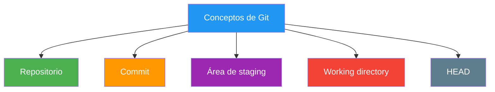

---

## 📁 Repositorio

Es el **corazón del proyecto**: donde se almacenan todos los datos y el historial completo.

<TipBox type="analogia">

Un repositorio es una **biblioteca infinita**: cada commit es un libro con la historia del proyecto hasta ese momento. El directorio `.git` es el **catálogo** de la biblioteca: si lo borras, la biblioteca sigue ahí pero ya no sabes dónde está nada.

</TipBox>

<TipBox type="nota">

Todo vive dentro de `.git`. **Si lo borras, pierdes el historial** — es la caja fuerte del proyecto.

</TipBox>

---

## ✍️ Commit

Un `commit` es un **punto de control**: una instantánea del proyecto en un momento específico.

<div class="grid grid-cols-2 gap-5 items-start">
<div>

```text
commit 7cff591a2b3c4d5e6f7a8b9c0d1e2f3a4b5c6d7e
Author: Tu Nombre <tu.email@ejemplo.com>
Date:   Thu Jan 8 10:00:00 2025 +0100
    Añadida funcionalidad de login
```

</div>
<div>

<TipBox type="analogia">

Es una **fotografía con timbre y fecha**: capturas qué archivos había, qué cambió, quién lo hizo y cuándo. El hash SHA-1 es el **número de serie** de la foto.

</TipBox>

</div>
</div>

---

## 🎬 El área de preparación

La **staging area** es la zona intermedia donde seleccionas los cambios que entrarán en el próximo `commit`.

<TipBox type="analogia">

Como **preparar la escena antes de tomar una foto:** decides qué incluir, cómo encuadrar… y cuando todo está listo, «disparas» (haces el commit).

</TipBox>

<TipBox type="advertencia">

Muchos principiantes hacen `git add .` y se arrepienten. **`git reset`** quita archivos del staging **sin perder** sus cambios.

</TipBox>

---

## 🪑 El directorio de trabajo

El **working directory** es la copia de los archivos del proyecto en tu máquina: aquí realizas las modificaciones directamente.

<TipBox type="analogia">

Es tu **mesa de trabajo**: papeles, borradores y cosas a medias. Puedes mover, borrar y cambiar lo que quieras, pero nada está «guardado oficialmente» hasta que lo metes en el cajón seguro (el commit).

</TipBox>

**Estados de un archivo:**

- 🔵 **No rastreado (untracked)** — archivo nuevo, Git aún no lo conoce
- 🟠 **Modificado (modified)** — lo cambiaste, pero no está preparado
- 🟣 **Preparado (staged)** — listo para el próximo commit
- 🟢 **Commiteado (committed)** — guardado en el repositorio

---

## 🏷️ HEAD

**HEAD** es un puntero a la referencia de rama actual, que a su vez apunta al último `commit`.

```text
HEAD → main → commit más reciente
```

<TipBox type="analogia">

Es un **marcador de página** en un libro enorme (tu historial): señala en qué página estás ahora. Si creas una rama, es como sacar una copia de esa página y empezar una historia alternativa.

</TipBox>

---

## 🔄 Ciclo de vida: modifica, prepara, confirma

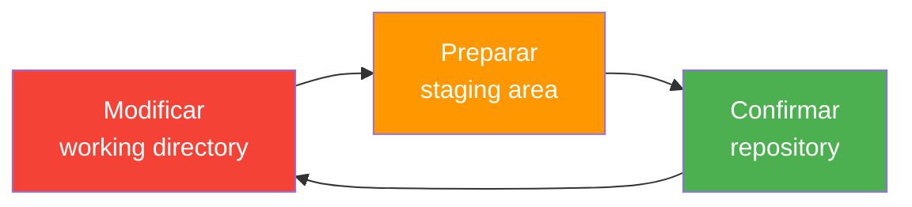

1. **Modificar archivos** — cambias en tu **directorio de trabajo**
2. **Preparar archivos** — añades los cambios al **área de preparación**
3. **Confirmar cambios** — el `commit` guarda la instantánea **permanentemente**

---

## 🧮 Los tres estados de Git

| Estado | Descripción |
|---|---|
| **Confirmado (committed)** | Los datos están almacenados en tu base de datos local |
| **Modificado (modified)** | Has modificado un archivo, pero aún no lo has preparado |
| **Preparado (staged)** | Has marcado un archivo modificado para el próximo commit |

<TipBox type="analogia">

**Modified:** escribes un borrador en tu cuaderno (trabajo privado). **Staged:** lo pasas a una libreta limpia y la dejas lista para entregar. **Committed:** se archiva y se sella con fecha — ya no cambias sin un documento nuevo (otro commit o un revert).

</TipBox>

---

## 💻 Instalar Git en tu sistema

Los alumnos de 1DAW trabajamos en diferentes sistemas operativos:

<div class="grid grid-cols-3 gap-4 text-sm">
<div>

**Windows** (con winget)

```powershell
winget install Git.Git
```

O descarga manual de `git-scm.com` (64-bit).

</div>
<div>

**Linux**

```bash
sudo apt update      # Debian/Ubuntu
sudo apt install git
sudo dnf install git # Fedora
pacman -S git        # Arch
```

</div>
<div>

**macOS** (con Homebrew)

```bash
brew install git
```

O `xcode-select --install`.

</div>
</div>

<TipBox type="truco">

Al terminar, verifica siempre con `git --version`. Si el comando no se reconoce, **reinicia la terminal**.

</TipBox>

---

## ⚙️ Tu identidad: nombre y email

Lo primero: tu identidad **aparece en cada commit**.

```bash
git config --global user.name "Tu Nombre"    # obligatorio
git config --global user.email "tu.email@ejemplo.com"
git config --global init.defaultBranch "main"
git config --global core.editor "code --wait"
git config --list
```

<TipBox type="analogia">

Tu **ficha de socio** en la biblioteca: sin nombre y email, no se sabe quién hizo cada commit.

</TipBox>

<TipBox type="advertencia">

**Sin `--global`** solo aplica al proyecto actual. ¿Pantalla rara (Vim)? `ESC`, `:wq`, Enter.

</TipBox>

---

## 📄 El fichero `.gitconfig`

Todo lo que configuras vive en un único fichero de texto:

| SO | Ruta |
|---|---|
| **Windows** | `C:\Users\TuUsuario\.gitconfig` |
| **Linux / macOS** | `~/.gitconfig` |

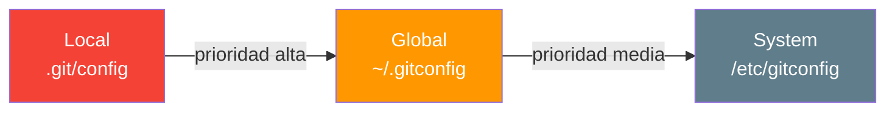

<TipBox type="truco">

**La configuración más específica gana:** si configuras `user.email` en local, se usa en ese proyecto aunque tengas otra global. Y puedes editar el fichero directamente con tu editor favorito.

</TipBox>

---

## 🧩 Las secciones de tu `.gitconfig`

```text
[user]
    email = tu.email@ejemplo.com
    name = Tu Nombre
[init]
    defaultBranch = "main"
[core]
    editor = code --wait
[alias]
    uncommit = reset --soft HEAD^
    tree = log --graph --oneline
```

| Sección | Qué configura |
|---|---|
| **`[user]`** | Tu identidad: nombre y email en cada commit |
| **`[init]`** | Rama por defecto (antes `master`, ahora `main`) |
| **`[core]`** | Editor y saltos de línea |
| **`[alias]`** | Atajos: `git tree` en vez de `git log --graph --oneline` |

---

## 🆕 `git init`: crear el repositorio

Los dos puntos de partida de cualquier proyecto: crear uno nuevo o descargar uno ya existente.

```bash
# Inicializar un nuevo repositorio
mkdir mi-proyecto
cd mi-proyecto
git init
# Salida: Initialized empty Git repository in /ruta/a/mi-proyecto/.git/
```

<TipBox type="analogia">

`git init` es como **instalar una caja fuerte** en una habitación: antes es una carpeta normal; después tiene un cajón secreto (`.git`) donde todo lo que pase quedará registrado.

</TipBox>

<TipBox type="advertencia">

Ejecutar `git init` dentro de un repositorio ya existente no es peligroso, pero Git avisa: `Reinitialized existing Git repository` — confunde.

</TipBox>

---

## 📥 `git clone`: copiar uno existente

```bash
# Clonar desde HTTPS o SSH
git clone https://github.com/usuario/repo.git
git clone git@github.com:usuario/repo.git

# Clonar y renombrar la carpeta
git clone https://github.com/usuario/repo.git mi-proyecto-local

# Clonar solo el último commit (más rápido)
git clone --depth 1 repo
```

<TipBox type="analogia">

`git clone` es **fotocopiar toda la biblioteca y llevártela a casa**: no solo los libros actuales (archivos), sino también todo el catálogo (historial). Copia idéntica y completa.

</TipBox>

<TipBox type="nota">

**Después de clonar ya estás dentro** del repositorio: no necesitas `git init`.

</TipBox>

---

## 🧭 ¿Init o clone?

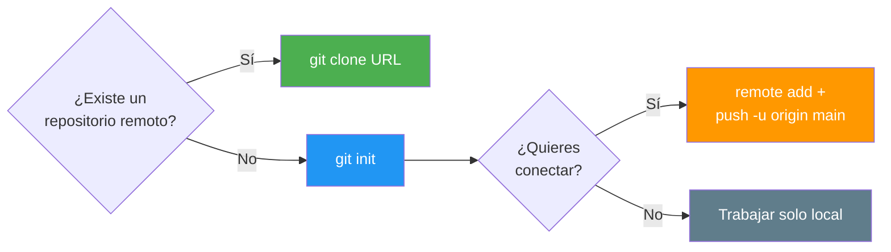

<TipBox type="nota">

**`git init`** crea un repositorio nuevo; **`git clone`** copia uno existente. Ambos dejan una carpeta con `.git` dentro: a partir de ahí, el flujo es el mismo.

</TipBox>

---

## 🔎 `git status`: mira el estado

El comando que más vas a ejecutar: te dice qué has modificado, qué tienes preparado y qué está limpio.

```bash
git status          # Estado completo
git status -s       # Estado resumido
# M archivo.txt     (Modified)
# ?? nuevo.cs       (Untracked)
```

<TipBox type="analogia">

Como **mirar por el cristal del escaparate:** qué hay dentro (staged), qué espera en el almacén (modified) y qué es nuevo y nadie ha visto (untracked).

</TipBox>

<TipBox type="consejo">

**Mira el estado antes de cada commit:** es el hábito que te salvará más de un susto.

</TipBox>

---

## 📋 `status` después de preparar

Si ejecutas `git add index.html`, el archivo aparece en **Changes to be committed**; el nuevo `menu.html` sigue en **Untracked** si aún no lo has añadido:

```text
Changes to be committed:
  modified:   index.html
Untracked files:
  menu.html
```

<TipBox type="nota">

El commit registrará la versión **preparada** de `index.html`; `menu.html` queda fuera. Si vuelves a editar `index.html`, `status` puede mostrarlo **en ambos grupos**.

</TipBox>

---

## ➕ `git add`: pasar al escaparate

```bash
git add archivo.txt    # Un archivo
git add .              # Todo (¡revisa antes!)
git add -u             # Solo modificados (no nuevos)
git add *.cs           # Con patrón
git reset archivo.txt  # Quitar del staging (sin perder cambios)
```

<TipBox type="analogia">

`git add` es **pasar productos del almacén al escaparate**: coges los archivos que quieres en el próximo commit. `git add .` es vaciar todo el almacén de golpe.

</TipBox>

<TipBox type="advertencia">

`git add .` **sin revisar** puede meter `.env`, `bin/`, `obj/` o credenciales. Siempre `git status` antes de commitear.

</TipBox>

---

## ✍️ `git commit`: guardar la instantánea

```bash
git commit -m "Añadida funcionalidad de login"

# Si olvidaste algo: añadir al último commit
git add archivo-olvidado.txt
git commit --amend
```

<TipBox type="analogia">

Es como **sellar un sobre con una foto dentro**: una vez sellado, el contenido queda registrado con fecha, autor y descripción. No abres el sobre y cambias la foto — creas un sobre nuevo (otro commit).

</TipBox>

<TipBox type="nota">

El mensaje es **para tu compañero y para tu yo del futuro**, no para la máquina.

</TipBox>

---

## 📝 El mensaje de commit

**Regla de los tres bloques:**

1. **Línea 1:** resumen en menos de 50 caracteres
2. **Línea 2:** vacía
3. **Líneas 3+:** explicación detallada (qué y por qué)

<TipBox type="advertencia" title="Errores comunes">

- Mensajes vagos: `git commit -m "fix"` → nadie entenderá qué arreglaste
- Commits gigantes (50 archivos) → imposible hacer un revert limpio
- Olvidar `git add` → el commit queda vacío
- Commitear contraseñas o `.env` → quedan en el historial **para siempre**

</TipBox>

---

## 🧪 Ejemplo: dos cambios, dos commits

En la web de la cafetería, separa la página inicial de la carta para que cada commit tenga un propósito:

```bash
git add index.html
git commit -m "Añade la página principal"
git add carta.html
git commit -m "Añade la carta de bebidas"
git log --oneline
```

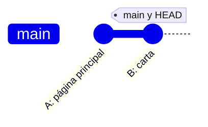

<TipBox type="nota">

`git add` **prepara**, no crea commits: localizas después cada cambio sin mezclarlo con la creación inicial.

</TipBox>

---

## 🔍 `git diff`: ver qué cambió

```bash
git diff                # Cambios NO preparados
git diff --staged       # Cambios PREPARADOS (¿qué voy a commitear?)
git diff commit1 commit2  # Entre dos commits
git diff --stat         # Resumen
```

<TipBox type="analogia">

Como **poner dos fotos una al lado de la otra** y señalar con lápiz rojo lo que cambió: línea por línea, qué se añadió, borró o modificó. Tu detective privado antes del commit.

</TipBox>

<TipBox type="advertencia">

`git diff` solo muestra cambios **no preparados**; para los preparados, `git diff --staged`.

</TipBox>

---

## 🔍 Interpretar un diff

```diff
-<p>Café: 2 €</p>
+<p>Café: 2,50 €</p>
```

La línea con `-` es el contenido **anterior**; la `+`, el **nuevo**.

```bash
git diff -- index.html   # Acota la revisión a un archivo
git diff --stat          # Resumen: archivos y líneas tocadas
```

<TipBox type="nota">

Los archivos **nuevos sin seguimiento** no aparecen en `git diff` hasta que los preparas con `git add`.

</TipBox>

---

## 🔎 `diff`: tres comparaciones útiles

| Comando | Compara |
|---|---|
| `git diff` | Directorio de trabajo ↔ índice |
| `git diff --staged` | Índice ↔ último commit |
| `git diff HEAD` | Directorio de trabajo ↔ último commit |

<TipBox type="nota">

Para comparar commits: `git diff A B` — el orden va del estado **anterior A** al **nuevo B**.

</TipBox>

---

## 🌳 El historial: `git log`

```bash
git log                   # Historial completo
git log --oneline         # Cada commit en una línea
git log --oneline -10     # Últimos 10
git log --oneline archivo.txt  # De un archivo
git log -p archivo.txt    # Con sus cambios
```

<TipBox type="analogia">

`git log` es la **bitácora de un capitán de barco**: cada commit es una entrada en el diario — cuándo, quién y qué pasó. Puedes recorrerla desde el primer día.

</TipBox>

<TipBox type="truco">

`git log --oneline --graph` muestra las ramas como un grafo: tu mejor herramienta para entender el historial.

</TipBox>

---

## 🌳 El historial es un grafo de commits

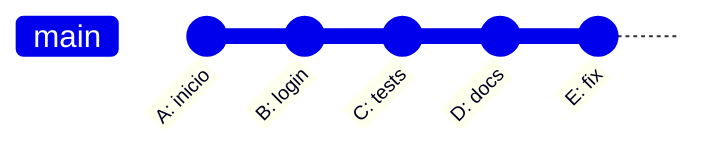

Cada punto es un **commit real**, no una operación como `add` o `push`: las líneas indican ascendencia — cada uno tiene como padre al anterior. El grafo se lee de izquierda a derecha: **lo último está a la derecha**.

```bash
git log --oneline --graph --all   # Todas las ramas
git show HEAD                     # El último commit, con cambios
```

<TipBox type="nota">

Con `--all` ves **todas las ramas** del repositorio: el grafo deja de ser una línea y muestra las bifurcaciones.

</TipBox>

---

## 🗂️ Las tres zonas de Git

Antes de deshacer, visualiza dónde vive tu código:

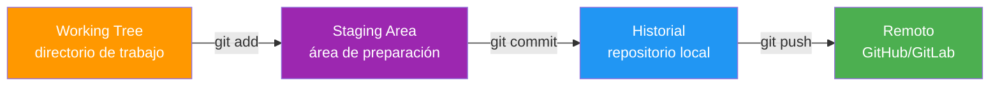

| Zona | Qué es | Equivalente |
|---|---|---|
| **Working Tree** | Archivos en tu disco, editándolos | Tu cuaderno de borradores |
| **Staging Area** | Preparados para el siguiente commit | La mesa de lo que vas a fotocopiar |
| **Historial** | Commits confirmados (base de datos local) | El archivador con copias certificadas |
| **Remoto** | Repositorio en GitHub/GitLab | La nube donde se comparten |

---

## 🪜 ¿Dónde está el error?

Cada zona necesita su propio comando — y cuanto más tarde en darte cuenta, más difícil es:

| Nivel | ¿Dónde está el error? | Herramienta | Dificultad |
|---|---|---|---|
| 1 | Working Tree (sin add) | `git restore` | ★☆☆☆☆ Trivial |
| 2 | Staging (sin commit) | `git restore --staged` | ★☆☆☆☆ Trivial |
| 3 | Commit local (sin push) | `git reset` | ★★☆☆☆ Fácil |
| 4 | Push sin merge | `git push --force-with-lease` | ★★★☆☆ Media |
| 5 | Push compartido | `git revert` | ★★★★☆ Alta |
| 6 | Mergeado en main | `git revert` | ★★★★☆ Alta |
| 7 | En producción | `git revert` + hotfix | ★★★★★ Muy alta |

<TipBox type="consejo">

**Niveles 1-3** (local): solución fácil y segura. **4-7** (compartido): toca `git revert`.

</TipBox>

---

## 🛟 `git restore`: deshacer en local

```bash
git restore archivo.txt          # Volver al último commit (borra cambios locales)
git restore .                    # En todos los archivos
git restore --staged archivo.txt # Quitar del staging SIN perder cambios
```

| Comando | Zona | ¿Borra commits? | ¿Borra cambios? |
|---|---|---|---|
| `git restore archivo` | Working Tree | ❌ No | ✅ Sí |
| `git restore --staged` | Staging | ❌ No | ❌ No (vuelven al disco) |

<TipBox type="analogia">

Como **tirar el borrador a la papelera y sacar una copia limpia del archivador**.

</TipBox>

<TipBox type="advertencia">

`git restore .` sin querer **pierde todos tus cambios locales**: revisa qué hay sin commit antes.

</TipBox>

---

## ↩️ `restore`: ¿qué versión recupera?

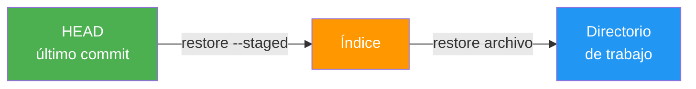

`git restore --staged menu.html` recupera en el **índice** la versión de `HEAD` pero mantiene la edición en disco; `git restore menu.html` reemplaza la edición en disco por la versión del **índice**.

---

## 👀 `restore`: el historial no cambia

Partimos de `menu.html` con «Café: 2 €» en el commit y «Café: 3 €» en el índice y el archivo. `restore` cambia el contenido, pero **no crea ni quita commits**: `main` y `HEAD` siguen en B.

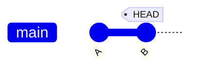

| Después de... | Índice | Archivo | Historial |
|---|---|---|---|
| `restore --staged menu.html` | 2 € | 3 € | Sigue en B |
| `restore menu.html` | 2 € | 2 € | Sigue en B |

<TipBox type="nota">

Son **dos pasos consecutivos**, no dos formas equivalentes: el segundo descarta la edición de 3 €.

</TipBox>

---

## 🧪 Ejemplo: retirar del staging

```bash
git add menu.html
git status
git restore --staged menu.html
git status
```

Después del primer `add`, el cambio estaba **preparado**; `restore --staged` lo retira del próximo commit, pero **el contenido modificado sigue en el archivo**.

<TipBox type="advertencia">

Sin `--staged`, `git restore menu.html` puede **descartar los cambios del archivo**: comprueba qué quieres conservar antes.

</TipBox>

---

## ↩️ `git revert`: deshacer compartido

Cuando el cambio ya está compartido, la historia **no se borra**: se añade un commit nuevo que invierte el anterior.

```bash
git revert HEAD        # Revertir el último commit
git revert 7cff591     # Uno específico
git revert -n HEAD     # Solo preparar (sin commit)
```

<TipBox type="analogia">

Como **añadir una página suplementaria al libro**: «lo de la página anterior estaba mal, haced como si no existiera». No arrancas la página (el commit sigue ahí), la invalidas.

</TipBox>

<RealExample app="Netflix">

Cuando un despliegue a producción falla, el equipo usa `git revert` para deshacer el commit **sin perder nada del historial**: queda constancia de qué pasó y por qué se revirtió.

</RealExample>

---

## 🧾 `revert` en el historial

Antes de revertir B, la rama termina en el precio erróneo de 3 €. `git revert <hash-de-B>` crea **C con el cambio inverso** y **B sigue en la historia**:

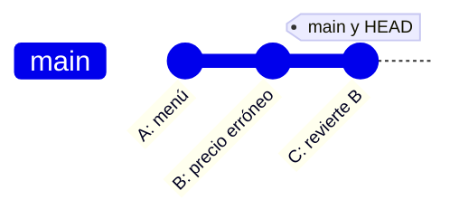

<TipBox type="nota">

Apropiado para cambios **compartidos**; puede haber conflictos si esas líneas cambiaron después.

</TipBox>

---

## 🧪 `reset`: mismo punto de partida

En cada ejemplo partimos de una copia independiente, con el directorio limpio:

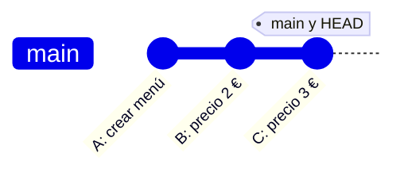

En **C** (el último commit), el índice y `menu.html` contienen «3 €». Queremos volver a **B** («2 €»): cambiaremos el modo y veremos qué ocurre en cada zona.

---

## 🔄 `git reset`: mover el puntero HEAD

`git reset` **mueve el puntero HEAD** hacia atrás: deshace commits según el modo, con un efecto distinto en cada zona.

```bash
git reset --soft HEAD~1   # Solo mueve el puntero
git reset HEAD~1          # --mixed (por defecto): también deshace el staging
git reset --hard HEAD~1   # Borra TODO (irreversible)
```

<TipBox type="analogia">

Como **mover el marcador de página hacia atrás**: `--soft` solo mueve el marcador — el texto sigue en tu cuaderno; `--mixed` lo mueve **y borras el cuaderno**; `--hard` lo mueves, borras el cuaderno **y tiras el original al fuego**.

</TipBox>

---

## 🧮 Qué toca cada modo

| Modo | Working Tree | Staging | Historial |
|---|---|---|---|
| **`--soft`** | ✅ Intacto | ✅ Intacto | ❌ Commit eliminado (vuelve al staging) |
| **`--mixed`** (defecto) | ✅ Intacto | ❌ Borrado | ❌ Commit eliminado |
| **`--hard`** | ❌ Borrado | ❌ Borrado | ❌ Commit eliminado |

```bash
git reset HEAD~1   # Equivale a --mixed (el modo por defecto)
```

<TipBox type="nota">

Por eso `git reset HEAD~1` a secas deshace el commit **y** deja los cambios en el disco, listos para `git add`.

</TipBox>

<TipBox type="advertencia">

**`git reset --hard` es irreversible**: borra del disco. Si ya está compartido, toca `git revert`.

</TipBox>

---

## 🧪 Comparar `reset --soft` y `--mixed`

<div class="grid grid-cols-2 gap-5 items-start">
<div>

```bash
git reset --soft HEAD~1
git status
```

El commit deja de ser el último. Los cambios permanecen en el **índice**, listos para reconfirmarse.

</div>
<div>

```bash
git reset --mixed HEAD~1
git status
```

La rama retrocede igual, pero el **índice** se actualiza: las ediciones siguen en el **directorio de trabajo**.

</div>
</div>

<TipBox type="nota">

Pruébalas en repositorios **separados**: una detrás de otra retrocedería **dos commits**.

</TipBox>

---

## 🧨 Eliminar el último commit

Te has dado cuenta de que el último commit no debía existir:

```bash
# 1. Conservar cambios en staging (recomendado)
git reset --soft HEAD~1

# 2. Conservar cambios sin staging
git reset HEAD~1

# 3. ¡Borrar todo! (peligroso)
git reset --hard HEAD~1

# 4. Seguro para repos compartidos
git revert HEAD
```

<TipBox type="nota">

Si ejecutas `--hard` por error, **no todo está perdido**: `git reflog` guarda los movimientos de HEAD durante **90 días**.

</TipBox>

---

## 🛟 `git reflog`: tu salvavidas

Incluso tras un `reset --hard` o un rebase desastroso, Git recuerda dónde ha estado tu HEAD.

```bash
git reflog                      # Historial de movimientos de HEAD

# Recuperar (recomendado: crear rama desde ahí)
git switch -c recuperar [hash]

# O con reset (si estás seguro)
git reset --hard [hash]
```

<TipBox type="truco">

Truco profesional: recupera commits «perdidos» con `git reflog` — prácticamente **nada se pierde de forma definitiva**.

</TipBox>

---

## ✏️ `git commit --amend`

Olvidaste un archivo o te equivocaste en el mensaje: `--amend` reescribe el último commit como si fuera el mismo.

```bash
git commit --amend -m "Nuevo mensaje mejor"

git add archivo-olvidado.txt
git commit --amend --no-edit    # Sin tocar el mensaje
```

<TipBox type="advertencia">

**No lo uses en commits ya subidos**: reescribir la historia compartida da problemas al equipo.

</TipBox>

---

## ⚖️ ¿Qué comando uso?

| Comando | Qué hace | Zona | ¿Seguro en equipo? |
|---|---|---|---|
| `git restore` | Descarta cambios locales | Working Tree | ✅ Sí |
| `git restore --staged` | Quita del staging | Staging | ✅ Sí |
| `git revert` | Crea commit inverso | Historial | ✅ Sí |
| `git reset --soft` | Deshace commit, guarda cambios | Historial | ❌ Solo local |
| `git reset --mixed` | Deshace commit y staging | Historial + Staging | ❌ Solo local |
| `git reset --hard` | Borra TODO | Todo | ❌ Solo local |
| `git commit --amend` | Modifica el último commit | Historial | ❌ Solo local |

<TipBox type="truco" title="Regla de oro">

`git restore` = sin historial · `git reset` = solo local · `git revert` = compartido.

</TipBox>

---

## 🚨 Commiteé y subí algo mal

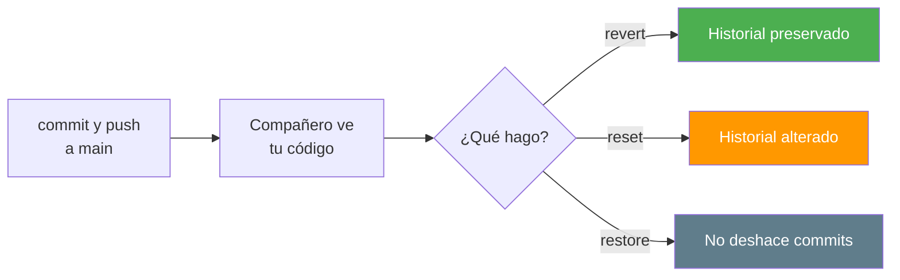

<TipBox type="advertencia">

**Si hay gente trabajando: `git revert`; nunca `git reset`.**

</TipBox>

---

## 🧹 Caso: commiteé un archivo que no debía

```bash
# El error: commiteé mi contraseña
git add .env
git commit -m "Configuración"

# La solución: deshacer y rehacer limpio
git reset --soft HEAD~1      # Deshace el commit, mantiene cambios
git restore --staged .env    # Quita .env del staging
echo ".env" >> .gitignore
git add .gitignore
git commit -m "Configuración sin .env"
```

<TipBox type="nota">

El archivo sigue en commits anteriores — si es un secreto de verdad, hay que sacarlo del historial (lo veremos en la guía de emergencia).

</TipBox>

---

## 🧯 Caso: código con errores en main

```bash
git log --oneline
# a1b2c3d Fix: arreglé el login  (🔴 falla tests)
# e4f5g6h Feature: añadí logs

git revert a1b2c3d
# Nuevo commit que deshace a1b2c3d
```

<TipBox type="consejo">

En main compartido **nunca `git reset`**: el revert mantiene el historial intacto y documenta qué se hizo y por qué se deshizo — así funciona el equipo de Netflix, Google y cualquier empresa con Git.

</TipBox>

---

## 🗑️ `git rm`: eliminar archivos

Borrar con el Explorador no basta: hay que registrarlo también en el repositorio.

```bash
git rm archivo.txt        # Del repositorio Y del disco
git rm --cached archivo.txt  # Solo del repositorio (queda en disco)
git rm *.log              # Múltiples archivos
```

<TipBox type="analogia">

`git rm` es **sacar un libro de la estantería y tirarlo a la papelera**. `git rm --cached` es sacarlo de la estantería pero dejarlo en la mesa: ya no está archivado, pero lo tienes a mano.

</TipBox>

<TipBox type="nota">

En ambos casos el archivo **sigue existiendo en commits anteriores**.

</TipBox>

---

## 🚫 `.gitignore`: ignorar archivos

```text
*.log           # Todos los .log
node_modules/   # Directorios
*.tmp           # Temporales
.DS_Store       # Basura de macOS
/build/         # Compilación
.env            # Secretos (¡nunca commitear!)
*.pem
!lib.a          # Excepción: no ignorar este
```

<TipBox type="analogia">

Una **lista de personas que no pueden entrar a la biblioteca**: le dices a Git «estos son privados, temporales o basura, ni los mires».

</TipBox>

<TipBox type="advertencia">

`.gitignore` **solo afecta archivos nuevos**: si ya está rastreado, primero `git rm --cached`, luego la regla. Si el secreto ya está en el historial, hace falta `git filter-repo` o BFG.

</TipBox>

---

## 🏷️ Etiquetas (tags)

Las etiquetas marcan puntos importantes de la historia, normalmente versiones de release.

```bash
git tag -a v1.0 -m "Versión 1.0 estable"  # Anotada (recomendada)
git show v1.0                             # Detalles
git push origin --tags                    # Subirlas al remoto
```

<TipBox type="analogia">

Son **llevadores de color en un libro**: cada color marca un capítulo importante (v1.0, v1.1, v2.0). Los tags no cambian el libro, solo señalan dónde empieza cada parte.

</TipBox>

**Semantic Versioning** (`MAJOR.MINOR.PATCH`):

- **MAJOR** (1.0.0) — incompatible
- **MINOR** (1.1.0) — funcionalidad nueva, compatible
- **PATCH** (1.0.1) — corrección, compatible

---

## 🏷️ Etiquetas en el historial

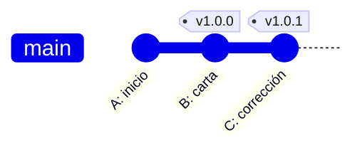

Una etiqueta **apunta a un commit concreto**: `git tag -a v1.0.0 -m "Versión estable"` crea la etiqueta **anotada** (con metadatos) y `git show v1.0.0` la muestra. Para compartirla, hay que **enviarla explícitamente** al remoto.

---

## 📚 El flujo típico de Git

El ciclo que vas a repetir cientos de veces:

1. **`git init`** → creas la caja fuerte
2. **`git add`** → pasas archivos al escaparate
3. **`git commit`** → sellas y archivas
4. **Repite** add → commit las veces que haga falta
5. **`git tag`** → marcas los momentos importantes (versiones)

<TipBox type="analogia">

Como **escribir un libro**: escribes capítulos (commits) y cuando terminas una parte importante, pones un marcador (tag).

</TipBox>

---

## 📌 Stash: guardar cambios temporales

Estás a medio hacer algo y necesitas cambiar de rama sin dejar el trabajo colgado.

```bash
git stash push -m "Trabajo parcial"  # Guardar (¡no el deprecated save!)
git stash list                       # Ver la pila
git stash show -p                    # Ver qué hay dentro
git stash pop                        # Recuperar y quitar de la pila
git stash apply                      # Recuperar sin quitar
git stash drop stash@{0}             # Eliminar uno
```

<TipBox type="analogia">

El **bolsillo del bata de laboratorio**: temporal — guardas, trabajas en otra cosa y sacas el material después.

</TipBox>

<TipBox type="advertencia">

`git stash save` está **deprecated** desde Git 2.16: usa siempre `git stash push -m "mensaje"`. `pop` aplica y elimina; `apply` aplica pero conserva.

</TipBox>

---

## 🔄 El viaje de un stash


<TipBox type="nota">

**Guardas** → trabajas en otra rama → **recuperas**. Sin `pop`, se queda olvidado en la pila.

</TipBox>

---

## 📋 Chuleta: comandos básicos

```bash
# Flujo básico
git status          # Ver estado
git add .           # Preparar cambios
git commit -m "msg" # Guardar cambios

# Deshacer errores
git restore archivo.txt           # Cambios locales
git restore --staged archivo.txt  # Quitar del staging
git revert HEAD                   # Revertir último commit

# Remotos (próximo punto)
git remote -v              # Ver remotos
git push -u origin main    # Subir por primera vez
git pull                   # Bajar y fusionar
```

<TipBox type="consejo">

**`git pull` = `git fetch` + `git merge`** — con control total, haz fetch + diff + merge. Antes de un pull: commit o stash.

</TipBox>

---

## 📋 Los conceptos del punto

| Concepto | Descripción |
|---|---|
| **Repositorio** | Carpeta que Git vigila para controlar cambios |
| **Commit** | Instantánea guardada con autor, fecha y mensaje |
| **Staging Area** | Zona de preparación antes del commit |
| **HEAD** | Apunta al último commit de la rama actual |
| **Historial** | Lista ordenada de todos los commits |
| **Deshacer** | `git restore` / `git reset` / `git revert` según la zona |

---

## Resumen del punto 1

<div class="grid grid-cols-2 gap-5 items-start">
<div>

<ConceptCard icon="✅" title="Buenas prácticas">

- Crea `.gitignore` **al inicio** de cada proyecto
- Guarda cambios parciales con `git stash`, no con commits a medias
- Mensajes de commit descriptivos: **qué y por qué**, no solo «fix»
- `git revert` en código compartido, `git reset` solo en local
- Configura tu `.gitconfig` antes de empezar: nombre, email y editor

</ConceptCard>

</div>
<div>

<ConceptCard icon="⏭️" title="¿Qué viene después?">

En el **Punto 02: Git avanzado** aprenderás a crear ramas, fusionarlas, resolver conflictos y usar estrategias de branching como GitHub Flow y GitFlow.

Lo que aquí son comandos sueltos (add, commit, restore) allí se convierten en **flujo de trabajo en equipo**.

</ConceptCard>

</div>
</div>

---
layout: section
---

<div class="ud-section-number">02</div>

# Git avanzado

<div class="opacity-70">Ramas, merges, rebase y flujos</div>

---

## 2 · Punto de partida

<div class="grid grid-cols-2 gap-6 items-start">
<div>

<TipBox type="consejo" title="Punto de partida">

¿Te imaginas construir un rascacielos sin poder probar ideas en un planito primero? **Sin ramas, cada cambio experimental arriesga todo el proyecto.** Las ramas son tu laboratorio seguro.

</TipBox>

<TipBox type="nota">

En el Punto 01 viste repositorios, commits y comandos esenciales. Aquí verás **ramas, fusiones, rebase y conflictos**: las herramientas que hacen posible el trabajo en equipo. Y ojo: las ramas son **baratas** — Git no copia archivos, solo crea punteros.

</TipBox>

</div>
<div>

<Objetivos
  :items="[
    'Crear, cambiar y eliminar ramas',
    'Entender las diferencias entre merge, rebase y cherry-pick',
    'Resolver conflictos de fusión',
    'Conocer estrategias de branching (GitHub Flow, GitFlow)',
    'Aplicar buenas prácticas con ramas',
  ]"
/>

</div>
</div>

---

## 🌿 ¿Qué es una rama?

Una **rama** es una línea de desarrollo independiente. La rama principal suele llamarse `main`.

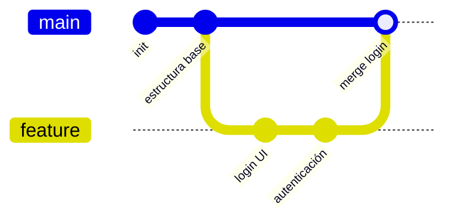

<TipBox type="analogia">

**Las ramas son universos paralelos:** en el universo `main` tu aplicación está en producción; en `feature/login` experimentas con una pantalla nueva. Si el experimento sale mal, cierras ese universo (borras la rama) y el principal sigue intacto. Si sale bien, fusionas ambos universos.

</TipBox>

---

## ⌨️ Comandos de ramas

Listar, crear, cambiar y borrar — el ciclo completo:

```bash
git branch                # Listar ramas locales
git branch -a             # Locales y remotas
git branch -v             # Con su último commit

git switch -c nombre      # Crear y cambiar (moderno)
git switch nombre         # Cambiar a una existente
git switch -              # Volver a la anterior

git branch -d nombre      # Borrar (solo si está fusionada)
git branch -D nombre      # Borrar a la fuerza
git branch -m nuevo-nombre  # Renombrar la actual
```

<TipBox type="nota">

`git checkout` hace lo mismo que `switch` (y `-b` = `-c`), pero **cambia de rama y toca archivos** a la vez: confuso para quien empieza. `switch` solo cambia de rama — recomendado hoy.

</TipBox>

---

## 🗺️ Las metáforas de los comandos

Memoriza el flujo por su imagen:

- 🗺️ **`git branch`** — abrir el **mapa** y enumerar universos; no viajas a ninguno
- 🚪 **`git switch`** — el **portal**: te transporta de universo al instante (sin tocar archivos)
- 📦 **`git stash`** — el **cajón temporal**: pones ahí tus papeles mientras ordenas la mesa
- 🗑️ **`git branch -d`** — **cerrar un universo** solo si ya está todo integrado; `-D` es fuerza bruta

<TipBox type="advertencia">

Si tienes **cambios sin commit** y cambias de rama, Git intenta mezclarlos: siempre **commit o stash antes**.

</TipBox>

<TipBox type="consejo">

Antes de borrar: `git log` — si la rama tiene commits que no están en `main`, **cherry-pick o merge**.

</TipBox>

---

## 🔀 Fusionar: combinar dos ríos

La **fusión** combina los cambios de una rama con otra.

<TipBox type="analogia">

`main` es un **río caudaloso**; tu rama `feature` es un **afluente** que ha ido recogiendo agua (cambios). Al hacer `merge`, ambos ríos se unen: sin obstáculos, la fusión es automática; si ambos modificaron la misma roca (mismas líneas), toca decidir cómo unir el cauce.

</TipBox>

**Tres tipos de fusión:**

1. **Fast-forward** — no hay cambios en `main` desde que creaste la rama
2. **Merge commit** — `main` avanzó: Git crea un commit de merge con dos padres
3. **Merge con conflicto** — ambos modificaron las mismas líneas

---

## ⏩ Fast-forward: solo se mueve el puntero

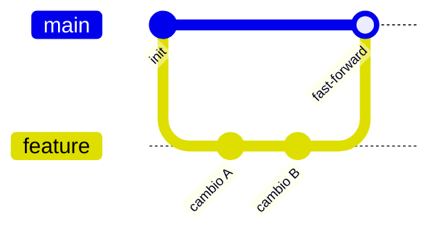

Git **no crea un commit de merge**: simplemente mueve el puntero de `main` al último commit de `feature`. Es limpio… pero **oculta que hubo una rama**.

<TipBox type="truco">

Si quieres que siempre quede constancia de la rama, fusiona con **`git merge --no-ff`**: obliga a crear el commit de merge (recomendado para funcionalidades).

</TipBox>

---

## 🔀 Merge commit: dos padres, una presa

Cuando `main` avanzó mientras trabajabas, Git **sí crea un commit de merge**:

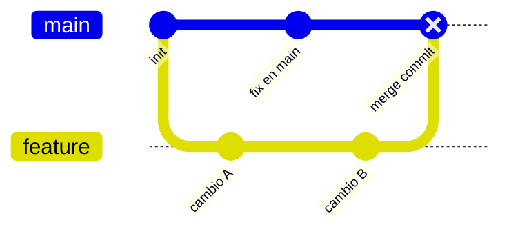

El commit de merge tiene **dos padres**: el último de `main` y el último de `feature`. Es la **presa** que une ambos cauces.

---

## ⚙️ Comandos de merge

```bash
git merge nombre-rama          # Fusionar en la rama actual
git merge nombre-rama -m "…"   # Mensaje personalizado
git merge --no-ff nombre-rama  # Siempre crea commit de merge
git merge --abort              # Cancelar si hay conflicto
```

<TipBox type="truco" title="Regla de oro">

Siempre **fusionas sobre la rama destino**: primero te cambias a ella (`git switch main`) y después fusionas.

</TipBox>

<TipBox type="nota">

El fast-forward es «limpio» pero puede ocultar la estructura real del desarrollo; usa `--no-ff` cuando quieras conservar el historial de ramas.

</TipBox>

---

## 🎯 Estrategias de merge

Git permite elegir el algoritmo de la fusión:

| Estrategia | Cuándo usarla |
|---|---|
| **recursive** (por defecto) | Caso general: resuelve automáticamente si puede |
| **ours** | Cuando quieres descartar los cambios de la otra rama |
| **theirs** | Cuando quieres aceptar los cambios de la otra rama |
| **octopus** | Fusionar más de 2 ramas a la vez |

```bash
git merge -X theirs feature   # Acepta la versión entrante en conflictos
git merge -X ours feature     # Mantiene la versión actual
git merge --no-commit feature # Deja todo staged sin commit
```

<TipBox type="advertencia">

`-s ours` y `-X theirs` **pueden descartar cambios sin avisar**: úsalas solo cuando sepas exactamente qué hacen.

</TipBox>

---

## 🍒 Cherry-pick: solo la cerezita

Aplica **un commit específico** de otra rama sin fusionar toda la rama.

<TipBox type="analogia">

Estás en un **buffet** (tu rama) y en el plato de tu compañero hay una **cereza** deliciosa (un commit con un fix importante). No quieres todo el plato: solo esa cerezita. Con `cherry-pick` la agarras y la copias a tu plato.

</TipBox>

```bash
git cherry-pick [hash]        # Un commit a la rama actual
git cherry-pick hash1 hash2   # Varios en orden
git cherry-pick -n [hash]     # Solo preparar (sin commit)
```

<TipBox type="consejo" title="¿Cuándo usarlo?">

- Aplicar un **hotfix a `main`** sin mergear toda la rama
- Traer una **funcionalidad específica** de otra rama
- **Recuperar un commit** de una rama ya eliminada

</TipBox>

---

## 🍒 Un hotfix sin fusionar la rama

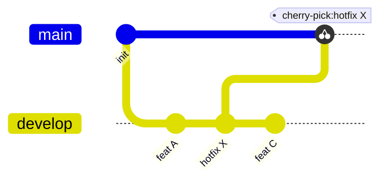

Solo el commit **«hotfix X»** se copia a `main`: ni `feat A` ni `feat C`. Así se aplican hotfixes puntuales o se recuperan commits de ramas ya eliminadas.

<TipBox type="advertencia">

`cherry-pick` crea commits **nuevos con hash distinto**: si lo aplicas dos veces, **duplicas** los cambios.

</TipBox>

---

## 📐 Rebase: reescribir la historia

El **rebase** reaplica los commits de tu rama sobre otra base, creando un historial **lineal**.

<TipBox type="analogia">

Es como **viajar al pasado**: construyes una casa (tu rama `feature`) y quieres las paredes alineadas con el plano más reciente de la ciudad (`main`). Retrocedes, te sitúas en el último punto del plano y **vuelves a construir desde ahí**. La casa queda alineada… pero el plano antiguo ya no existe: se reescribió la historia.

</TipBox>

<TipBox type="nota">

Los commits originales desaparecen y **sobreviven sus copias con hashes nuevos**: por eso se dice que el rebase reescribe el historial.

</TipBox>

---

## ⚖️ Merge frente a rebase

| Aspecto | **Merge** | **Rebase** |
|---|---|---|
| **Historial** | Conserva la estructura de ramas | Lineal, limpio |
| **Commits** | Crea un commit de merge | Sin commit extra |
| **Conflictos** | Se resuelven una vez | Pueden resolverse por commit |
| **Ramas compartidas** | ✅ Seguro | ❌ Peligroso |
| **Auditoría** | ✅ Completo | ⚠️ Modificado |

<TipBox type="advertencia">

**PELIGRO:** el rebase **reescribe la historia** (hashes nuevos). Si alguien más tiene esos commits, todos tendrán problemas de sincronización. **NUNCA rebeases commits que ya han sido compartidos (push).**

</TipBox>

---

## 🧭 ¿Cuándo uso cada uno?

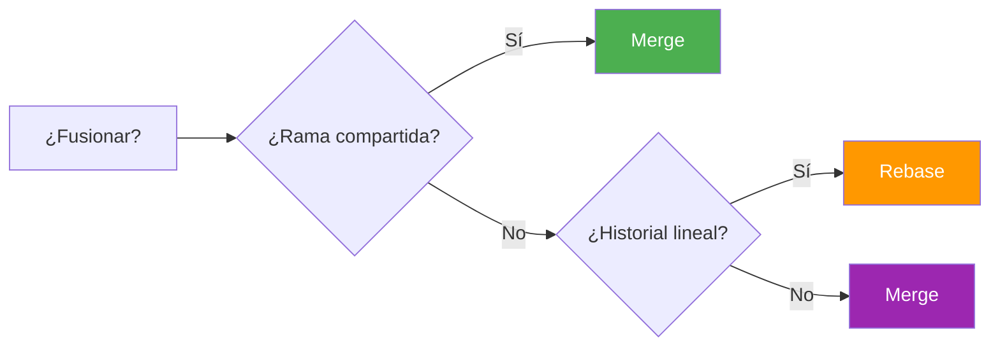

<TipBox type="truco" title="Regla de oro">

- **Rebase** tu rama local antes de fusionar
- **Merge** para ramas compartidas

</TipBox>

---

## ⚙️ Comandos de rebase

```bash
git rebase main            # Reaplicar sobre main
git rebase -i HEAD~3       # Interactivo: últimos 3 commits
git rebase --continue      # Tras resolver un conflicto
git rebase --skip          # Saltar el commit problemático
git rebase --abort         # Volver al estado anterior
```

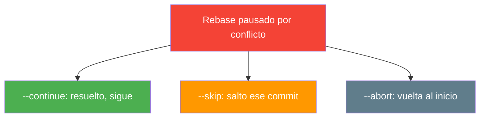

---

## ✂️ Rebase interactivo

```bash
git rebase -i HEAD~3

# pick     = usar el commit (orden por defecto)
# reword   = cambiar el mensaje
# edit     = pausar para modificarlo
# squash   = combinar con el anterior (conserva mensajes)
# fixup    = combinar y descartar este mensaje
# drop     = eliminar el commit
```

<TipBox type="truco">

Tienes commits `WIP`, `fix`, `fix2`: con `-i` haces **`reword`** del fix, **`squash`** del fix2 y **`drop`** del WIP → un solo commit limpio.

</TipBox>

---

## 🧪 Rebase paso a paso

```bash
# 1. Estás en feature; main tiene nuevos commits
git checkout feature
git fetch origin

# 2. Rebase tu rama sobre main
git rebase origin/main

# 3. Resolver conflictos si los hay
# 4. Subir (sin --force si no rebaseaste push)
git push origin feature

# 5. Crear Pull Request
```

<TipBox type="consejo">

**Cuándo rebasear:** para mantener historial lineal y limpio, y **antes** de hacer el merge a main. **Nunca** en ramas compartidas.

</TipBox>

---

## 🧩 ¿Qué es un conflicto?

Cuando dos personas modifican las mismas líneas, Git no puede fusionar automáticamente.

<TipBox type="analogia">

Tú y un compañero **pintáis la misma pared**: tú la pintas de **azul** en `feature`, él la pinta de **verde** en `main`. Al juntar el trabajo, Git no sabe qué color elegir. Necesitáis sentaros, hablarlo y decidir: azul, verde o un color nuevo. **Eso es un conflicto**: dos cambios incompatibles en el mismo sitio.

</TipBox>

```mermaid
gitGraph
    commit id: "pared pintada"
    branch feature
    checkout feature
    commit id: "pintar azul"
    checkout main
    commit id: "pintar verde"
    checkout feature
    merge main id: "CONFLICTO"
```

---

## 🛠️ Resolver un conflicto paso a paso

```bash
# 1. Traer los cambios y fusionar
git fetch origin
git merge origin/main

# 2. Ver qué archivos tienen conflicto
git status
# "Unmerged paths: both modified: archivo.txt"

# 3. Editar el archivo: eliminar los marcadores
#    <<<<<<< ======= >>>>>>>  y decidir el contenido

# 4. Marcarlo como resuelto y firmar el acuerdo
git add archivo-resuelto.txt
git commit -m "Resueltos conflictos de merge"
```

<TipBox type="analogia">

Como un **mediador**: identificáis dónde estáis en desacuerdo (marcadores), escucháis ambos lados (contenido), decidís la solución (edición) y **firmáis** (commit).

</TipBox>

---

## 🔎 El conflicto por dentro

Así se ve el archivo con los marcadores (`ServicioLogin.cs`):

```csharp
public bool IniciarSesion(string u, string p)
{
<<<<<<< HEAD
    var hash = CalcularHash(p);          // tu versión
    return BaseDatos.Verificar(u, hash);
=======
    return !string.IsNullOrEmpty(u)      // la otra
        && !string.IsNullOrEmpty(p);
>>>>>>> feature
}
```

<TipBox type="advertencia" title="Errores comunes">

- **Olvidar los marcadores** `<<< === >>>` → no compilará
- **No hacer `git add` tras resolver** → Git sigue viendo conflicto
- **No probar el build** → `dotnet build` o tests tras resolver

</TipBox>

---

## ✅ Resolución: un ejemplo en C#

Decidís que la versión de `main` es la correcta (con hash) y le añadís la validación de nulos de la feature:

```csharp
public bool IniciarSesion(string usuario, string password)
{
    if (string.IsNullOrEmpty(usuario)
        || string.IsNullOrEmpty(password))
        return false;

    var hash = CalcularHash(password);
    return BaseDatos.Verificar(usuario, hash);
}
```

<RealExample app="Netflix">

Cuando dos equipos modifican el mismo servicio de streaming, resuelven los conflictos con una **reunión de 15 minutos**: el conflicto es el punto de partida de la conversación, no el final.

</RealExample>

---

## 🧰 Cuando el merge se complica

```bash
git mergetool     # Editor visual para resolver
git merge --abort # Cancelar y volver atrás
```

<TipBox type="nota">

**`--abort` no es rendirse**: es volver al estado anterior y replantear. Conocer estas dos salidas te quita el miedo a los conflictos.

</TipBox>

<TipBox type="truco">

Un IDE como **Rider** o **VS Code** te muestra ambos lados y te deja elegir: «aceptar actual», «aceptar entrante» o «aceptar ambos».

</TipBox>

---

## 🌱 Rama por funcionalidad

Cada funcionalidad en su propia rama:

```bash
git switch -c feature/nueva-funcionalidad main
# …trabajar…
git switch main
git merge feature/nueva-funcionalidad
```

```mermaid
gitGraph
    commit id: "main estable"
    branch feature/login
    checkout feature/login
    commit id: "login: paso 1"
    commit id: "login: tests"
    checkout main
    merge feature/login id: "merge login"
    commit id: "release v1.1"
```

---

## 🚑 Rama por bugfix

```bash
git switch -b hotfix/descripcion main
# …arreglar…
git switch main
git merge hotfix/descripcion
```

```mermaid
gitGraph
    commit id: "v1.0 estable"
    branch hotfix/bug-critico
    checkout hotfix/bug-critico
    commit id: "Fix: bug crítico"
    checkout main
    merge hotfix/bug-critico id: "merge"
    commit id: "v1.0.1"
```

<TipBox type="nota">

El hotfix parte **siempre de `main`** y se fusiona de vuelta.

</TipBox>

---

## 🗂️ Tres flujos de trabajo

- 🌱 **GitHub Flow** — solo `main`, ramas de feature cortas, **PR obligatorio**, despliegue continuo
- 🗺️ **GitFlow** — `main` + `develop` con ramas de `feature`, `release` y `hotfix`: más estructurado
- 🚀 **Trunk-Based** — todos escriben en `main` con ramas de 1-2 días y **feature flags**

<TipBox type="consejo">

**Para tus proyectos de 1DAW, GitHub Flow es suficiente.** Trunk-Based es para equipos grandes con CI/CD maduro.

</TipBox>

---

## 🌱 GitHub Flow

```mermaid
graph LR
    A[main] -->|Crear rama| B[feature]
    B -->|Commits| C[feature]
    C -->|PR y merge| A
    A -->|Deploy| D[Producción]

    style A fill:#4CAF50,color:#fff
    style B fill:#FF9800,color:#fff
    style C fill:#9C27B0,color:#fff
    style D fill:#f44336,color:#fff
```

**Principios:** 1) en `main` todo está listo para producción · 2) rama con nombre descriptivo · 3) trabaja y commitea · 4) abre la PR · 5) fusiona tras aprobación · 6) deploy inmediato.

<TipBox type="nota">

**Cuándo usarlo:** proyectos con despliegue continuo (CD), webs, startups y equipos pequeños.

</TipBox>

---

## 🗺️ GitFlow: todas las ramas

| Rama | Propósito |
|---|---|
| **`main`** | Producción, versiones estables |
| **`develop`** | Integración de nuevas funcionalidades |
| **`feature-*`** | Nuevas funcionalidades |
| **`release-*`** | Preparación de release |
| **`hotfix-*`** | Correcciones urgentes en producción |

<TipBox type="nota">

**Cuándo usarlo:** software con versiones formales, apps móviles, proyectos enterprise y equipos grandes.

</TipBox>

---

## 🌳 GitFlow: las ramas se hablan

```mermaid
graph LR
    M[main<br/>versiones estables] --> H[hotfix<br/>corrección urgente]
    M --> D[develop<br/>integración]
    D --> F[feature<br/>funcionalidad]
    F --> D
    D --> R[release<br/>preparación]
    R --> M
    R --> D
    H --> M
    H --> D

    style M fill:#4CAF50,color:#fff
    style D fill:#2196F3,color:#fff
    style F fill:#FF9800,color:#fff
    style R fill:#9C27B0,color:#fff
    style H fill:#f44336,color:#fff
```

<TipBox type="nota">

Las features **viven en `develop`**; los releases salen de `develop` hacia `main` y vuelven; los hotfixes saltan directos a `main` y también se incorporan a `develop`.

</TipBox>

---

## 🔁 El ciclo completo de GitFlow

```mermaid
gitGraph
    commit id: "A" tag: "v1.0"
    branch develop
    checkout develop
    commit id: "B"
    branch feature/carta
    checkout feature/carta
    commit id: "C"
    checkout develop
    merge feature/carta id: "D"
    branch release/1.1
    checkout release/1.1
    commit id: "E"
    checkout main
    merge release/1.1 id: "F" tag: "v1.1"
    checkout develop
    merge release/1.1 id: "G"
```

**A** v1.0 → **B** desarrollo → **C-D** feature integrada → **E-G** release con tag que vuelve a `develop`: el patrón de la chuleta, en un vistazo.

---

## ⚙️ Comandos GitFlow

```bash
# Iniciar develop
git switch -c develop main
# Funcionalidad
git switch -c feature/login develop
git switch develop && git merge feature/login --no-ff
# Release
git switch -c release/1.1 develop
# …ajustes finales…
git switch main && git merge release/1.1 --no-ff
git tag -a v1.1 -m "Version 1.1"
# Hotfix
git switch -c hotfix/1.1.1 main
# …arreglo urgente…
git switch main && git merge hotfix/1.1.1 --no-ff
```

<TipBox type="truco">

Patrón fijo: **todo acaba en `main` con `--no-ff` y tag**; `develop` se sincroniza después.

</TipBox>

---

## 🚀 Trunk-Based y feature flags

Todos escriben en `main` directamente, con ramas **muy cortas (1-2 días)** o sin ramas. Se usa con **feature flags**: variables que activan o desactivan funciones incompletas para no romper la producción.

<RealExample app="Gmail (Google)">

Cuando ves una función nueva que solo algunos usuarios tienen, es una **feature flag**: está probándose en silencio. Cuando pasa las pruebas, se activa para todos. Google y Facebook trabajan así.

</RealExample>

---

## ⚖️ Comparativa de flujos

| Aspecto | **GitHub Flow** | **GitFlow** |
|---|---|---|
| **Complejidad** | Simple | Complejo |
| **Ramas principales** | Solo `main` | `main` + `develop` |
| **Ramas de release** | No | Sí |
| **Hotfixes** | Rama desde `main` | Rama desde `main` |
| **Ideal para** | CD, despliegue continuo | Proyectos con versiones |
| **Ejemplo** | Web apps modernas | Software embebido |

---

## 🏷️ main frente a master

Históricamente la rama principal se llamaba `master`. Hoy, **`main` es el nombre recomendado** por GitHub — los repositorios nuevos ya nacen así.

```bash
# Si tu repositorio aún usa master
git branch -m master main
git push -u origin main
```

<TipBox type="nota">

Renombrar **no pierde historial**: solo cambia el nombre de la referencia.

</TipBox>

---

## 💡 Buenas prácticas con ramas

<div class="grid grid-cols-2 gap-5 items-start">
<div>

<ConceptCard icon="✅" title="Recomendaciones">

- **Ramas cortas**: crear, trabajar y fusionar rápido
- **Nombres descriptivos**: `feature/login`, `hotfix/security`
- **Commits frecuentes**: cada commit hace una cosa
- **Mensajes claros**: el «por qué», no solo el «qué»
- **Integrar temprano**: merge a `main` a menudo

</ConceptCard>

</div>
<div>

<ConceptCard icon="⚠️" title="Errores a evitar">

| Error | Consecuencia |
|---|---|
| Trabajar directo en `main` | Conflictos frecuentes |
| Ramas muy largas | Merges gigantes |
| Commits gigantes | Historial confuso |
| No probar antes del merge | Bugs en producción |

</ConceptCard>

</div>
</div>

---

## 📋 Chuleta: comandos avanzados

```bash
# Ramas
git branch                # Listar
git switch -c rama        # Crear y cambiar
git branch -d rama        # Eliminar

# Merge
git merge rama            # Fusionar
git merge --no-ff rama    # Sin fast-forward
git merge --abort         # Cancelar

# Rebase
git rebase main           # Sobre main
git rebase -i HEAD~3      # Interactivo
git rebase --continue     # Tras conflicto

# Conflictos
git status                # Ver conflictos
git mergetool             # Herramienta visual
git add archivo           # Marcar resuelto
git commit                # Commit de merge
```

---

## 📋 Los conceptos del punto

| Concepto | Descripción |
|---|---|
| **Rama** | Línea de desarrollo paralela (instantánea, barata en Git) |
| **Merge** | Fusión que conserva el historial de ramas |
| **Rebase** | Reescribe commits sobre otra base (historial lineal) |
| **Cherry-pick** | Copia un commit específico a otra rama |
| **Conflicto** | Cuando dos ramas modifican las mismas líneas |
| **GitHub Flow** | `main` + ramas de feature + PR |
| **GitFlow** | Ramas `main`, `develop`, `feature`, `release`, `hotfix` |

---

## Resumen del punto 2

<div class="grid grid-cols-2 gap-5 items-start">
<div>

<ConceptCard icon="✅" title="Buenas prácticas">

- Ramas **cortas** y con nombre descriptivo
- Integra **temprano**: merge a `main` con frecuencia
- **Rebase solo en local**; nunca en commits pushados
- Conflictos: resolver, `git add`, probar el build y **commit**
- En tus proyectos: **GitHub Flow** te sobra

</ConceptCard>

</div>
<div>

<ConceptCard icon="⏭️" title="¿Qué viene después?">

En el **Punto 03: Git remoto** verás GitHub y los repositorios remotos: crear repos en la nube, clonar, publicar ramas, `fetch`/`pull` y sincronizar con tu equipo.

Las ramas que aquí nacen y fusionan, **allí se comparten** con `push` y pull requests.

</ConceptCard>

</div>
</div>
---
layout: section
---

<div class="ud-section-number">03</div>

# Git remoto

<div class="opacity-70">GitHub, SSH, versiones y Actions</div>

---

## 3 · Punto de partida

<div class="grid grid-cols-2 gap-6 items-start">
<div>

<TipBox type="consejo" title="Punto de partida">

¿De qué sirve tener el mejor código del mundo si solo vive en tu ordenador? **Un disco duro puede fallar, un portátil puede perderse.** Los repositorios remotos son tu copia de seguridad en la nube y tu puerta al trabajo en equipo.

</TipBox>

<TipBox type="nota">

Tras ver comandos básicos (P1) y ramas con fusiones (P2), ahora: **subir tu código a la nube, clonar proyectos, sincronizar cambios y gestionar versiones.**

</TipBox>

</div>
<div>

<Objetivos
  :items="[
    'Diferenciar entre Git (local) y GitHub (remoto)',
    'Conocer la arquitectura cliente-servidor de Git',
    'Dominar los comandos: remote, push, fetch y pull',
    'Crear y gestionar repositorios en GitHub',
    'Trabajar con SSH keys para autenticación segura',
    'Aplicar Semantic Versioning con tags',
  ]"
/>

</div>
</div>

---

## ☁️ Git no es GitHub

**Git** es tu **cuaderno personal** donde apuntas todo y organizas tus ideas. **GitHub** es la **biblioteca pública** donde cualquiera puede leerlo, anotarte en los márgenes (comentarios), proponer cambios (pull requests) y compartirlo con el mundo.

| **Git** | **GitHub** |
|---|---|
| Herramienta de control de versiones | Plataforma de hosting |
| Local (en tu PC) | Remoto (en la nube) |
| Comandos: `add`, `commit`, `branch` | Interfaz web, PRs, forks |
| Creado por Linus Torvalds (2005) | Creado en 2008 |

<RealExample app="Instagram">

Instagram usa Git internamente para gestionar su código: cada desarrollador tiene su repositorio **local** (Git) y todo se sincroniza en servidores centrales (como GitHub) para que el equipo complete colabore.

</RealExample>

---

## 🌐 ¿Por qué GitHub? Sus alternativas

| Plataforma | Características |
|---|---|
| **GitLab** | CI/CD integrado, auto-hosting |
| **Bitbucket** | Integración con Atlassian (Jira, Trello) |
| **Gitea** | Auto-hosting ligero |
| **Azure DevOps** | Enterprise Microsoft |

<TipBox type="consejo">

Para empezar, **GitHub**: es donde está la mayor comunidad y donde los empleadores buscan desarrolladores. Tu perfil es tu **portafolio profesional** — el «Facebook de los programadores».

</TipBox>

---

## ⚖️ Comparativa de plataformas

| Plataforma | Ventajas | Ideal para |
|---|---|---|
| **GitHub** | Máxima comunidad, Actions gratuito, Copilot | Open source, portafolios |
| **GitLab** | CI/CD sin plugins, auto-hosting, privacidad | Equipos que necesitan CI/CD ya |
| **Bitbucket** | Gratis para equipos ≤5, Jira/Trello | Equipos que ya usan Atlassian |
| **Gitea** | Ligero, sin dependencias externas | Proyectos internos, aprendizaje |

<TipBox type="nota">

GitHub es algo lento y su plan gratuito limita lo privado; GitLab aprende algo más. **Regla: elige según tu equipo, no por moda.**

</TipBox>

---

## 🏠 La arquitectura remota

<TipBox type="analogia">

Tu repositorio local es **tu casa**; el remoto (GitHub) es una **bodega en la nube**. `origin` es la dirección de esa bodega: con `push` envías cajas, con `pull` las traes de vuelta.

</TipBox>

```mermaid
graph LR
    A[Tus archivos<br/>working tree] -->|git add| B[Staging]
    B -->|git commit| H[Historial local]
    H -->|git push| R[Remoto<br/>GitHub]
    R -->|fetch / pull| H

    style A fill:#FF9800,color:#fff
    style B fill:#9C27B0,color:#fff
    style H fill:#2196F3,color:#fff
    style R fill:#4CAF50,color:#fff
```

<TipBox type="nota">

`origin` es solo el nombre por defecto: puedes tener varios remotos — `origin` (tu repo), `upstream` (el original del fork), `backup`. Varias bóvedas, varias direcciones.

</TipBox>

---

## 📇 `git remote`: la lista de contactos

```bash
git remote -v              # Ver remotos y sus URLs
git remote add origin URL  # Añadir
git remote rename origin mi-repo
git remote remove origin   # Eliminar
git remote show origin     # Detalle
```

**Salida de `git remote -v`:**

```text
origin   https://github.com/miusuario/mi-proyecto.git (fetch)
upstream https://github.com/proyecto-original/proyecto.git (fetch)
```

<TipBox type="advertencia">

`fatal: remote origin already exists` → `git remote remove origin` y vuelve a añadirlo con la URL correcta.

</TipBox>

---

## ⬆️ `git push`: subir a la nube

```bash
git push origin main          # Subir la rama
git push -u origin main       # Primera vez: crea tracking
git push origin --tags        # Subir etiquetas
git push origin --delete rama # Borrar rama remota
git push --force-with-lease origin main  # Sobrescribir (seguro)
```

<TipBox type="nota">

Si la caja es la **primera** que envías, `-u` enseña a la mensajería la dirección: a partir de ahí, `git push` solo.

</TipBox>

<TipBox type="advertencia">

`! [rejected] (non-fast-forward)` = el remoto tiene commits que tú no tienes → **`git pull` antes de push**. Y **nunca `--force` en ramas compartidas** (destruye el trabajo de otros): usa `--force-with-lease`.

</TipBox>

---

## ⬇️ `git fetch`: mira sin pedir

```bash
git fetch origin           # Traer cambios del remoto
git fetch origin nombre    # Una rama concreta
git branch -r              # Ver ramas remotas
git fetch --prune          # Limpiar remotas obsoletas
```

<TipBox type="analogia">

Como **mirar el menú de un restaurante sin pedir nada**: ves qué hay disponible (qué cambios hay), pero no te tocas nada.

</TipBox>

<TipBox type="nota">

**`fetch` es seguro**: no modifica tu código local. Revisa con `git diff` y decides después.

</TipBox>

---

## 📥 `git pull`: descarga y fusiona

```bash
git pull origin main           # fetch + merge
git pull --rebase origin main  # fetch + rebase
git pull --ff-only origin main # Solo si no hay cambios locales
git pull                       # Usa el tracking configurado
```

<TipBox type="analogia">

Como **pedir del restaurante**: traes los cambios **y los integras**. Si ya tenías algo en el plato (cambios locales), puede haber un lío.

</TipBox>

<TipBox type="advertencia">

`CONFLICT (content): Merge conflict in archivo` → abres, resuelves, `git add` y `git commit` (el flujo del Punto 02).

</TipBox>

---

## ⚖️ fetch frente a pull

| Aspecto | **`git fetch`** | **`git pull`** |
|---|---|---|
| ¿Qué hace? | Solo descarga | Descarga **y** fusiona |
| ¿Modifica tu código? | No | Sí |
| ¿Es seguro? | Siempre | Puede causar conflictos |
| Paso adicional | Sí (`merge` o `rebase`) | No, todo en uno |
| Nivel de control | Alto | Bajo |

<TipBox type="truco">

Mientras aprendes: **`fetch` + `git diff` + `merge`** en lugar de `pull` — controlas cada paso y detectas conflictos antes de que sucedan.

</TipBox>

---

## 🆕 Crear el repositorio en GitHub

1. Entra en [GitHub](https://github.com) e inicia sesión
2. **+** → *New repository*
3. Rellena nombre, descripción y visibilidad (público/privado)
4. Opcional: README, `.gitignore`, licencia
5. **Create repository**

<TipBox type="analogia">

Es como **reservar un terreno en la nube**: le pones nombre, decides si es público o privado y lo dejas listo para que otros vengan a construir contigo.

</TipBox>

<TipBox type="truco">

Para .NET, elige la plantilla **`.gitignore` «VisualStudio»**: excluye `bin/`, `obj/`, `.vs/` y `*.user` desde el primer commit.

</TipBox>

---

## 🚫 Plantilla `.gitignore` para .NET

```text
# Compilación
bin/
obj/

# IDEs
.idea/
.vs/
.vscode/

# Temporales y basura
*.user
*.suo
*.log
*.tmp
```

<RealExample app="Netflix">

Los primeros repos open source de Netflix nacieron así: público, con README y `.gitignore` listos para contribuir **desde el primer día**.

</RealExample>

---

## 🔗 Conectar tu repositorio local

```bash
cd mi-proyecto
git init
git add .
git commit -m "Initial commit"

git remote add origin https://github.com/usuario/repo.git
git push -u origin main
```

<TipBox type="analogia">

Conectas **tu casa con la bodega**: le das la dirección exacta (`remote add`) y el primer envío lleva el sello `-u` para que la mensajería aprenda la ruta.

</TipBox>

<TipBox type="advertencia">

`error: src refspec main does not match any` → **no tienes commits**: haz al menos un `git commit` antes del push.

</TipBox>

---

## 📥 Clonar un repositorio existente

```bash
git clone https://github.com/usuario/repo.git
git clone URL mi-carpeta            # Carpeta concreta
git clone git@github.com:usuario/repo.git   # Por SSH
git clone --branch rama --single-branch URL # Solo una rama
git clone --depth 1 URL             # Últimos commits (rápido)
```

<TipBox type="analogia">

Clonar es **mudarte a una casa ya amueblada**: alguien construyó todo (código, estructura, archivos) y tú solo traes una copia exacta a tu ordenador.

</TipBox>

<RealExample app="Glovo">

Cuando un desarrollador nuevo se une al proyecto, lo primero que hace es `git clone`: en segundos tiene todo el código en su PC y puede empezar a desarrollar.

</RealExample>

---

## 🔄 Sincronizar cambios

```bash
git fetch origin
git diff main origin/main  # Ver qué cambió (sin traerlo)

git pull origin main       # Traer y fusionar

git fetch origin           # O por separado:
git merge origin/main

git fetch --all            # Todos los remotos
```

<TipBox type="analogia">

Sincronizar es **revisar el buzón de la bodega**: `fetch` es mirar si ha llegado algo; `pull` es traerlo todo de golpe y ordenarlo en casa.

</TipBox>

---

## 🏷️ Tags en el remoto

```bash
git tag -a v1.0 -m "Version 1.0 estable"  # Crear (anotado)
git show v1.0                             # Ver detalles
git push origin --tags                    # Subir todos
git push origin v1.0                      # Subir uno
git tag -d v1.0                           # Borrar local
```

```mermaid
gitGraph
    commit id: "v0.1: inicio"
    commit id: "v1.0.0: release"
    commit id: "v1.0.1: hotfix"
    commit id: "v1.1.0: nueva feature"
```

<TipBox type="nota">

Las etiquetas **no viajan con el `push` normal**: hay que subirlas expresamente para que todo el equipo las vea.

</TipBox>

---

## 📐 Semantic Versioning

```text
MAJOR.MINOR.PATCH

v2.1.3
│ │ │
│ │ └─ PATCH:  correcciones compatibles
│ └─── MINOR:  funcionalidades compatibles
└───── MAJOR:  cambios incompatibles
```

<TipBox type="analogia">

Es la **dirección de tu casa**: MAJOR = cambiar de dirección (busca ruta nueva) · MINOR = añadir un dormitorio (sigues en la misma) · PATCH = arreglar una gotera (nadie se entera).

</TipBox>

| Tipo | Ejemplo | ¿Rompe compatibilidad? |
|---|---|---|
| **Major** | v1.0 → v2.0 | **Sí**, puede romper código |
| **Minor** | v1.0 → v1.1 | No, retrocompatible |
| **Patch** | v1.0 → v1.0.1 | No, solo corrige errores |

---

## 🧭 ¿Qué versión incremento?

```mermaid
graph LR
    A{¿Qué cambio?} --> B{¿Incompatible?}
    B -->|Sí| C[MAJOR]
    B -->|No| D{¿Nueva función?}
    D -->|Sí| E[MINOR]
    D -->|No| F[PATCH]

    style C fill:#f44336,color:#fff
    style E fill:#FF9800,color:#fff
    style F fill:#4CAF50,color:#fff
```

<RealExample app="Node.js">

v18 → **v20** (MAJOR) rompió paquetes; v20.1.0 (MINOR) añadió sin romper; v20.1.1 (PATCH) solo corrigió.

</RealExample>

---

## 🔑 Claves SSH: la llave maestra

```bash
# Generar par de claves (ed25519, recomendado)
ssh-keygen -t ed25519 -C "tu.email@ejemplo.com"

# Añadir al agente
eval "$(ssh-agent -s)"
ssh-add ~/.ssh/id_ed25519
```

<TipBox type="analogia">

Una **llave maestra** que abre la puerta de GitHub sin contraseña: generas un par — la **pública** la dejas en la recepción de GitHub, la **privada** se queda solo en tu PC.

</TipBox>

<TipBox type="advertencia">

**NUNCA compartas tu clave privada** (`id_ed25519`): solo la pública (`.pub`) se sube a GitHub.

</TipBox>

---

## 📋 Añadir la clave a GitHub

1. **Copia tu clave pública:**

```bash
# Windows (Git Bash)        # Linux/Mac
cat ~/.ssh/id_ed25519.pub | clip
cat ~/.ssh/id_ed25519.pub | xclip -selection clipboard
```

2. GitHub → **Settings** → **SSH and GPG keys**
3. **New SSH key** → pegar → guardar

<TipBox type="truco">

Comprueba todo con **`ssh -T git@github.com`**: si ves «Hi usuario! You've successfully authenticated», está correcto.

</TipBox>

---

## 🔑 El viaje de tu clave

```mermaid
graph LR
    A[ssh-keygen<br/>par de claves] --> B[Pegas la pública<br/>en GitHub]
    B --> C[ssh -T verifica<br/>Hi usuario!]

    style A fill:#2196F3,color:#fff
    style B fill:#9C27B0,color:#fff
    style C fill:#4CAF50,color:#fff
```

<TipBox type="nota">

**Pública** en GitHub, **privada** solo en tu PC: a partir de ahí, Git deja de pedirte usuario y contraseña.

</TipBox>

---

## 🔀 SSH o HTTPS

| Aspecto | **SSH** | **HTTPS** |
|---|---|---|
| Autenticación | Llave automática | Usuario + contraseña/token |
| Velocidad | Más rápido | Más lento |
| Seguridad | Muy alta (cifrado asimétrico) | Alta (depende del token) |
| Configuración | Generar y subir clave | Solo usuario y contraseña |
| Firewalls | Puede estar bloqueado | Funciona casi siempre |
| Ideal para | Uso diario, CI/CD | Clones rápidos y puntuales |

```bash
git remote set-url origin git@github.com:usuario/repo.git
```

<RealExample app="Microsoft (VS Code)">

Los desarrolladores de VS Code usan **SSH** para trabajar en el código: es la forma estándar en entornos profesionales porque evita introducir contraseñas constantemente.

</RealExample>

---

## ⚠️ Errores comunes con SSH

| Error | Solución |
|---|---|
| `Permission denied (publickey)` | `ssh-add ~/.ssh/id_ed25519` o revisa que la clave está en GitHub |
| `Host key verification failed` | `ssh -T git@github.com` para añadirlo a `known_hosts` |
| `Bad owner or permissions` | Ajusta permisos de `~/.ssh/config` |

<TipBox type="nota">

Si `git remote -v` sigue con URL HTTPS, cámbiala con `git remote set-url`: Git dejará de pedirte usuario y contraseña.

</TipBox>

---

## 📐 `.editorconfig`: el reglamento de estilo

```ini
root = true

[*]
charset = utf-8
indent_style = space
indent_size = 4

[*.cs]
indent_size = 4
```

<TipBox type="analogia">

Un **reglamento que firma todo el equipo**: «4 espacios, UTF-8, sin espacios al final» — igual en cualquier editor.

</TipBox>

<RealExample app="Equipos de 10+">

Sin `.editorconfig`, los diffs salen gigantes solo por espacios; con él, **solo muestran cambios reales**.

</RealExample>


---

## 📋 Chuleta: comandos remotos

Todos los comandos para **ver, añadir, sincronizar y subir** — tenlos a mano durante la práctica de GitHub:

```bash
git remote -v              # Ver remotos
git remote add origin url  # Añadir
git remote set-url origin nueva-url

git fetch origin           # Traer sin fusionar
git pull origin main       # Traer y fusionar
git push origin main       # Subir
git push origin --tags     # Subir tags

git clone url              # Clonar
git branch -r              # Ramas remotas
git remote prune origin    # Limpiar obsoletas
```

<TipBox type="nota">

Con esta chuleta cubres el ciclo completo: **ver remotos → traer sin fusionar → traer y fusionar → subir → tags**. El resto (`clone`, `set-url`) ya lo usaste en los Puntos 01 y 03.

</TipBox>

---

## 🔁 Workflow remoto completo

```bash
# 1. Clonar
git clone https://github.com/usuario/proyecto.git
cd proyecto
# 2. Rama de trabajo
git switch -c feature/nueva-funcionalidad
# 3. Commits
git add . && git commit -m "feat: añadir nueva funcionalidad"
# 4. Subir la rama
git push -u origin feature/nueva-funcionalidad
# 5. Actualizarte con los demás
git fetch origin && git pull origin main
# 6. Ver diferencias antes de integrar
git diff main origin/main
```

<TipBox type="nota">

Es el **circuito completo** del Punto 01 y 02 en un flujo real: clonar → rama → commits → push → sincronizar. Repítelo hasta que te salga sin pensar.

</TipBox>

---

## 💡 Buenas prácticas del punto

<div class="grid grid-cols-2 gap-5 items-start">
<div>

<ConceptCard icon="✅" title="En el día a día">

- **`fetch` antes de `pull`** cuando trabajes en equipo
- **Nunca `push --force`** en ramas compartidas → `--force-with-lease`
- **Configura SSH** y olvídate de las contraseñas
- **Semantic Versioning** en tus tags
- **`.editorconfig`** en todo proyecto de equipo

</ConceptCard>

</div>
<div>

<RealExample app="Netflix">

En sus repositorios open source configuran **SSH** para el equipo, usan **tags semánticos** en cada release y mantienen un **`.editorconfig`**: el código queda consistente sin importar el editor de cada uno.

</RealExample>

</div>
</div>

---

## 🌐 GitHub Pages

<TipBox type="analogia">

GitHub Pages es **tu propia tienda online gratis**: subes tus archivos web (HTML, CSS, JS) y GitHub los publica en una URL como `https://tuusuario.github.io/mi-proyecto`.

</TipBox>

1. Repositorio → **Settings** → **Pages**
2. Elige **source**: rama (`main` o `gh-pages`) y carpeta (`/` o `/docs`)
3. Guardar → URL pública en segundos

```mermaid
graph LR
    A[Repositorio<br/>GitHub] -->|Settings → Pages| B[Pages<br/>activado]
    B --> C[URL pública<br/>usuario.github.io/repo]
    C --> D[Cualquiera<br/>ve tu web]

    style A fill:#2196F3,color:#fff
    style B fill:#4CAF50,color:#fff
    style C fill:#FF9800,color:#fff
    style D fill:#9C27B0,color:#fff
```

---

## 📁 Estructura para Pages

```text
mi-proyecto/
├── index.html     # Página principal (obligatoria)
├── style.css      # Estilos
├── script.js      # JavaScript
├── images/        # Imágenes
└── README.md      # Descripción
```

<TipBox type="advertencia">

Pages solo sirve archivos **estáticos** (HTML, CSS, JS): no ejecuta C#, Python ni bases de datos. Para .NET, usa **Azure** o **Docker**.

</TipBox>

<RealExample app="Netflix, Google">

Usan GitHub Pages para la **documentación** de sus proyectos open source: es la forma más rápida de publicar un portfolio de desarrollo web.

</RealExample>

---

## 🌿 Desplegar desde una rama `gh-pages`

```bash
git switch -b gh-pages
git add index.html style.css script.js && git commit -m "feat: página web"
git push -u origin gh-pages
git switch main
```

```mermaid
gitGraph
    commit id: "main: desarrollo"
    branch gh-pages
    checkout gh-pages
    commit id: "web desplegada"
    checkout main
    commit id: "nuevo desarrollo"
    checkout gh-pages
    commit id: "web actualizada"
```

<TipBox type="nota">

Separas **código fuente** (`main`) de **web publicada** (`gh-pages`): cada actualización, su propio commit.

</TipBox>

---

## ⚙️ Despliegue automático con Actions

Crea `.github/workflows/deploy.yml`:

```yaml
on:
  push:
    branches: [main]

jobs:
  deploy:
    runs-on: ubuntu-latest
    steps:
      - uses: actions/checkout@v4
      - uses: actions/configure-pages@v4
      - uses: actions/upload-pages-artifact@v3
        with: { path: '.' }
      - uses: actions/deploy-pages@v4
```

<TipBox type="consejo">

**Cada push a `main` despliega tu web.** En el Punto 04: Actions.

</TipBox>

---

## 📋 Los conceptos del punto

| Concepto | Descripción |
|---|---|
| **Git / GitHub** | Herramienta local / plataforma de hosting |
| **origin** | Nombre por defecto del remoto |
| **push** | Sube commits al remoto |
| **fetch** | Descarga cambios sin fusionar |
| **pull** | Descarga y fusiona (fetch + merge) |
| **SSH** | Autenticación segura sin contraseñas |
| **Tags** | Marcadores de versión (v1.0.0) |
| **Pages** | Hosting estático gratis de GitHub |

---

## Resumen del punto 3

<div class="grid grid-cols-2 gap-5 items-start">
<div>

<ConceptCard icon="✅" title="Buenas prácticas">

- `fetch` + `diff` antes de integrar: **revisa primero**
- `--force-with-lease`, nunca `--force` a secas
- SSH para el día a día, HTTPS para clones rápidos
- Tags anotados con Semantic Versioning
- `.editorconfig` + `.gitignore` desde el primer commit

</ConceptCard>

</div>
<div>

<ConceptCard icon="⏭️" title="¿Qué viene después?">

En el **Punto 04: Colaboración** verás pull requests, forks, code review e integración continua con GitHub Actions — cómo proponer cambios en proyectos de otros y trabajar en equipo de forma profesional.

</ConceptCard>

</div>
</div>

---
layout: section
---

<div class="ud-section-number">04</div>

# Colaboración

<div class="opacity-70">Pull requests, revisión e integración</div>

---

## 4 · Punto de partida

<div class="grid grid-cols-2 gap-6 items-start">
<div>

<TipBox type="consejo" title="Punto de partida">

¿Alguna vez has trabajado en un documento con varios compañeros y al final **nadie sabe cuál es la versión correcta**? En software es un desastre. Git y GitHub lo resuelven con **Pull Requests, Forks y Code Review**.

</TipBox>

<TipBox type="nota">

Tras GitHub y los remotos (P3), aquí: **PR, forks, revisión de código y CI/CD** — lo que separa a un junior de un senior no es solo escribir código, sino **colaborar**.

</TipBox>

</div>
<div>

<Objetivos
  :items="[
    'Crear y gestionar Pull Requests',
    'Entender el flujo de trabajo con Forks',
    'Aplicar buenas prácticas de Code Review',
    'Configurar pipelines básicos de CI/CD con GitHub Actions',
    'Gestionar Issues y Projects en GitHub',
    'Aplicar convenciones de mensajes de commit',
  ]"
/>

</div>
</div>

---

## 📨 ¿Qué es una Pull Request?

Una **Pull Request** es una herramienta de comunicación: **propones cambios, explicas el trabajo y pides revisión** antes de fusionar. Se llama «pull» porque le pides al proyecto que **tire** de tus cambios.

<TipBox type="analogia">

Como dejar un **post-it en el código de otro**: *«Oye, he pensado que si cambiamos esto, quedaría mejor. ¿Qué te parece?»*. **No borras ni cambias nada directamente**: propones y esperas a que alguien revise, comente y acepte o rechace.

</TipBox>

<RealExample app="React">

Quien quiere añadir una funcionalidad a React crea una **PR**; los mantenedores revisan, sugieren cambios y deciden si la integran. **Nadie modifica `main` directamente.**

</RealExample>

---

## ✅ Qué gana y qué cuesta una PR

<div class="grid grid-cols-2 gap-4 text-sm">
<div>

| ✅ Ventaja | |
|---|---|
| **Revisión previa** | Errores fuera de producción |
| **Historial claro** | Qué, por quién y cuándo |
| **Colaboración** | Debate y mejora entre varios |
| **Tests antes de aceptar** | Control de calidad automático |
| **Trazabilidad** | Rastrear qué PR introdujo un fallo |

</div>
<div>

| ❌ Límite | |
|---|---|
| **Retrasos** | Si el revisor está ocupado |
| **Overhead** | Para un typo, mucho papeleo |
| **Conflictos** | Otros fusionan mientras esperas |
| **Dependencia** | Sin revisor no avanzas |
| **Rituales** | Abusar del proceso en equipos pequeños |

</div>
</div>

---

## 🧭 ¿Por dónde se empieza?

| Situación | ¿`push` directo? | Primer paso |
|---|---|---|
| **Tu repo** o donde ya eres colaborador | Sí | Crear rama |
| **Repositorio ajeno** (open source, compañero) | **No** | **Fork** |

<TipBox type="advertencia">

Si haces `push` a un repo ajeno: `Permission denied` (o rama protegida). En un proyecto de otro **el fork no es opcional: es el paso 1** — por eso el primer botón que pulsas siempre es **Fork**, nunca «New branch».

</TipBox>

<RealExample app="React (docs)">

Para corregir una errata en la documentación de React no puedes tocar el repo de Meta: **fork** → trabajas en tu copia → **PR** al original → los mantenedores deciden.

</RealExample>

---

## 🔁 El circuito completo

```mermaid
graph LR
    A[Fork + clone] --> B[Rama y commits]
    B --> C[Push a tu fork]
    C --> D[Abrir la PR]
    D --> E{¿Aprobada?}
    E -->|Sí| F[Fusionar en main]
    E -->|No| B

    style A fill:#FF9800,color:#fff
    style D fill:#9C27B0,color:#fff
    style F fill:#4CAF50,color:#fff
    style B fill:#607D8B,color:#fff
    style C fill:#607D8B,color:#fff
    style E fill:#2196F3,color:#fff
```

<TipBox type="nota">

Si el repositorio **ya es tuyo**, los pasos de fork no existen: empiezas directamente creando la rama. El fork es el **peaje** que pagas cuando contribuyes a un proyecto de otro.

</TipBox>

---

## 🌳 El flujo en el historial

```mermaid
gitGraph
    commit id: "init" tag: "main"
    branch feature/login
    checkout feature/login
    commit id: "add login form"
    commit id: "add validation"
    commit id: "add tests"
    checkout main
    merge feature/login id: "merge PR #42" tag: "v1.1.0"
```

La rama `feature/login` nace de `main`, se trabaja en ella con varios commits y vuelve a `main` **mediante la PR**. Ese es el patrón que vas a repetir cientos de veces.

---

## 🍴 Paso 1: haz el fork

<div class="grid grid-cols-2 gap-5 items-start">
<div>

Si no tienes permisos de escritura en el repositorio original, pulsa **Fork** y crea una copia en tu cuenta: el original no cambia y **trabajarás en tu fork** para proponer después la integración mediante una PR.

<TipBox type="nota">

**¿Cuándo empiezas por aquí?** Si el repo es **tuyo** o ya eres colaborador → directo a crear rama. Si es de **otro** (open source, compañero, clase) → **el fork es el paso 1**: sin él, el `push` te dará `Permission denied`.

</TipBox>

</div>
<div>


</div>
</div>

---

## 📥 Paso 2: clona tu fork

<div class="grid grid-cols-2 gap-5 items-start">
<div>

Pulsa **Code**, copia la URL HTTPS y baja la copia a tu equipo:

```bash
git clone [URL]
cd [REPO]
```

</div>
<div>


</div>
</div>

---

## 🌿 Paso 3: crea la rama

**Nunca trabajes directamente sobre `main`:**

<div class="grid grid-cols-2 gap-4 items-center">
<div>

```bash
git checkout -b [Nombre de la Rama]
```

Nombre **breve y descripción** del trabajo: `fix/errata-documentacion`.

</div>
<div>


</div>
</div>

---

## ✍️ Paso 4: cambios y commit

<div class="grid grid-cols-2 gap-5 items-start">
<div>

```bash
git status      # Qué has tocado
git add .       # A la zona de preparación
git commit -m "Corregida la errata del apartado 3"
```

Tras el `add`, el archivo aparece en **Changes to be committed**; los nuevos siguen en **Untracked** hasta que los añadas. El mensaje explica **qué** y **por qué** — no un «fix» a secas.

</div>
<div>


</div>
</div>

---

## ⬆️ Paso 5: sube a tu fork

<div class="grid grid-cols-2 gap-5 items-start">
<div>

```bash
git remote                     # Ver el remoto
git push origin [Nombre de la Rama]
```

Subes a **tu fork** (`origin` es tu copia), no al proyecto original.

</div>
<div>


</div>
</div>

---

## 📨 Paso 6: crea la pull request

<div class="grid grid-cols-2 gap-5 items-start">
<div>

En tu fork aparece un aviso amarillo con **Compare & pull request**: título claro y descripción con **qué cambias, por qué y qué revisar**. Si no se entiende en 30 segundos, la negociación va mal.

</div>
<div>


</div>
</div>

---

## 🔄 Paso 7: sincroniza tu fork

```bash
git branch
git checkout main
git remote add upstream [HTTPS DEL ORIGINAL]
git fetch upstream
git merge upstream/main
```

<div>


</div>

<TipBox type="advertencia">

Hazlo **antes de cada PR**, no solo al final: tu fork es una foto del original; si el original avanza, tu PR llega desactualizada y con conflictos. **Es el error número uno de los que empiezan.**

</TipBox>

---

## 🗑️ Paso 8: limpia la rama

Cuando tu propuesta se acepta, la rama cumple su misión:

```bash
git branch -d [Nombre de la Rama]
git push origin --delete [Nombre de la Rama]
```

<div>


</div>

<TipBox type="truco">

El propio `git push` te devuelve la **URL directa** para abrir la PR: úsala y no vuelvas al navegador.

</TipBox>

---

## 🧩 Componentes de una PR

| Elemento | Descripción | Ejemplo |
|---|---|---|
| **Título** | Resumen claro del cambio | «Añadida autenticación OAuth2» |
| **Descripción** | Contexto y motivación | «Implementa login con Google…» |
| **Cambios** | Archivos modificados | 3 archivos, +150 líneas |
| **Revisiones** | Comentarios de revisores | «LGTM», «Cambia esto…» |
| **Checks** | Tests automatizados | ✅ CI passing |

---

## 💬 Abrir la PR es empezar a hablar

<div class="grid grid-cols-2 gap-5 items-start">
<div>

**No es el final del trabajo: es el principio de la conversación.** El mismo botón te lleva al formulario donde argumentas tu propuesta: **qué cambias, por qué y qué debe revisar**.

<TipBox type="nota">

Solo hay dos salidas: **aprobar y fusionar** o **cerrar**. **Cerrar no es un insulto**: a veces la propuesta no encaja con la hoja de ruta.

</TipBox>

</div>
<div>


</div>
</div>

---

## 👀 La PR en manos del mantenedor

<div class="grid grid-cols-2 gap-5 items-start">
<div>

En el otro extremo, el propietario ve tu PR pendiente con los archivos cambiados y tus comentarios: la analiza, aprueba, pide cambios o la cierra.

<TipBox type="nota">

**Aprobar no siempre es fusionar al instante**: puede esperar a los tests, a una segunda revisión o al calendario del proyecto.

</TipBox>

</div>
<div>


</div>
</div>

---

## 🛡️ Aprobar es una responsabilidad

<TipBox type="advertencia">

Aprobar **no es un pulgar arriba**: te haces cargo de lo que entra en `main` — responde **quien fusionó**.

</TipBox>

**Comprueba siempre antes de aceptar:**

| Comprobación | Por qué |
|---|---|
| **Sin conflictos de merge** | Fusionar a ciegas deja código sin probar |
| **Tests en verde** | Un PR que rompe la suite deja el proyecto **sin red de seguridad** |
| **El código cumple lo que promete** | Si el diff toca más de lo prometido, **se pregunta**, no se asume |
| **No se pierde nada existente** | Revisa los **borrados**: se notan hasta producción |

<TipBox type="truco">

Si hay conflictos, **no fuerces**: pide al autor que resuelva.

</TipBox>

---

## 🔁 El ciclo de negociación

```mermaid
graph LR
    A[Autor propone la PR] --> B[Revisor comenta]
    B --> C{¿Pide cambios?}
    C -->|Sí| D[Autor corrige y push]
    D --> B
    C -->|No, aprueba| E[Fusionar en main]
    F[Cerrar sin fusionar] -.->|alternativa| E

    style A fill:#2196F3,color:#fff
    style B fill:#9C27B0,color:#fff
    style D fill:#FF9800,color:#fff
    style E fill:#4CAF50,color:#fff
    style F fill:#f44336,color:#fff
```

<TipBox type="consejo">

**No abras una PR nueva**: corrige y `git push` — **la PR se actualiza sola**.

</TipBox>

---

## 🗣️ Las acciones de la negociación

En la práctica, la negociación se concreta en estas acciones:

| Acción | Quién | Significado |
|---|---|---|
| Comentario en una línea | Revisor | «Aquí haría esto otro» |
| Solicitar cambios | Revisor | «No lo fusiono hasta que corrijas» |
| Aprobar | Revisor | «Listo para fusionar» |
| Nuevos commits | Autor | Se añaden a la **misma** PR |
| Cerrar | Cualquiera | Se retira sin fusionar |

<TipBox type="nota">

Todo el ida y vuelta vive **en la misma PR**: comentarios, correcciones y veredicto, con el hilo intacto.

</TipBox>

---

## 🗣️ Negociar bien

- **Responde a cada comentario** (aunque sea un «ya está, gracias»): un PR mudo deja al revisor a ciegas.
- **No lo tomes como ataque personal**: el revisor critica el **código**, no a ti — su objetivo es que el proyecto salga mejor.
- **Si no entiendes una indicación, pregúntala** en el mismo hilo: adivinar suele llevar a la segunda ronda.
- **Sube cambios pequeños y comentados**, no un mega-commit que lo cambia todo.

<RealExample app="Open source">

En proyectos como React o Vue, una PR de **10 líneas** puede llevar **cinco rondas** de revisión y días de conversación. No es burocracia: **es calidad**.

</RealExample>

<TipBox type="analogia">

Como **entregar un borrador a un editor**: te lo devuelve anotado, corriges y reentregas. **La nota final es el merge.**

</TipBox>

---

## 📭 Si la cierran sin aceptarla

<TipBox type="nota">

No te preocupes si tus PRs son rechazadas: quienes mantienen los proyectos dedican mucho tiempo a mejorarlos y **saben mucho más sobre sus proyectos**. Lee el motivo, guarda lo aprendido y vuelve a intentarlo. Incluso una PR cerrada **deja tu nombre en el historial**.

</TipBox>

Cuando **sí** la fusionan, recibirás el correo de confirmación; solo queda sincronizar tu fork para seguir desde la última versión — también desde la propia interfaz:

<div>


</div>

---

## 💻 Tu PR desde la terminal

Con **GitHub CLI** recorres todo el circuito sin salir de la terminal — mismo orden: fork → clone → rama → commit → push → PR:

```bash
# 1. FORK: tu copia en tu cuenta
gh repo fork owner/repo
# 2. CLONE: bajar TU fork
git clone https://github.com/TU-USUARIO/repo.git && cd repo
# 3. RAMA
git checkout -b feature/nuevo-login
# 4. COMMIT
git add . && git commit -m "feat: añadir función de login"
# 5. PUSH a TU fork
git push -u origin feature/nuevo-login
# 6. PULL REQUEST
gh pr create --title "feat: login" --body "Implementación..."
```

<TipBox type="advertencia">

El paso 5 sube a **tu fork**. Push al proyecto de otro: `Permission denied` — **primero el fork, siempre**.

</TipBox>

---

## 🍽️ Las buenas prácticas: protocolo de un restaurante

<TipBox type="analogia">

Antes de servir revisas ingredientes frescos (**revisión**), preparas solo lo necesario (**PR pequeña**), pones el nombre en la carta (**título**) y anotas la receta (**commits claros**): **seguir un protocolo evita errores**.

</TipBox>

- 🔍 **Revisión independiente**: relee tu propio código antes de enviarlo — el revisor mejorará la lógica, no corregirá faltas
- 🎒 **PRs pequeñas**: una de 500 líneas es un dolor de cabeza; una de 50, un placer de revisar
- 🏷️ **Títulos descriptivos**: «Añadida validación del formulario» en vez de «cambios»
- 👨‍🍳 **Commits claros**: cada commit, un paso de la receta («Cortar la cebolla», «Sofreír la carne») — no «Hacer la cena»

<TipBox type="advertencia">

Un PR con un solo commit que dice `fix` o `update` **no le dice nada** al revisor. Describe el contexto.

</TipBox>

---

## 📋 Plantilla de PR profesional

```text
## Descripción
[Explica qué cambios hiciste y por qué]

## Tipo de cambio
- [ ] Corrección de bug
- [ ] Nueva funcionalidad
- [ ] Cambio breaking

## Tests
- [ ] Tests pasaron localmente
- [ ] Añadidos nuevos tests

## Checklist
- [ ] Mi código sigue las guías de estilo
- [ ] He revisado mi propio código
- [ ] He documentado mi código
```

<TipBox type="nota">

Una descripción así convierte tu PR en **fácil de aceptar**: el revisor marca casillas en vez de adivinar.

</TipBox>

---

## 🚦 Branch protection: el semáforo de `main`

<TipBox type="analogia">

Como un **semáforo en la entrada de `main`**: nadie entra directamente — todo pasa por PR, revisiones y tests.

</TipBox>

| Regla | ¿Qué protege? |
|---|---|
| **Require PR** | Nadie escribe directamente en `main` |
| **Require approvals** | Al menos 1 persona revisa |
| **Require status checks** | El código compila y pasa tests |
| **Prohibit force push** | No se puede sobrescribir historial |

**Configuración:** Settings → Branches → *Add branch protection rule* → `main`.

<RealExample app="Telefónica">

Sin PR aprobado y tests en verde, **no hay merge**.

</RealExample>

---

## 🎭 Ana y Carlos: el flujo completo

**Escenario:** Carlos tiene el repo `proyecto-web`; Ana quiere corregir un bug.

```mermaid
graph LR
    A[Ana: fork, rama<br/>y commits] --> B[Ana: push<br/>y gh pr create]
    B --> C[GitHub: CI<br/>y tests]
    C --> D[Carlos: revisa<br/>y aprueba]
    D --> E[Carlos: merge<br/>--squash]
    E --> F[Ana sincroniza<br/>su fork]

    style A fill:#FF9800,color:#fff
    style B fill:#9C27B0,color:#fff
    style C fill:#2196F3,color:#fff
    style D fill:#4CAF50,color:#fff
    style E fill:#4CAF50,color:#fff
    style F fill:#607D8B,color:#fff
```

<TipBox type="nota">

Este flujo es el que usan **React, Vue, .NET y Linux**. En empresas privadas `upstream` suele ser el repo de la empresa: **no necesitas fork**, solo rama → push → PR.

</TipBox>

---

## ⌨️ Ana trabaja (pasos 1-3)

```bash
# Autenticar y fork + clone + upstream, de una
gh auth login
gh repo fork carlos/proyecto-web --clone

# Main actualizado y rama de corrección
git checkout main && git fetch upstream && git merge upstream/main
git checkout -b fix/corregir-login

# Cambios, commit con Fixes, push
git add src/ServicioLogin.cs
git commit -m "fix(auth): corregir validación - Fixes #42"
git push -u origin fix/corregir-login

# Abrir la PR con revisor
gh pr create --title "fix(auth): corregir validación" \
  --body "Corrige el bug #42" --reviewer carlos
```

<TipBox type="nota">

`gh repo fork … --clone` deja fork, clone y `upstream` listos. Y siempre **primero la main al día**.

</TipBox>

---

## ⌨️ Carlos revisa y fusiona (pasos 4-6)

```bash
gh pr list / view 87 / diff 87 / checks 87
gh pr review 87 --approve --body "¡Buen fix!"
gh pr review 87 --request-changes --body "Falta el test"

gh pr merge 87 --squash   # Condensa la rama en un commit
```

```mermaid
gitGraph
    commit id: "A: repo original"
    branch B-feature
    checkout B-feature
    commit id: "fix login"
    checkout main
    commit id: "Squash: un solo commit"
```

<TipBox type="consejo">

`--request-changes` **lleva detalle**: sin qué, es inútil.

</TipBox>

---

## 🔄 Ana cierra el ciclo (paso 7)

```bash
git checkout main
git fetch upstream && git merge upstream/main
git push origin main
git branch -d fix/corregir-login   # Rama local, ya fusionada
git status                          # working tree clean
```

<TipBox type="truco" title="Fork o mismo repositorio">

- **Fork**: `origin` = tu copia, `upstream` = original → necesitas sincronizar
- **Mismo repo**: solo `origin` → rama, push y PR directamente (flujo de empresa)

</TipBox>

---

## 🍴 ¿Qué es un fork?

<TipBox type="analogia">

**Fotocopiar un libro de la biblioteca para anotar en tu copia sin ensuciar el original:** no puedes escribir en el libro original porque no es tuyo; sacas una copia completa, subrayas, anotas y mejoras **en tu copia**; después propones a la biblioteca incluir tus mejoras en el original.

</TipBox>

<RealExample app="Linux / React">

Para contribuir a Linux o a React, primero haces **fork** del repositorio: trabajas en tu copia y, cuando tienes algo listo, envías la **PR** al proyecto original.

</RealExample>

---

## ⚖️ Ventajas e inconvenientes del fork

<div class="grid grid-cols-2 gap-4 text-sm">
<div>

| ✅ Ventaja | |
|---|---|
| **Libertad total** | Modificas sin tocar el original |
| **Sin permisos** | No hace falta ser colaborador |
| **Experimentación** | Ideas locas sin riesgo |
| **Open source** | Flujo estándar de contribución |
| **Historial propio** | Tu fork tiene su historia |

</div>
<div>

| ❌ Inconveniente | |
|---|---|
| **Desactualización** | Si no sincronizas, te quedas atrás |
| **Complejidad** | Más pasos: fork, clone, upstream… |
| **Confusión de remotos** | `origin` vs `upstream` |
| **Mantenimiento** | Dos repos que cuidar |
| **Conflictos** | Si el original avanza mucho |

</div>
</div>

---

## 🔁 El ciclo de vida del fork

```mermaid
graph LR
    A[Original] -->|Fork| B[Tu fork]
    B -->|Clone| C[Local]
    C -->|Push| B
    A -->|Fetch upstream| C
    C -->|Merge + Push| B

    style A fill:#f44336,color:#fff
    style B fill:#FF9800,color:#fff
    style C fill:#4CAF50,color:#fff
```

<TipBox type="nota">

**El fork no toca el original**: cuando tu contribución está lista, el paso siguiente es proponerla — eso ya es **Pull Request**.

</TipBox>

---

## ⚙️ Configurar el fork: `upstream`

Tras hacer el fork hay que **enlazar tu copia con el original** para poder traerte sus novedades:

```bash
# 1. Clonar tu fork
git clone https://github.com/tu-usuario/fork.git

# 2. Enlazar con el original
git remote add upstream https://github.com/original/repo.git

# 3. Ver la topología
git remote -v
# origin    …/tu-usuario/fork.git    (tu copia)
# upstream  …/original/repo.git      (el original)
```

<TipBox type="nota">

**`origin`** es tu fork; **`upstream`** es el original. `git remote -v` te muestra la topología completa: con ella, traer novedades y subir tu trabajo deja de ser un misterio.

</TipBox>

---

## 💧 Mantener el fork actualizado

<TipBox type="analogia">

Tu fork es un **estanque** alimentado por una **fuente de montaña** (el original). Si la fuente mana y tu estanque no recibe nada, el agua se estanca: **abrir la compuerta** es sincronizar regularmente.

</TipBox>

```bash
git checkout main
git fetch upstream          # Traer del original
git merge upstream/main     # Fusionar a tu main
git push origin main        # Subir a tu fork
```

<TipBox type="truco">

Programa un recordatorio semanal para sincronizar: es como **regar las plantas** — si lo haces regularmente, todo crece mejor.

</TipBox>

---

## ⚠️ Errores al mantener el fork

1. **Olvidarse de sincronizar** → tu PR llegará con conflictos enormes
2. **Trabajar en `main`** → al sincronizar, conflictos contigo mismo. **Siempre ramas feature**
3. **Confundir `origin` con `upstream`** → `git pull upstream main` pensando que es tu fork **sobrescribe tu copia**
4. **No hacer push tras sincronizar** → el merge solo queda en tu PC; GitHub sigue desactualizado

<TipBox type="nota">

`origin` es **TU fork**; `upstream` es el **ORIGINAL**. Repítelo hasta que salga solo.

</TipBox>

---

## 📖 ¿Qué es el code review?

La **revisión de código**: otros desarrolladores examinan tu código **antes** de fusionarlo.

<TipBox type="analogia">

Como un **editor con un manuscrito**: lee, busca errores de coherencia, sugiere mejoras, señala párrafos confusos y verifica la gramática. **No es una crítica personal: es una colaboración** para que el producto final sea mejor.

</TipBox>

<RealExample app="Google / Microsoft">

**Todo** el código pasa por code review antes de integrarse: un senior revisa al junior, comenta en líneas concretas y pide cambios si hace falta.

</RealExample>

---

## ⚖️ Qué gana y qué cuesta el code review

<div class="grid grid-cols-2 gap-4 text-sm">
<div>

| ✅ Ventaja | |
|---|---|
| **Bugs tempranos** | El revisor ve lo que el autor no ve |
| **Aprendizaje** | Junior y senior se enseñan mutuamente |
| **Consistencia** | Estándares de estilo y arquitectura |
| **Documentación viva** | La PR explica qué y por qué |
| **Menor bus factor** | Si el autor se va, otros ya conocen su código |

</div>
<div>

| ❌ Coste | |
|---|---|
| **Retrasos** | Revisor ocupado = código bloqueado |
| **Subjetividad** | Discusiones eternas de estilo |
| **Rechazo doloroso** | Muchas críticas frustran al junior |
| **Burocracia** | Largo para cambios pequeños |
| **Dependencia** | Necesitas que otros tengan tiempo |

</div>
</div>

<TipBox type="nota">

La revisión también es **documentación viva** y baja el **bus factor**: si el autor se va, otros ya conocen su código.

</TipBox>

---

## 🔁 El proceso de revisión

```mermaid
graph LR
    A[Autor sube cambios] --> B[Revisor revisa]
    B --> C{¿Cambios?}
    C -->|Sí| D[Solicitar cambios]
    D --> E[Autor corrige]
    E --> B
    C -->|No| F[Aprobar]
    F --> G[Fusionar]

    style A fill:#2196F3,color:#fff
    style D fill:#f44336,color:#fff
    style F fill:#4CAF50,color:#fff
    style G fill:#4CAF50,color:#fff
```

---

## 💬 Los comentarios en una revisión

| Tipo | Símbolo | Significado |
|---|---|---|
| **Suggestion** | 💡 | Mejora sugerida |
| **Question** | ❓ | Duda o aclaración |
| **Blocking** | 🔴 | Debe resolverse antes del merge |
| **Nitpick** | 📝 | Detalle menor, opcional |
| **Approval** | ✅ | Aprobado |

<TipBox type="nota">

**Blocking** es el único que para el merge: distingue lo imprescindible de lo deseable y las revisiones fluyen.

</TipBox>

---

## ⚠️ Errores comunes al revisar

1. **Revisar solo la sintaxis**: no te limites a faltas — revisa lógica, arquitectura y consecuencias
2. **Ser demasiado crítico**: si todo es negativo, el autor se frustra; busca también lo bueno (*«buen uso del patrón Strategy aquí»*)
3. **No explicar el «por qué»**: «cambia esto» sin razón no enseña nada
4. **Revisión superficial**: sin ejecutar el código mentalmente, se cuelan bugs lógicos
5. **Demorar la revisión**: un PR de 3 días esperando frustra y provoca conflictos

<TipBox type="consejo">

Revisa en un **plazo razonable** y separa lo **funcional** (obligatorio) de lo **estilo** (opinión).

</TipBox>

---

## 🤝 Buen revisor, buen autor

<div class="grid grid-cols-2 gap-5 items-start">
<div>

<ConceptCard icon="🧑‍💻" title="Como revisor">

- **Constructivo**: enfocado en el código, no en la persona
- **Explica el por qué**: no solo qué cambiar
- **Específico**: líneas exactas
- **Aprueba rápido**: si está bien, no demores
- **Separa opiniones**: estilo ≠ funcionalidad

</ConceptCard>

</div>
<div>

<ConceptCard icon="✍️" title="Como autor">

- **PRs pequeñas**: más fáciles de revisar
- **Descripción clara**: qué y por qué
- **Contextualiza**: capturas o enlaces
- **Responde**: no tomes las críticas como personales
- **Auto-revisa**: antes de enviar

</ConceptCard>

</div>
</div>

---

## 🐙 CODEOWNERS: revisores automáticos

<TipBox type="analogia">

Un **sistema de asignación automática**: cuando alguien toca un archivo, Git sabe quién es el «dueño» y le pide revisión.

</TipBox>

```text
# .github/CODEOWNERS
*.cs       @equipo-backend
/docs/     @equipo-docs
*.csproj   @joseluis
```

Al modificar un archivo con owner asignado, **GitHub solicita su revisión automáticamente**; con branch protection, el PR no se fusiona sin su aprobación.

<RealExample app="Microsoft (VS Code)">

Cada archivo del código fuente de VS Code tiene un **CODEOWNERS**: si tocas el core, el equipo correspondiente recibe la notificación al instante.

</RealExample>

---

## 🤖 CI/CD: el asistente automático

<TipBox type="analogia">

Cada vez que entregas un ejercicio, **un asistente lo revisa al instante**: comprueba que compila, que pasa los tests y que no hay errores de estilo. Si está bien, «Aprobado» automático; si hay errores, te dice dónde. **GitHub Actions es ese asistente.**

</TipBox>

| Término | Significado |
|---|---|
| **CI** (Continuous Integration) | Cada cambio se prueba automáticamente |
| **CD** (Continuous Delivery) | El código se publica si pasa las pruebas |
| **Workflow** | Archivo YAML: qué hacer y cuándo |
| **Trigger** | Evento que lo activa (push, PR…) |

<RealExample app="GitHub">

La **bolita verde o roja** junto a cada commit es Actions ejecutando los tests automáticamente.

</RealExample>

---

## 📄 Tu primer workflow para .NET

```yaml
# .github/workflows/ci.yml
name: CI Pipeline
on:
  push: { branches: [main] }
  pull_request: { branches: [main] }

jobs:
  build-and-test:
    runs-on: ubuntu-latest
    steps:
      - uses: actions/checkout@v4
      - uses: actions/setup-dotnet@v4
        with: { dotnet-version: '10.0.x' }
      - run: dotnet restore
      - run: dotnet build --no-restore
      - run: dotnet test --no-build
```

<TipBox type="advertencia" title="Errores comunes">

**Indentación YAML** (sensible a espacios) · olvidar `actions/checkout@v4` · SDK incorrecto.

</TipBox>

---

## 🔁 Qué pasa cuando haces `push`

```mermaid
graph LR
    A[Push] --> B[Workflow<br/>se activa]
    B --> C[Build + test]
    C --> D{¿Pasan?}
    D -->|Sí| E[🟢 Merge permitido]
    D -->|No| F[🔴 Arreglar código]

    style A fill:#2196F3,color:#fff
    style B fill:#9C27B0,color:#fff
    style C fill:#FF9800,color:#fff
    style E fill:#4CAF50,color:#fff
    style F fill:#f44336,color:#fff
```

<TipBox type="nota">

Con `main` protegido, el **merge solo se abre en verde**: los tests son la condición, no la opinión.

</TipBox>

---

## ⌨️ GitHub CLI para workflows y PRs

```bash
gh workflow list        # Workflows del repo
gh run list             # Últimas ejecuciones
gh run view [id] --log  # Logs de un run
gh run re-run [id]      # Re-ejecutar

gh pr create / list / view / checkout
gh pr merge [PR] --squash   # o --rebase
gh pr review [PR] --approve
gh pr diff [PR]
```

<TipBox type="nota">

`gh` gestiona **workflows, PRs, issues y releases** desde la terminal: todo el ciclo de colaboración sin abrir el navegador.

</TipBox>

---

## 🐛 Issues: la lista de la compra

<TipBox type="analogia">

En el supermercado, sin lista te olvidas de cosas y vuelves con la bolsa medio vacía. Con **lista** sabes qué necesitas, qué ya tienes y qué falta. **Las Issues son la lista de la compra de tu proyecto**: cada bug, un artículo; cada feature, otro; y Projects es la lista **organizada por secciones**.

</TipBox>

```bash
gh issue create --title "Bug en login" --body "Descripción..."
gh issue list
gh issue view [issue-number]
```

<RealExample app="Spotify">

Si encuentras un bug en Spotify, puedes ir a su repo y crear un Issue: *«El botón de play no responde en Safari»*. Lo clasifican (bug, feature) y lo asignan a alguien del equipo.

</RealExample>

---

## 🧩 Componentes de una issue

| Elemento | Descripción |
|---|---|
| **Título** | Resumen del problema o tarea |
| **Descripción** | Detalles del bug o la funcionalidad |
| **Etiquetas** | `bug`, `feature`, `enhancement`, `help wanted` |
| **Asignado** | Persona responsable |
| **Milestone** | Versión o sprint al que pertenece |
| **Comentarios** | Debate entre quien reporta y el equipo |

<TipBox type="nota">

En open source, las issues son **públicas**: cualquiera puede reportar y ver el progreso — eso es **transparencia**.

</TipBox>

---

## ⚖️ Qué gana y qué cuesta

Vistos los conceptos: qué gana el equipo con la revisión y qué le cuesta en el día a día.

<div class="grid grid-cols-2 gap-4 text-sm">
<div>

| ✅ Ventajas de las Issues | |
|---|---|
| **Registro centralizado** | Bugs y tareas en un solo sitio |
| **Colaboración** | Cualquiera reporta o sugiere |
| **Organización** | Etiquetas y milestones priorizan |
| **Trazabilidad** | Vinculadas con sus PRs |

</div>
<div>

| ❌ Inconvenientes | |
|---|---|
| **Ruido** | Duplicadas e irrelevantes |
| **Mantenimiento** | Si nadie las cierra, se acumulan |
| **Priorizar** | Sin proceso, todo es urgente |
| **No sustituyen hablar** | Algunos temas se resuelven hablando |

</div>
</div>

---

## 🔗 Vincular issues con PRs

| Palabra clave | Resultado |
|---|---|
| `Fixes #123` | Cierra la Issue al mergear |
| `Closes #123` | Cierra la Issue al mergear |
| `Resolves #123` | Cierra la Issue al mergear |

```bash
git commit -m "fix(auth): resolve token refresh bug. Fixes #42"
```

```mermaid
graph LR
    A[Issue #42<br/>Bug en login] -->|Fixes #42 en PR| B[PR #87<br/>Corrección]
    B -->|Merge| C[Issue #42<br/>cerrada sola]

    style A fill:#f44336,color:#fff
    style B fill:#FF9800,color:#fff
    style C fill:#4CAF50,color:#fff
```

<RealExample app="Netflix (C#)">

Cada PR que corrige un bug lleva **`Fixes #X`**: al fusionarse, la issue se cierra sola y el equipo sabe **qué PR resolvió qué problema**.

</RealExample>

---

## 📋 Projects: el tablero kanban

<TipBox type="analogia">

El **tablero de recetas** de una cocina profesional: tarjetas que avanzan de izquierda a derecha — «Preparar masa» → «Hornear» → «Decorar». Cada Issue o PR es una tarjeta que **se mueve por las columnas** hasta completarse.

</TipBox>

1. Repositorio → **Projects** → **New project**
2. Tipo: **Board** (kanban) o **Table**
3. Columnas: `To Do` → `In Progress` → `Review` → `Done`
4. Añade Issues y PRs como tarjetas

<RealExample app="Telefónica">

Cada sprint se gestiona con **GitHub Projects**: las issues se mueven a *Done* **solamente** cuando el PR asociado se mergea.

</RealExample>

---

## ⚙️ Características y CLI de Projects

| Característica | Descripción |
|---|---|
| **Board view** | Kanban con columnas arrastrables |
| **Table view** | Campos personalizados |
| **Custom fields** | Prioridad, sprint, estimación |
| **Automation** | Mueve tarjetas al cerrar issues o mergear |

```bash
gh project list
gh project create --title "Sprint 1" --owner @me
gh project item-add [n] --url [issue-url]
```

<TipBox type="truco">

Con **automation**, las tarjetas pasan a *Done* al mergear: el tablero nunca miente.

</TipBox>

---

## 🏷️ Conventional Commits

<TipBox type="analogia">

Cajas idénticas **sin etiqueta**: tendrías que abrir cada una para saber qué hay dentro — un caos. Con etiquetas claras (🥛 leche, 🥣 cereales) lo sabes de un vistazo. **Los conventional commits son esas etiquetas**: cada commit lleva su rótulo (`feat`, `fix`, `docs`…) para leer el historial **sin leer el código**.

</TipBox>

```text
<tipo>(<ámbito>): <descripción>

[cuerpo opcional]

[pie opcional]
```

<RealExample app="NestJS / Angular / Vue">

Su historial es estrictamente así: `feat(auth): add JWT token validation` · `fix(core): resolve null reference` · `docs(readme): update guide` — de ahí salen **changelogs automáticos**.

</RealExample>

---

## 🧩 Los tipos de commit

| Tipo | Descripción | Ejemplo |
|---|---|---|
| **feat** | Nueva funcionalidad | `feat(auth): add login` |
| **fix** | Corrección de bug | `fix(api): resolve 500 error` |
| **docs** | Solo documentación | `docs: update README` |
| **style** | Formato, sin cambio de código | `style: format code` |
| **refactor** | Reestructuración | `refactor: simplify logic` |
| **test** | Añadir tests | `test: add unit tests` |
| **chore** | Mantenimiento | `chore: update deps` |

---

## 🧭 Del tipo a la versión

```mermaid
graph LR
    A["tipo(ámbito): desc"] --> B{¿Tipo?}
    B -->|feat| C[MINOR]
    B -->|fix| D[PATCH]
    B -->|BREAKING| E[MAJOR]
    B -->|docs/test| F[sin versión]

    style C fill:#4CAF50,color:#fff
    style D fill:#FF9800,color:#fff
    style E fill:#f44336,color:#fff
    style F fill:#607D8B,color:#fff
```

Aquí se cruzan Convencional Commits y Semantic Versioning: **el tipo del commit decide qué número incrementas**.

---

## ✅ Malos y buenos mensajes

```bash
# ❌ Malos
git commit -m "fix"
git commit -m "cambios"
git commit -m "wip"

# ✅ Buenos
git commit -m "feat(user): add email verification"
git commit -m "fix(auth): resolve token refresh bug"
git commit -m "docs(api): add endpoint documentation"
```

<TipBox type="advertencia" title="Errores comunes">

- **Vagos**: `fix bug` — ¿qué bug?
- **Mezclar tipos**: un commit no es `feat` **y** `fix`; sepáralo
- **Olvidar el ámbito**: `auth`, `api`, `ui` dicen qué parte tocas
- **Idioma**: si el equipo habla español, español; en open source, inglés

</TipBox>

---

## 📋 Chuleta: colaboración

El flujo de equipo en diez líneas: rama, push, PR, fork sincronizado y CLI — repásalo antes de la práctica.

```bash
# Pull Request
git checkout -b feature/nova
git push -u origin feature/nova   # → GitHub: crear PR

# Fork sincronizado
git remote add upstream original-repo-url
git fetch upstream && git merge upstream/main

# GitHub CLI
gh pr create / list / checkout
gh issue create
gh run list
```

<TipBox type="nota">

Si dominas esta chuleta, dominas el **circulo completo de colaboración**: proponer, revisar, fusionar y mantenerse al día.

</TipBox>

---

## 📋 Los conceptos del punto

| Concepto | Descripción |
|---|---|
| **Pull Request** | Propuesta de cambios para revisar antes de fusionar |
| **Fork** | Copia personal del repositorio de otro |
| **Code Review** | Revisión sistemática por otros desarrolladores |
| **CI/CD** | Integración y despliegue continuo con Actions |
| **Issues** | Seguimiento de errores y tareas |
| **Projects** | Tableros kanban del trabajo |
| **Convenciones** | Formato estándar de mensajes de commit |

---

## Resumen del punto 4

<div class="grid grid-cols-2 gap-5 items-start">
<div>

<ConceptCard icon="✅" title="Buenas prácticas">

- PRs **pequeñas** con título y descripción claros
- **Sincroniza tu fork antes de cada PR**
- Aprueba solo con **conflictos resueltos y tests verdes**
- `Fixes #N` para cerrar issues **solas**
- Conventional Commits: **tipo(ámbito): descripción**

</ConceptCard>

</div>
<div>

<ConceptCard icon="⏭️" title="¿Qué viene después?">

En el **Punto 05: Herramientas** verás clientes gráficos de Git (Rider, VS Code, GitKraken), extensiones, terminales especializadas y complementos que potencian tu productividad — todo lo que has hecho a mano, **con ratón y atajos**.

</ConceptCard>

</div>
</div>

---
layout: section
---

<div class="ud-section-number">05</div>

# Herramientas y recursos

<div class="opacity-70">IDEs, GUIs, CLI y complementos</div>

---

## 5 · Punto de partida

<div class="grid grid-cols-2 gap-6 items-start">
<div>

<TipBox type="consejo" title="Punto de partida">

Dominar las herramientas correctas **multiplica tu productividad**: un cliente gráfico te ayuda a visualizar el historial, una extensión te ahorra comandos y GitHub CLI automatiza lo repetitivo.

</TipBox>

<TipBox type="nota">

Tras PR, forks y colaboración (P4), aquí: **clientes gráficos, extensiones, terminal y recursos** — el mismo Git, con otra piel y más velocidad.

</TipBox>

</div>
<div>

<Objetivos
  :items="[
    'Conocer los clientes gráficos y los IDE con Git integrado (GitKraken, GitHub Desktop, Sourcetree, VS Code, Rider)',
    'Instalar y usar extensiones de VS Code para Git',
    'Dominar GitHub CLI para automatizar tareas',
    'Resolver errores comunes de forma rápida',
  ]"
/>

</div>
</div>

---

## 📦 Qué instalar primero

| Herramienta | Para qué | Cómo |
|---|---|---|
| **VS Code** | Editor principal con Git integrado | `code.visualstudio.com` |
| **Git** | Control de versiones en línea de comandos | `git-scm.com` |
| **GitHub CLI (`gh`)** | Repos, PRs e issues desde terminal | `scoop install gh` / `brew install gh` |

**Extensiones imprescindibles en VS Code:**

| Extensión | Qué hace |
|---|---|
| **GitLens** | Quién cambió cada línea, historial detallado |
| **Git Graph** | Ramas y commits como un grafo |
| **GitHub Pull Requests** | Gestionar PRs desde VS Code |


---

## 🦑 GitKraken

<div class="grid grid-cols-2 gap-5 items-start">
<div>

| Característica | Descripción |
|---|---|
| **Plataforma** | Windows, Mac, Linux |
| **Licencia** | Freemium (gratis uso personal) |
| **Fuerte** | Mejor GUI, integra GitFlow, aprendizaje visual |
| **Integra** | GitHub, GitLab, Bitbucket |

</div>
<div>


</div>
</div>


---

## 🗂️ Las tres zonas de GitKraken

<div class="grid grid-cols-2 gap-5 items-start">
<div>

| Zona | Qué contiene |
|---|---|
| **Left Panel** (izquierda) | Ramas, PRs, issues, tags y stashes |
| **Commit Graph** (centro) | El historial visual: cada commit, una fila |
| **Commit Panel** (derecha) | Archivos cambiados, staging y mensaje |
| **Toolbar** (arriba) | Undo, Pull, Push, Branch, Stash |
| **Status Bar** (abajo) | Resumen y zoom (80 %–300 %) |

<TipBox type="truco">

El Left Panel se pliega y filtra (`Ctrl+Alt+F`): escribe parte del nombre de la rama.

</TipBox>

</div>
<div>


</div>
</div>

---

## 📝 El Commit Panel: de los cambios al commit

<div class="grid grid-cols-2 gap-5 items-start">
<div>

Tu zona de trabajo diaria, en el orden en que la usas: **Unstaged** → **Staged** → **mensaje de commit**. Los archivos llevan **color** según lo que les haya pasado (modificado, añadido, eliminado, renombrado): aprendértelos ahorra tiempo.

</div>
<div>


</div>
</div>

---

## 📊 El Commit Graph

<div class="grid grid-cols-2 gap-5 items-start">
<div>

Cada **fila** es un commit (el más reciente, arriba); las **líneas**, las fusiones. Puedes reordenar las columnas arrastrando las cabeceras y añadir autor, fecha o SHA.

<TipBox type="truco">

Casi todo está en la **paleta de comandos** (`Ctrl+P`): si no encuentras un botón, búscalo ahí.

</TipBox>

</div>
<div>


</div>
</div>

---

## 🚀 Tu primer flujo en GitKraken (1-4)

<div class="grid grid-cols-2 gap-5 items-start">
<div>

1. **Clonar**: `File > Clone Repo`, pega la URL → *Clone the repo!*
2. **Crear rama**: clic derecho sobre cualquier commit → *Create branch here*
3. **Modificar**: abre el archivo desde el Commit Panel
4. **Preparar**: nodo `//WIP` → botón verde *Stage All Changes*

</div>
<div>


</div>
</div>

---

## 🚀 Tu primer flujo en GitKraken (5-7)

5. **Commit**: escribe el mensaje y `Ctrl+Intro`
6. **Push**: botón *Push* de la barra
7. **Merge**: **arrastra tu rama sobre la de destino** y elige la fusión

<div>


</div>

<TipBox type="nota">

Si la fusión tiene conflictos, GitKraken abre su **Merge Tool**: eliges las líneas de cada lado y confirmas.

</TipBox>

---

## 🐱 GitHub Desktop

| Característica | Descripción |
|---|---|
| **Plataforma** | Windows, Mac |
| **Licencia** | Gratis |
| **Fuerte** | Integración nativa con GitHub, simple |
| **Límite** | Solo GitHub, menos features |

<div class="grid grid-cols-2 gap-5 items-start mt-2">
<div>

Todo empieza en **File**: crear repo nuevo, añadir uno local o clonar desde GitHub — tras añadir tu cuenta en *Options → Accounts*.

</div>
<div>


</div>
</div>

---

## 🐱 Rama, cambios y diff

<div class="grid grid-cols-2 gap-5 items-start">
<div>

La barra cambia o crea ramas; la pestaña **Changes** marca qué entra en el commit; el panel de diff admite vista **unificada o dividida** y oculta los cambios de espacios en blanco.

</div>
<div>


</div>
</div>

---

## 🐱 Commit, push y PR

<div class="grid grid-cols-2 gap-5 items-start">
<div>

Escribes el resumen, pulsas *Commit to* la rama, **Push origin**… y si la rama no tiene PR, Desktop te ofrece crearlo **sin salir de la aplicación**.

<TipBox type="nota">

**Ideal para** quien empieza y vive en GitHub: rama → commit → push → PR en **tres clics**.

</TipBox>

</div>
<div>


</div>
</div>

---

## 🌲 Sourcetree

| Característica | Descripción |
|---|---|
| **Plataforma** | Windows, Mac |
| **Licencia** | Gratis |
| **Fuerte** | Completo, gratuito |
| **Débil** | Interfaz anticuada |

<div class="grid grid-cols-2 gap-5 items-start mt-2">
<div>

Cliente gráfico **de Atlassian** (casa de Bitbucket y Jira): combina el grafo de commits con el panel de cambios — su fuerte son los **diagramas de ramas** detallados, para seguir el progreso del equipo de un vistazo.

</div>
<div>


</div>
</div>

---

## 🌲 Revisar, commitear y Bitbucket

<div class="grid grid-cols-2 gap-5 items-start">
<div>

Diferencias **lado a lado** y commit con vista previa de lo que vas a subir. Y como ambos son de Atlassian, ves tus **pull requests de Bitbucket** sin cambiar de aplicación.

<TipBox type="consejo">

Con **Bitbucket o Jira**, Sourcetree es la pareja natural; para GitHub puro, Desktop o GitKraken.

</TipBox>

</div>
<div>


</div>
</div>

---

## 🧩 VS Code + Git

<div class="grid grid-cols-2 gap-5 items-start">
<div>

| Característica | Cómo acceder |
|---|---|
| **Source Control** | `Ctrl+Shift+G` → lateral con cambios |
| **Commit visual** | Mensaje + clic en ✓ |
| **Diff inline** | Cambios resaltados línea a línea |
| **Conflictos UI** | «Accept Current / Incoming / Both» |
| **Ramas** | Selector en la barra inferior |
| **Stash** | Clic derecho en los cambios |

<TipBox type="nota">

Carpeta sin repo → *Initialize Repository* desde el panel o la paleta.

</TipBox>

</div>
<div>


</div>
</div>

---

## ⚔️ Conflictos sin salir del editor

<div class="grid grid-cols-2 gap-5 items-start">
<div>

VS Code marca los conflictos (`<<<<<<<`, `=======`, `>>>>>>>`) con **Accept Current / Incoming / Both**. Para enredos mayores: **editor de tres vías** — entrante izq., actual der., resultado abajo → *Complete Merge*.

<TipBox type="advertencia">

«Aceptar ambos lados» **no garantiza que funcione**: suele dejar duplicados. Revisa el resultado.

</TipBox>

</div>
<div>


</div>
</div>

---

## 💻 La terminal integrada de VS Code

```bash
git status
git add .
git commit -m "feat: añadir login"
git push origin main
git pull --rebase
git stash push -m "WIP: refactorizando"
```

<RealExample app="Spotify / Netflix">

Usan **VS Code** como editor estándar: commits, diffs y conflictos **sin salir del editor**. Muchos profesionales ni siquiera abren otra herramienta para Git.

</RealExample>

<TipBox type="nota">

VS Code combina la comodidad de la GUI con el poder de la terminal: panel visual para commits rápidos, terminal para operaciones complejas. Y **GitLens y Git Graph** (siguiente apartado) amplían todo esto.

</TipBox>

---

## 🚀 JetBrains Rider

<div class="grid grid-cols-2 gap-5 items-start">
<div>

| Característica | Descripción |
|---|---|
| **Plataforma** | Windows, Mac, Linux |
| **Licencia** | Gratis estudiantes/docentes; suscripción empresas |
| **Fuerte** | IDE completo con Git integrado de serie |
| **Integra** | GitHub, GitLab, Bitbucket |

<TipBox type="nota">

Es el **IDE principal del curso**: no necesitas instalar nada aparte — todo pasa por la misma ventana.

</TipBox>

</div>
<div>


</div>
</div>

---

## 🆕 Crear un proyecto Git en Rider

<div class="grid grid-cols-2 gap-5 items-start">
<div>

En el asistente de nuevo proyecto basta con marcar **Create Git repository** para que Rider cree el repositorio junto con la solución.

| Acceso | Atajo | Para qué |
|---|---|---|
| **Widget VCS** | barra superior | Rama actual y operaciones |
| **Ventana Commit** | `Ctrl+K` | Revisar cambios y confirmar |
| **Ventana Git** | `Alt+9` | Log, historial y ramas |

</div>
<div>


</div>
</div>

---

## ✍️ Rider: archivos y commit

<div class="grid grid-cols-2 gap-5 items-start">
<div>

Al crear un archivo, Rider te pregunta si añadirlo al seguimiento; desde entonces, **azul = modificado, verde = nuevo**. Todo vive en la ventana **Commit** (`Ctrl+K`): marcas los archivos, escribes el mensaje y confirmas.

</div>
<div>


</div>
</div>

---

## 🌿 Rider: ramas y push

<div class="grid grid-cols-2 gap-5 items-start">
<div>

**New Branch** desde el widget VCS; `Ctrl+Shift+K` abre el push, donde revisas **exactamente qué se va a enviar** antes de subirlo.

</div>
<div>


</div>
</div>

---

## ⚔️ Rider: fusionar y resolver conflictos

<div class="grid grid-cols-2 gap-5 items-start">
<div>

El widget VCS fusiona; si hay conflicto eliges **Yours / Theirs / Merge** — y el editor de tres paneles te deja escribir el resultado al centro.

</div>
<div>


</div>
</div>

---

## 📜 Rider: el historial

<div class="grid grid-cols-2 gap-5 items-start">
<div>

La ventana Git (`Alt+9`) muestra el log de todas las ramas — desde ahí **revert** o **cherry-pick** — y con clic derecho ves qué commits tocaron cada archivo.

<RealExample app="IntelliJ IDEA">

La integración de Rider con Git es **idéntica** a la de IntelliJ: lo que aprendas aquí te vale para otros módulos.

</RealExample>

</div>
<div>


</div>
</div>

---

## ⚖️ Comparativa de GUIs

| Herramienta | Facilidad | Features | Integración | Precio |
|---|---|---|---|---|
| GitKraken | ⭐⭐⭐⭐⭐ | ⭐⭐⭐⭐⭐ | ⭐⭐⭐⭐⭐ | Freemium |
| GitHub Desktop | ⭐⭐⭐⭐⭐ | ⭐⭐⭐ | ⭐⭐⭐⭐⭐ | Gratis |
| Sourcetree | ⭐⭐⭐ | ⭐⭐⭐⭐ | ⭐⭐⭐ | Gratis |
| VS Code + Git | ⭐⭐⭐⭐ | ⭐⭐⭐⭐ | ⭐⭐⭐⭐ | Gratis |
| JetBrains Rider | ⭐⭐⭐⭐ | ⭐⭐⭐⭐⭐ | ⭐⭐⭐⭐⭐ | Gratis (educativo) |

---

## 🧭 ¿Qué GUI elijo?

**Elige según tu prioridad**: aprendizaje visual, simplicidad, precio o IDE del curso — ninguna es «la mejor»: **la que te haga productivo es la correcta**.

```mermaid
graph TB
    A{Prioridad} --> B[GitKraken]
    A --> C[GitHub Desktop]
    A --> D[Sourcetree]
    A --> E[VS Code + GitLens]
    A --> F[Rider]

    style B fill:#9C27B0,color:#fff
    style C fill:#2196F3,color:#fff
    style D fill:#FF9800,color:#fff
    style E fill:#4CAF50,color:#fff
    style F fill:#f44336,color:#fff
```

---

## 🔍 GitLens

<div class="grid grid-cols-2 gap-5 items-start">
<div>

| Característica | Descripción |
|---|---|
| **Función** | Blame, historial, comparar commits |
| **Atajo** | `Alt+Shift+A` para blame rápido |

Su pieza central: el **Commit Graph** — historial, cambios sin confirmar y operaciones en una sola vista.

<TipBox type="nota">

Lo básico (blame, hovers, CodeLens, historial) es **gratis para siempre**; el Commit Graph, en repos públicos.

</TipBox>

</div>
<div>


</div>
</div>

---

## 📈 Git Graph

Cada rama una línea, cada punto un commit — con clic derecho lanzas las operaciones de Git:

<div>


</div>

<TipBox type="nota">

Cada rama, una línea; cada punto, un commit — y con clic derecho lanzas las operaciones de Git **directamente desde el grafo**.

</TipBox>

---

## 🧩 Otras extensiones útiles

| Extensión | Función |
|---|---|
| **Gitmoji** | Emojis en los commits |
| **Git History** | Historial detallado de archivos |
| **GitLab Workflow** | Integración con GitLab |
| **GitHub Pull Requests** | Gestionar PRs desde VS Code |
| **Remote Repositories** | Editar repos remotos directamente |

<TipBox type="consejo">

Con **Ctrl+Shift+X** las buscas e instalas en segundos; empieza por las tres imprescindibles y añade según necesites.

</TipBox>

---

## ⌨️ Instalar GitHub CLI

```bash
# Windows
scoop install gh        # o: choco install gh
# macOS
brew install gh
# Linux
sudo apt install gh     # Debian/Ubuntu
sudo dnf install gh     # Fedora
pacman -S github-cli    # Arch
```

<TipBox type="nota">

Verifica con **`gh --version`** antes de continuar. Sin `gh auth login`, ninguno de los demás comandos funcionará.

</TipBox>

---

## 📇 Los comandos de `gh` (1)

```bash
# Autenticación
gh auth login / status / logout

# Repositorios
gh repo create nombre --public|--private
gh repo list / view / clone / fork

# Pull Requests
gh pr list / view / diff / checks
gh pr create --title "feat: login" --body "…"
gh pr merge [PR] --squash|--rebase
gh pr review [PR] --approve
```

<TipBox type="nota">

Empieza por `gh auth login`: **sin sesión, nada de lo demás funciona**.

</TipBox>

---

## 📇 Los comandos de `gh` (2)

```bash
# Issues
gh issue list / view / close / reopen
gh issue create --title "Bug" --label "bug,P0"

# Actions (CI/CD)
gh workflow list / run
gh run list / view / watch / cancel

# Búsqueda y extras
gh search repos|issues|code [query]
gh release list / create v1.0.0
gh alias set prs 'pr list --state open'
```

<TipBox type="truco">

Los **alias** (`gh alias set prs …`) abrevian lo que repites a diario — igual que los alias de Git.

</TipBox>

---

## 🔁 Flujo completo con `gh`

El circuito completo de colaboración sin salir de la terminal:

```bash
gh repo clone usuario/repo
git checkout -b feature/nueva
git add . && git commit -m "feat: nueva funcionalidad"
git push -u origin feature/nueva
gh pr create --title "feat: nueva funcionalidad" --body "…"
gh pr review --approve && gh pr merge --merge
```

<TipBox type="truco">

**Pruébalo en un repo de prueba**: clone → rama → commit → push → PR → merge — sin tocar el navegador.

</TipBox>

---

## 📚 Recursos para seguir aprendiendo

<div class="grid grid-cols-2 gap-4 text-sm">
<div>

**Tutoriales interactivos**

| Recurso | Nivel |
|---|---|
| [Learn Git Branching](https://learngitbranching.js.org) | Principiante |
| [Git Immersion](https://gitimmersion.com) | Principiante |
| [GitKatas](https://github.com/praqma-training/git-katas) | Todos |
| [GitHub Learning Lab](https://lab.github.com) | Principiante |

</div>
<div>

**Documentación oficial**

| Recurso | |
|---|---|
| [Git Documentation](https://git-scm.com/doc) | Oficial de Git |
| [Git Pro Book](https://git-scm.com/book/es/v2) | Libro completo |
| [GitHub Docs](https://docs.github.com) | Documentación GitHub |
| [GitLab Docs](https://docs.gitlab.com) | Documentación GitLab |

</div>
</div>

---

## 🎮 Cheat sheets y juegos

<div class="grid grid-cols-2 gap-4 text-sm">
<div>

**Cheat sheets**

| Recurso | |
|---|---|
| [Git Cheat Sheet](https://education.github.com/git-cheat-sheet-education.pdf) | Oficial de GitHub |
| [Git Cheatsheet](https://ndpsoftware.com/git-cheatsheet.html) | Visual interactivo |
| [Git Command Explorer](https://git-cheatsheet.com) | Búsqueda por comando |

</div>
<div>

**Juegos**

| Recurso | |
|---|---|
| [Oh My Git!](https://ohmygit.org) | Juego para aprender |
| [Git Tower Game](https://www.git-tower.com/learn/git/commands/game) | Juego de comandos |
| [jupyterlab-git](https://github.com/jupyterlab/jupyterlab-git) | Git en Jupyter |

</div>
</div>

<TipBox type="nota">

En `chuletas/` del repositorio tienes **PDFs de referencia rápida** de Git y GitHub para imprimir.

</TipBox>

---

## ⚙️ Configuración avanzada: alias

**Solo lo esencial** — referencia rápida:

```bash
git config --global alias.st status
git config --global alias.co checkout
git config --global alias.br branch
git config --global alias.ci commit
git config --global alias.df diff
git config --global alias.lg "log --oneline --graph --all"

# El más importante: VS Code como editor
git config --global core.editor "code --wait"
```

<TipBox type="nota">

Los alias son **atajos de teclado** para la terminal: `git st` en vez de `git status`. Útiles cuando escribes muchos comandos al día.

</TipBox>

---

## ⚠️ Errores típicos y su solución

| Error | Causa | Solución |
|---|---|---|
| `fatal: not a git repository` | No estás en un repo | `git init` o `git clone` |
| `nothing to commit` | No hay cambios | Modifica archivos |
| `changes not staged` | Cambios sin preparar | `git add` |
| `failed to push some refs` | El remoto tiene cambios nuevos | `git pull` primero |
| `merge conflict` | Dos modificaron lo mismo | Resolver conflictos |
| `detached HEAD` | Checkout a un commit | `git checkout rama` |

---

## 🛟 Recuperar casi todo

Cuando algo sale mal (un `reset --hard` precipitado, un archivo eliminado), **Git guarda pistas**:

```bash
git reflog                      # Historial de HEAD (90 días)
git reset --hard HEAD@{n}       # Restaurar estado
git restore archivo.txt         # Recuperar archivo
git cherry-pick [hash]          # Recuperar commit eliminado
git log --all --full-history -- archivo.txt
```

<TipBox type="nota">

Primeros auxilios: **busca en el reflog el estado anterior y restaura desde ahí**. Prácticamente nada se pierde de forma definitiva.

</TipBox>

---

## 🧰 Comandos de emergencia

```bash
git reflog                      # Todo el historial, incluidos resets
git log --all --grep="mensaje"  # Buscar por mensaje
git log -S "texto buscado"      # Buscar por línea
git checkout [hash] -- archivo.txt
git fsck --lost-found           # Objetos sueltos
```

<TipBox type="nota">

Caja de herramientas de **última instancia**: léelos con calma; cuando los necesites de verdad, te alegrarás de conocerlos. Si dudas por dónde empezar: **el reflog lo guarda todo**.

</TipBox>

---

## 💡 Buenas prácticas del punto

- **Instala VS Code + GitLens + GitHub CLI** como punto de partida: te cubren el 90 % de necesidades
- **Configura tu editor antes de empezar**: `git config --global core.editor "code --wait"`
- **Usa GUI si prefieres visual**: GitKraken para aprender, Desktop para simplicidad — **no hay una «mejor», la que te haga productivo es la correcta**
- **Aprende los comandos básicos aunque uses GUI**: habrá momentos (CI/CD, scripts, conflictos) donde necesites la terminal

---

## 📋 Los conceptos del punto

| Herramienta | Descripción |
|---|---|
| **GitKraken** | Cliente gráfico multiplataforma, visual intuitivo |
| **GitHub Desktop** | Cliente oficial de GitHub, simple y limpio |
| **Sourcetree** | Cliente gratuito de Atlassian, potente |
| **GitLens / Git Graph** | Extensiones de VS Code para historial y ramas |
| **GitHub CLI** | Terminal para gestionar GitHub |
| **Oh My Posh** | Temas para la terminal con iconos |

---

## 💻 Oh My Posh: la terminal que te informa

<div class="grid grid-cols-2 gap-5 items-start">
<div>

**Oh My Posh** es un motor de temas para la terminal: muestra iconos, colores y datos útiles — **la rama de Git actual**, el directorio, el estado… Antes, una línea seca (`PS C:\Users\ana\>`); después, todo en una sola línea.

<TipBox type="nota">

**`↑1 +2 ~1`** = un commit por subir, dos añadidos, uno sin confirmar. El prompt **se actualiza solo**: terminal que **te informa**.

</TipBox>

</div>
<div>


</div>
</div>

---

## 🔤 Nerd Fonts: los iconos sin cuadros

```bash
# Windows (scoop)
scoop install oh-my-posh && scoop install FiraCode-NF
# macOS (brew)
brew install oh-my-posh && brew install --cask font-fira-code-nerd-font
# Linux
curl -s https://ohmyposh.dev/install.sh | bash
```

<div>


</div>

<TipBox type="advertencia">

**Sin la Nerd Font, Oh My Posh muestra cuadros en lugar de iconos**: instala primero la fuente y luego configúrala en la terminal (Windows Terminal → Perfil → Apariencia → Fuente).

</TipBox>

<TipBox type="truco">

Más fuentes en `nerdfonts.com`: **JetBrainsMono**, **Cascadia Code** o **Hack** — elige la que más te guste.

</TipBox>

---

## Resumen del punto 5

<div class="grid grid-cols-2 gap-5 items-start">
<div>

<ConceptCard icon="✅" title="Buenas prácticas">

- **VS Code + GitLens + gh** como base profesional
- Editor de Git configurado **antes** del primer commit
- GUI para visualizar, terminal para **entender**
- Recupera con `reflog` antes de entrar en pánico
- Practica con un repo de prueba de punta a punta

</ConceptCard>

</div>
<div>

<ConceptCard icon="⏭️" title="¿Qué viene después?">

En la **UD04: Diseño Orientado a Objetos — Diagrama de Clases** usarás Git para versionar tus diagramas UML: las herramientas de aquí (ramas, commits, PRs) te permitirán **iterar sobre diseños** sin perder versiones anteriores.

</ConceptCard>

</div>
</div>

---
layout: section
---

<div class="ud-section-number">06</div>

# Guía de emergencia Git

<div class="opacity-70">Diagnosticar y recuperarse de errores</div>

---

## 6 · Punto de partida

<div class="grid grid-cols-2 gap-6 items-start">
<div>

<TipBox type="consejo" title="Punto de partida">

**«¡He hecho algo mal en Git! ¿Qué hago?»** Esta guía te dice exactamente qué comando ejecutar según **qué** has hecho mal y **dónde** está el error — siempre de más fácil a más difícil.

</TipBox>

<TipBox type="nota">

Usa los conceptos de los Puntos 01-05: si no entiendes un comando, vuelve al punto donde se explicó.

</TipBox>

</div>
<div>

<Objetivos
  :items="[
    'Identificar el nivel del error según dónde se haya propagado',
    'Elegir el comando correcto para deshacer cada tipo de error',
    'Entender por qué cuanto más se propaga, más difícil es solucionarlo',
  ]"
/>

</div>
</div>

---

## 🪜 La regla de oro

<TipBox type="advertencia">

**Cuanto más tarde en darte cuenta del error y más se propague hacia arriba, más difícil es solucionarlo.**

</TipBox>

Piensa en Git como una **escalera**: cada paso que subes es más difícil de bajar.

```mermaid
graph LR
    A[1 · Working Tree<br/>sin add] --> B[2 · Staging<br/>sin commit]
    B --> C[3 · Commit local<br/>sin push]
    C --> D[4 · Push<br/>sin merge]
    D --> E[5 · Merge en main<br/>compartido]
    E --> F[6 · Producción<br/>desplegado]

    style A fill:#4CAF50,color:#fff
    style B fill:#4CAF50,color:#fff
    style C fill:#2196F3,color:#fff
    style D fill:#FF9800,color:#fff
    style E fill:#f44336,color:#fff
    style F fill:#9C27B0,color:#fff
```

<TipBox type="nota">

**Por qué:** cada paso propaga el error a más personas. En el nivel 1 solo **tú** sabes que has hecho algo mal; en el nivel 6, **todo el equipo y los clientes** lo ven.

</TipBox>

---

## 🧭 Diagrama de decisión

```mermaid
graph LR
    E{¿Dónde está?} -->|working tree| R[restore]
    E -->|staging| S[--staged]
    E -->|local| X[reset]
    E -->|compartido| Y[revert]

    style R fill:#4CAF50,color:#fff
    style S fill:#4CAF50,color:#fff
    style X fill:#FF9800,color:#fff
    style Y fill:#2196F3,color:#fff
```

**Localiza** el nivel en la escalera y elige la rama del diagrama: los escenarios siguientes son los casos reales.

---

## 🟢 Escenario 1: mensaje de commit mal

**Nivel de caca:** 💩 — estás en el **commit local**.

Pusiste un mensaje que no toca (`"fix"`). `git commit --amend` lo corrige **sin crear uno nuevo**:

```bash
git commit --amend -m "feat: añadir menú de cafetería"
```

```mermaid
gitGraph
    commit id: "Mensaje mal"
    commit id: "Corregido con amend" tag: "mismo commit"
```

<TipBox type="nota">

**Si ya lo subiste:** `--force-with-lease`.

</TipBox>

---

## 🟡 Escenario 2: commit con contenido mal

**Nivel de caca:** 💩💩 — **commit local, sin push**.

Commiteaste un archivo que no tocaba. `git reset --soft HEAD~1` mueve el puntero un commit atrás **pero mantiene los cambios en staging**:

```bash
# Opción A: conservar cambios (recomendado)
git reset --soft HEAD~1
git add . && git commit -m "feat: archivo correcto"

# Opción B: descartar y volver atrás
git reset --hard HEAD~1
```

```mermaid
gitGraph
    commit id: "A"
    commit id: "B: commit mal" tag: "se elimina"
    commit id: "C: commit correcto"
```

---

## 🟢 Escenario 3: etiqueta mal creada (local)

**Nivel de caca:** 💩 — **tag local, sin push**.

Creaste `v1.0` en vez de `v1.0.0`. Los tags locales se borran con `-d` (seguro): si no lo has subido, es como si nunca hubiera existido.

```bash
git tag -d v1.0
git tag -a v1.0.0 -m "Versión 1.0.0 estable"
```

```mermaid
gitGraph
    commit id: "A"
    commit id: "B"
    commit tag: "v1.0.0"
```

<TipBox type="nota">

SemVer: `vMAJOR.MINOR.PATCH` (Punto 03) — `v1.0` no lleva patch y confunde.

</TipBox>

---

## 🟡 Escenario 4: trabajaste en la rama equivocada

**Nivel de caca:** 💩💩 — **commits en la rama incorrecta**.

Hiciste commits en `main` en vez de `feature/login`. El `git stash` los guarda temporalmente mientras cambias de rama:

```bash
git stash push -m "Cambios que van a feature/login"
git checkout feature/login
git stash pop
git add . && git commit -m "feat: login"
```

<TipBox type="nota">

**Si los commits ya están en `main`:** `git cherry-pick <hash>` en la rama correcta y luego `git reset --hard HEAD~N` en `main` para quitarlos.

</TipBox>

---

## 🟠 Escenario 5: etiqueta errónea en el remoto

**Nivel de caca:** 💩💩💩 — **tag en GitHub**.

Primero borras el local, luego el remoto — **si solo borras el local, el remoto sigue ahí**:

```bash
git tag -d v1.0                  # Local
git push origin --delete v1.0    # Remoto
git tag -a v1.0.0 -m "Versión 1.0.0"
git push origin v1.0.0
```

<TipBox type="analogia">

Borrar una foto de tu móvil **pero no de Instagram**.

</TipBox>

---

## 🟠 Escenario 6: fusión por error (local)

**Nivel de caca:** 💩💩💩 — **merge local, sin push**.

Fusionaste `feature/X` en `main` sin querer. Como el merge es **un solo commit**, borrarlo es como si nunca hubiera pasado:

```bash
git reset --hard HEAD~1
```

<TipBox type="advertencia">

Si usaste `--no-ff`, `HEAD~1` es el commit de merge. Si fue **fast-forward**, identifica el hash anterior con `git log --oneline`.

</TipBox>

---

## 🔴 Escenario 7: push con datos equivocados

**Nivel de caca:** 💩💩💩💩 — **push a GitHub**.

Subiste commits que no corresponden a esa rama.

<div class="grid grid-cols-2 gap-5 items-start">
<div>

**Si nadie los tiene aún:**

```bash
git reset --hard HEAD~N
git push --force-with-lease
```

</div>
<div>

**Si ya los tienen:**

```bash
git revert <hash>
git push
```

</div>
</div>

<TipBox type="nota">

`--force-with-lease` es más seguro que `--force`: **verifica que nadie más ha subido cambios** antes de sobrescribir.

</TipBox>

---

## 🔴 Escenario 8: fusión por error (remota)

**Nivel de caca:** 💩💩💩💩💩 — **merge compartido en GitHub**.

`git revert -m 1` crea un commit que deshace el merge **sin borrar el historial**: es la **única** forma segura de deshacer un merge compartido.

```bash
git revert -m 1 <hash-del-merge>
git push
```

<TipBox type="advertencia">

**NUNCA `git reset` en código compartido**: borraría commits que otros tienen y rompería su trabajo. Solo `git revert`.

</TipBox>

---

## ⛔ Escenario 9: PR aceptada por error

**Nivel de caca:** 💩💩💩💩💩 — **merge en GitHub**.

Igual que el escenario 8: `git revert -m 1` crea el commit inverso.

```bash
git revert -m 1 <hash-del-merge>
git push
```

```mermaid
gitGraph
    commit id: "A"
    commit id: "B"
    commit id: "Merge PR #42" tag: "se revierte"
    commit id: "Revert: PR #42"
```

<TipBox type="truco">

**En GitHub** es aún más fácil: ve al commit de merge → botón **Revert** → crea automáticamente el PR de reversión.

</TipBox>

---

## 📋 Los escenarios de un vistazo

| Error | Caca | Local | Compartido en GitHub |
|---|---|---|---|
| Mensaje mal | 💩 | `git commit --amend` | `--amend` + `--force-with-lease` |
| Contenido mal | 💩💩 | `git reset --soft/--hard` | `git revert` |
| Tag mal | 💩 | `git tag -d` | `git tag -d` + `push --delete` |
| Rama equivocada | 💩💩 | `git stash` + `checkout` | `cherry-pick` + `reset` |
| Fusión por error | 💩💩💩 | `git reset --hard HEAD~1` | `git revert -m 1` |
| Push equivocado | 💩💩💩💩 | `reset --hard` + `--force-with-lease` | `git revert` |
| PR aceptada por error | 💩💩💩💩💩 | `git revert` | `git revert -m 1` |

<RealExample app="Spotify / Amazon">

Los errores de merge compartido o PR aceptada por error son **habituales** en equipos profesionales: GitHub tiene el botón **Revert** que ejecuta `git revert -m 1` automáticamente. Lo usan como parte de su proceso de release.

</RealExample>

---

## Resumen del punto 6

<div class="grid grid-cols-2 gap-5 items-start">
<div>

<ConceptCard icon="✅" title="Buenas prácticas">

- **`git revert` en código compartido**, nunca `git reset`
- Lee el **nivel del error** antes de actuar (1-3 local, 4-7 compartido)
- **`--force-with-lease`** en vez de `--force`
- Practica los escenarios en un repo temporal: **saber qué hacer bajo presión es clave**

</ConceptCard>

</div>
<div>

<ConceptCard icon="⏭️" title="¿Qué viene después?">

En la **UD04: Diseño Orientado a Objetos — Diagrama de Clases** modelarás sistemas con UML. Ramas y merges te servirán para **versionar iteraciones de tus diseños** y probar alternativas en paralelo.

</ConceptCard>

</div>
</div>

---
layout: section
---

<div class="ud-section-number">07</div>

# Resumen y conclusiones

<div class="opacity-70">Cierre del tema</div>

---

## Mapa conceptual del tema

```mermaid
graph LR
    A[1. Git inicial] --> B[2. Git avanzado]
    B --> C[3. Git remoto]
    C --> D[4. Colaboración]
    D --> E[5-6. Herramientas<br/>y emergencia]
    E --> F[7. Resumen ✅]

    style A fill:#2196F3,color:#fff
    style B fill:#FF9800,color:#fff
    style C fill:#9C27B0,color:#fff
    style D fill:#f44336,color:#fff
    style E fill:#607D8B,color:#fff
    style F fill:#4CAF50,color:#fff
```

<TipBox type="nota">

**Patrón universal:** todo cambio vive en tres zonas — **working tree → staging → commit** —; las ramas aíslan el trabajo y el **push** lo comparte con el equipo.

</TipBox>

---

## 🧰 Comandos y herramientas

<div class="grid grid-cols-2 gap-4 text-sm">
<div>

**En local**

| Comando | Para qué |
|---|---|
| `git status` | Ver el estado |
| `git add` | Preparar cambios |
| `git commit` | Guardar instantánea |
| `git log --oneline` | Ver el historial |

</div>
<div>

**En equipo**

| Comando | Para qué |
|---|---|
| `git switch -c` | Crear y cambiar de rama |
| `git merge` | Fusionar ramas |
| `git push -u origin main` | Subir al remoto |
| `git pull` | Traer y fusionar |

<TipBox type="nota">

Y con **`gh`** en la terminal: PRs, issues y workflows. En el IDE: **Rider** o **VS Code + GitLens**.

</TipBox>

</div>
</div>

---

## Errores comunes a evitar

<div class="grid grid-cols-2 gap-4 items-start">
<div>

| Error | Cómo evitarlo |
|---|---|
| `git push` sin `git pull` | Siempre `pull` antes de `push` |
| `reset --hard` sin pensar | Primero `--soft` o `--mixed` |
| Commit sin mensaje claro | Convención: `fix(auth): resolve token…` |
| `git add .` sin revisar | `git status` antes de cada `add` |

</div>
<div>

| Error | Cómo evitarlo |
|---|---|
| `push --force` compartido | Usa `--force-with-lease` |
| Sin `git add` tras conflictos | `add` + `commit` siempre |
| No probar tras conflictos | `dotnet build` tras cada merge |
| Ignorar `.gitignore` | Configúralo desde el inicio |

<TipBox type="advertencia">

Un **secreto commiteado** no lo borra `.gitignore`: si entró en el historial, toca `git filter-repo` o BFG.

</TipBox>

</div>
</div>

---

## Checklist de supervivencia

<div class="grid grid-cols-2 gap-5 items-start">
<div>

<ConceptCard icon="🧠" title="¿Lo tienes claro?" accent="accent">

- [ ] ¿Distingo **Git** de **GitHub** y sus tres zonas?
- [ ] ¿Explico **staging**, **commit**, **HEAD** y hash?
- [ ] ¿Diferencio **fetch** de **pull** y **reset** de **revert**?
- [ ] ¿Sé qué son **fork**, **PR** y **upstream**?

</ConceptCard>

</div>
<div>

<ConceptCard icon="🧰" title="¿Lo sabes hacer?" accent="blue">

- [ ] ¿Creo repo, rama y commit y los subo con `-u`?
- [ ] ¿Resuelvo conflictos y recupero con **reflog**?
- [ ] ¿Configuro **SSH** y subo **tags**?
- [ ] ¿Abro una PR con **`gh`** desde la terminal?

</ConceptCard>

</div>
</div>

<TipBox type="truco">

La mejor forma de aprender es **practicar**: clona un repo de prueba, rompe el historial a propósito y **arréglalo con la guía de emergencia**.

</TipBox>

---

## ¿Qué viene después?

<div class="grid grid-cols-2 gap-5 items-start">
<div>

```mermaid
graph LR
    A[UD01 ✅<br/>Desarrollo] --> B[UD02 ✅<br/>Entornos]
    B --> C[UD03 ✅<br/>Control de<br/>versiones]
    C --> D[UD04<br/>Diseño OO:<br/>Clases]

    style A fill:#4CAF50,color:#fff
    style B fill:#4CAF50,color:#fff
    style C fill:#4CAF50,color:#fff
    style D fill:#9C27B0,color:#fff
```

</div>
<div>

<ConceptCard icon="🚀" title="UD04: Diseño OO — Diagrama de Clases" accent="green">

Aprenderás a **modelar sistemas** con diagramas UML. Git seguirá siendo tu aliado: **versionarás cada diagrama e iteración** del diseño.

</ConceptCard>

<TipBox type="nota">

Después: **UD05** (diagramas de comportamiento), **UD06** (optimización) y **UD07** (pruebas) — la cadena completa del módulo.

</TipBox>

</div>
</div>

---
layout: center
---

<div class="flex flex-col items-center gap-3 w-full text-center">

<PacMan :size="64" />

# ¡Hasta el próximo deploy! <span class="ud-emoji">👋</span>

<b class="text-lg">UD03 · Sistema de Control de Versiones</b>

<span class="ud-pill">Entornos de Desarrollo · 1DAW · Curso 2026-2027</span>

<RepoBadge repo="EntornosDesarrollo-03-2026-2027" caption="📦 Materiales, prácticas y chuletas" size="lg" />

<div class="ud-social">

<a class="ud-social-pill" href="https://joseluisgs.dev" target="_blank">🌐 joseluisgs.dev</a>
<a class="ud-social-pill" href="https://github.com/joseluisgs" target="_blank">🐙 GitHub</a>
<a class="ud-social-pill" href="https://www.linkedin.com/in/JoseLuisGSDev" target="_blank">💼 LinkedIn</a>
<a class="ud-social-pill" href="https://www.youtube.com/@joseluisgs" target="_blank">🎬 YouTube</a>
<a class="ud-social-pill" href="https://x.com/JoseLuisGSDev" target="_blank">🐦 X</a>
<a class="ud-social-pill" href="https://www.instagram.com/joseluisgs.dev/" target="_blank">📸 Instagram</a>

</div>

</div>
