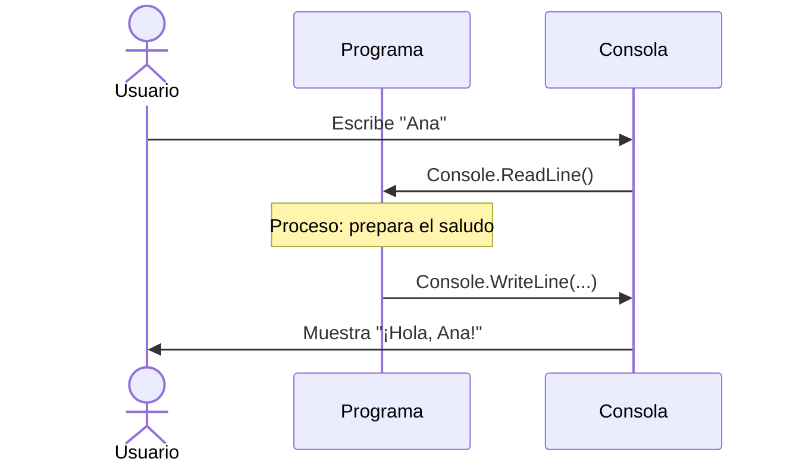
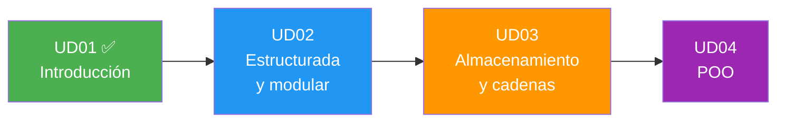

::top::

<div class="flex items-center gap-4 w-full">
  
  <span class="ud-pill">Programación · 1DAW · Curso 2026-2027</span>
</div>

::default::

# Introducción a la Programación Software

### Del algoritmo en papel a tu primer programa en C#

::bottom::

<div class="ud-author">
  
  <div>
    <b class="ud-author-name">José Luis González Sánchez</b>
    <span class="ud-author-meta">IES Luis Vives · Leganés · <a href="https://joseluisgs.dev">joseluisgs.dev</a></span>
  </div>
</div>

<PacMan :size="54" label="Cargando ideas..." />

---

## 📦 Materiales de la unidad

Todo el material de la UD01 está publicado en el repositorio de GitHub, organizado por carpetas:

<div class="grid grid-cols-2 gap-6 items-start">
<div>

- 📚 **11 puntos** — teoría, ejemplos reales y resúmenes
- 📝 **Prácticas** — ejercicios graduados en `practicas/`
- 💻 **Soluciones** — proyectos C# con `.slnx` en `Soluciones/`
- 🖼️ **Imágenes y recursos** — diagramas y esquemas en `images/`
- 🎬 **Vídeos** — lista de reproducción en YouTube

</div>
<div class="flex flex-col items-center justify-center gap-4 pt-4">

<RepoBadge caption="Repositorio con materiales de la unidad" />

<div class="text-sm opacity-75 text-center max-w-55">

Clónalo, forquéalo o descárgalo en zip: el material siempre está a un clic.

</div>

</div>
</div>

---

## 🎯 Resultados de aprendizaje y criterios

<RaaCcee
  code="RA1"
  title="Reconoce la estructura de un programa informático, identificando y relacionando los elementos propios del lenguaje de programación utilizado."
  :ccee="[
    'Se han identificado los bloques que componen la estructura de un programa informático.',
    'Se han creado proyectos de desarrollo de aplicaciones.',
    'Se han utilizado entornos integrados de desarrollo.',
    'Se han identificado los distintos tipos de variables y la utilidad específica de cada uno.',
    'Se ha modificado el código de un programa para crear y utilizar variables.',
    'Se han creado y utilizado constantes y literales.',
    'Se han clasificado, reconocido y utilizado en expresiones los operadores del lenguaje.',
    'Se ha comprobado el funcionamiento de las conversiones de tipo explícitas e implícitas.',
    'Se han introducido comentarios en el código.',
  ]"
/>

---

## 📚 Índice: los 11 puntos del tema

<div class="grid grid-cols-3 gap-3 text-sm">

<TopicCard :num="1" title="Qué es la programación" desc="Algoritmos, paradigmas y lenguajes" />
<TopicCard :num="2" title="El entorno .NET" desc="SDK, CLI, NuGet e IDE" />
<TopicCard :num="3" title="Soluciones y proyectos" desc=".slnx, .csproj y compilación" />
<TopicCard :num="4" title="Estructura de un programa" desc="Bloques, sentencias y TLP" />
<TopicCard :num="5" title="Tipos de datos" desc="Enteros, texto, lógicos y más" />
<TopicCard :num="6" title="Variables, constantes y literales" desc="Declaración y buenas prácticas" />
<TopicCard :num="7" title="Operadores y expresiones" desc="Aritméticos, lógicos y precedencia" />
<TopicCard :num="8" title="Conversiones de tipo" desc="Implícitas y explícitas" />
<TopicCard :num="9" title="Entrada y salida de datos" desc="Console.ReadLine y WriteLine" />
<TopicCard :num="10" title="Comentarios y documentación" desc="Buenas prácticas de código" />
<TopicCard :num="11" title="Resumen y conclusiones" desc="Cierre de la unidad" />

</div>

<div class="ud-card mt-4 flex items-center justify-between gap-4 px-4 py-2">

<span class="text-sm">📦 <b>Materiales:</b> los 11 puntos, prácticas, soluciones y vídeos de la unidad</span>

<RepoBadge />

</div>

---
layout: section
---

<div class="ud-section-number">01</div>

# Qué es la programación

<div class="opacity-70">Algoritmos, paradigmas y lenguajes</div>

---

## 1 · Punto de partida

<div class="grid grid-cols-2 gap-6 items-start">
<div>

<TipBox type="consejo" title="Punto de partida">

¿Alguna vez has pensado **cómo funciona Netflix** cuando te recomienda una serie, o **cómo Instagram** decide qué posts ves primero? Todo eso es programación. Pero, ¿qué es exactamente programar?

</TipBox>

<TipBox type="analogia">

**Programar es como montar un restaurante:** necesitas ingredientes (datos), una receta (algoritmo), utensilios (operadores) y saber qué pide el cliente (entrada). Si falta alguno, el plato no sale bien.

</TipBox>

</div>
<div>

<Objetivos
  :items="[
    'Definir qué es la programación y por qué es importante',
    'Comprender qué es un algoritmo, sus características y cómo se representa',
    'Conocer los principales paradigmas de programación',
    'Entender por qué C# es el lenguaje que usaremos',
  ]"
/>

</div>
</div>

---

## ✏️ Variables y constantes

<div class="grid grid-cols-2 gap-4 items-start">
<div>

```csharp
// Declaración + asignación
int edad = 25;
string nombre = "Ana";

// La variable puede cambiar...
edad = 26;

// ...la constante, no
const double Iva = 21.0;
Iva = 22.0;   // ❌ error de compilación
```

</div>
<div>

<TipBox type="truco" title="Truco de nombres">

**camelCase** para variables (`nombreCliente`, `precioTotal`) y **PascalCase** para constantes (`Iva`, `MaximoUsuarios`). Que el nombre se lea solo: ❌ `int d = 30;` → ✅ `int diasDelMes = 30;`

</TipBox>

<RealExample app="Tiendas online">

El **IVA** (21%) y la **moneda** ("EUR") son `const`: no cambian nunca. Pero el **precio** de un carrito es `readonly`: se asigna al crear el pedido y después no se toca.

</RealExample>

</div>
</div>

---

## 🔄 Entrada → proceso → salida

<div class="grid grid-cols-2 gap-5 items-start">
<div>



</div>
<div>

<TipBox type="nota">

**E → P → S** es el patrón universal: todo programa, desde una calculadora hasta Netflix, hace exactamente estas tres cosas.

</TipBox>

<TipBox type="truco" title="Truco">

`Console.ReadLine()` devuelve **siempre `string`**: si necesitas un número, conviértelo con `int.TryParse`.

</TipBox>

</div>
</div>

---

## Resumen del punto 6

<div class="grid grid-cols-2 gap-5 items-start">
<div>

| Concepto | Descripción | Ejemplo |
|----------|-------------|---------|
| **Variable** | Contenedor que puede cambiar | `int edad = 25;` |
| **Constante** | Contenedor que NO puede cambiar | `const double Iva = 21.0;` |
| **Literal** | Valor fijo en el código | `25`, `"Hola"`, `true` |
| **Identificador** | Nombre de variable o constante | `edad`, `Iva` |

</div>
<div>

<ConceptCard icon="✅" title="Buenas prácticas" accent="green">

- **camelCase** en variables, **PascalCase** en constantes
- Nombres que se entienden solos: `diasDelMes`, no `d`
- Constantes para lo que **nunca** cambia (IVA, moneda)
- Inicializa al declarar: evita valores "basura"

</ConceptCard>

<div class="mt-3">

**⏭️ ¿Qué viene después?** En el **punto 7**: **operadores y expresiones** — aritméticos, lógicos y precedencia.

</div>

</div>
</div>

---

## ¿Qué viene después?

<div class="grid grid-cols-2 gap-5 items-start">
<div>



</div>
<div>

<ConceptCard icon="🚀" title="UD02: Programación estructurada y modular" accent="green">

Aprendremos a **organizar** el código con estructuras de control (`if`, `for`, `while`) y a dividirlo en **funciones reutilizables**.

</ConceptCard>

<TipBox type="nota">

Todo lo visto aquí es la **base**: sin tipos de datos y variables, no hay estructuras de control.

</TipBox>

</div>
</div>

---
layout: center
---

<div class="flex flex-col items-center gap-3 w-full text-center">

<PacMan :size="64" />

# ¡Hasta el próximo deploy! <span class="ud-emoji">👋</span>

<b class="text-lg">Tema 01: Introducción a la Programación Software</b>

<span class="ud-pill">Programación · 1DAW · Curso 2026-2027</span>

<RepoBadge caption="📦 Materiales, prácticas y soluciones" size="lg" />

<div class="ud-social">

<a class="ud-social-pill" href="https://joseluisgs.dev" target="_blank">🌐 joseluisgs.dev</a>
<a class="ud-social-pill" href="https://github.com/joseluisgs" target="_blank">🐙 GitHub</a>
<a class="ud-social-pill" href="https://www.linkedin.com/in/JoseLuisGSDev" target="_blank">💼 LinkedIn</a>
<a class="ud-social-pill" href="https://www.youtube.com/@joseluisgs" target="_blank">🎬 YouTube</a>
<a class="ud-social-pill" href="https://x.com/JoseLuisGSDev" target="_blank">🐦 X</a>
<a class="ud-social-pill" href="https://www.instagram.com/joseluisgs.dev/" target="_blank">📸 Instagram</a>

</div>

</div>
